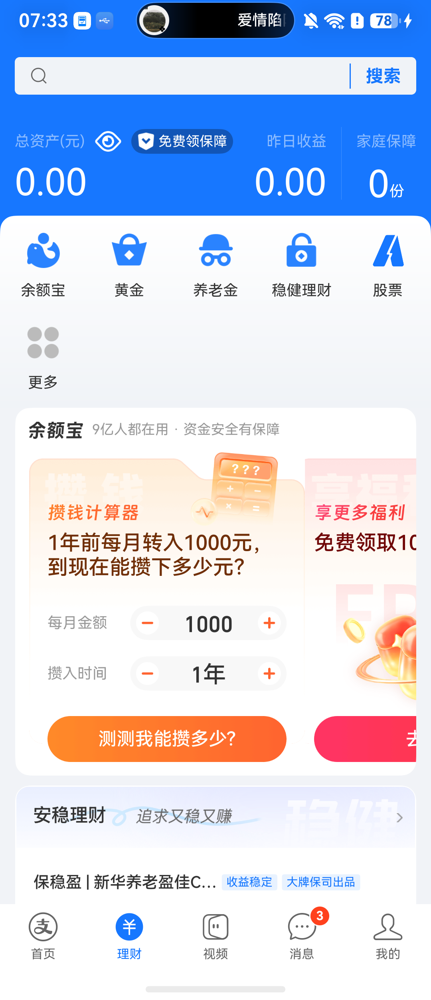
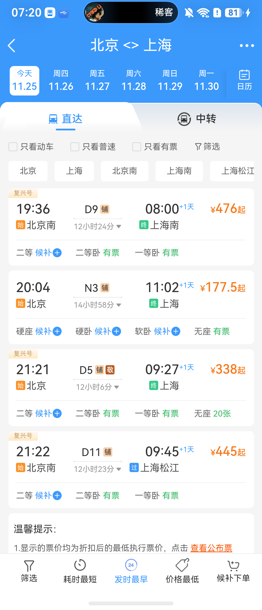
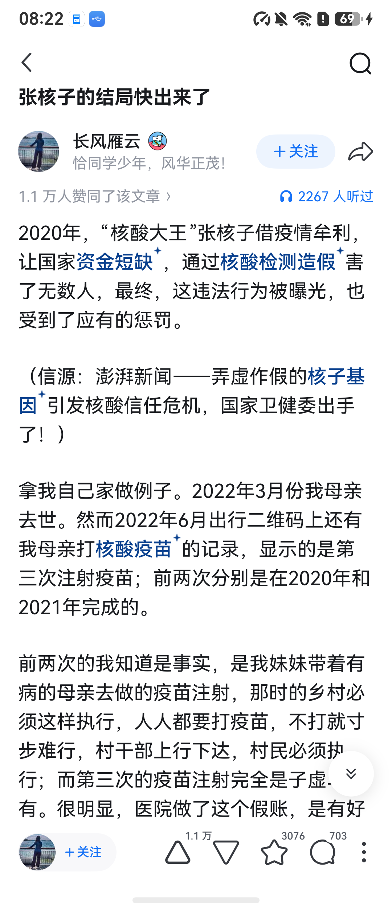
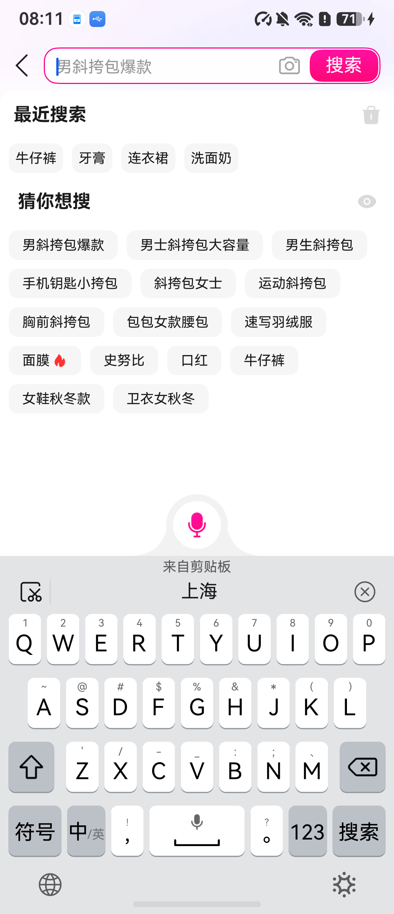
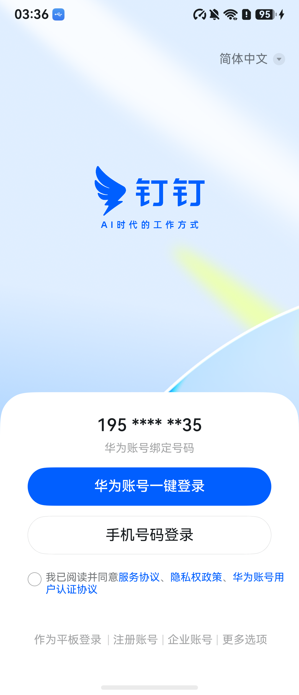

类型：材料 ｜ 归属：2026-11-24_1215高低级指令导航交付 / 汇报_1126 ｜ 状态：维护中（明天会上用）

# T+6（12-15）验收进度与对齐说明

> **主题边界**：本文讲的是 **GUI Agent「到指定页面」+ 到达后 UX 检测** 的交付进度。  
> **不是**截断主线 / 开合数据集那条线。  
> 数据截至 2026-11-25 夜；开源样例（CoolMall / 葡萄广场）按用户要求 **不进验收分母**。

---

## 1. 一句话：现在验收到哪了

| 模块 | 状态 | 相对 12-15 V1 |
|---|---|---|
| **高级指令 → 到页** | 商业 App、免登录短路径已可稳定跑；扩测商业段约 **35/38（~92%）**，高于任务书 ≥80% | **基本够展**；要书面确认「到达」怎么判 |
| **低级指令 → 到页** | 同批有成对低级，商业段多数能过；**尚未单独按 ≥95% 出验收表** | **差一张干净对照表** |
| **到页后 7 类检测** | demo5 已通「到页 → final_ux_detect（single+dual）」；多数类型仍是 **prompt 顶**，未对 TOP7 真值 | **能演示链路**；准确率数字 **还不能报** |
| **不崩 / 可复现跑法** | 生产机百炼旁路脚本已固化；设备掉线、未装 App、任务卡自相矛盾会拖垮批次 | **可演示**；缺环境熔断与开跑前校验 |
| **接口形态 / 交付物** | 目前是仓内 benchmark CLI + 结果目录；HTTP/库函数形态 **未冻结** | **必须会上对齐**（见 §5） |

**对外可说的程度**：  
「真机上，高级/低级指令驱动 agent **能点到一批商业 App 目标页**；到页后再调检测已打通。V1 建议先按 **约 10 个可演示 case + 不崩** 验收，数字指标与接口形态请对方书面确认。」

---

## 2. 验收口径对照（任务书 vs 会上 vs 现状）

| 条目 | 任务书 / 说明书 | 11-23 会补充 | **我们现在** |
|---|---|---|---|
| 高级到页 | ≥80% | 当面更在乎不崩；可先交 ~10 case | 免登录商业扩测约 **92%**（35/38）；含「已到未 report」假失败 |
| 低级到页 | ≥95% | 同上 | 成对低级已跑，**未出独立验收表** |
| 发现问题准确率 | ≥95% | 七种里截断可接真模型，其余可先 prompt | **只证明调通**，未评准确率 |
| 速度 | 步均 ≤3s 等 | **V1 可不卡**；速度放到 7+12 | 单条墙钟常 **1–3 分钟**（含模型） |
| 架构 | 到页 ≠ 检测同一模型 | 到页后接口并发子检测 | runtime 已拆开；对外接口未定 |
| 范围 | — | — | **商业 App**；登录墙任务剔除；开源样例不测 |

---

## 3. 怎么运行（演示级）

### 3.1 环境

- 设备：Mate X5，`hdc list targets` 能看到 id（例：`22M0223928009654`）
- 生产机：`user@10.202.6.167`（飞连；封装 `~/.config/prod-mac/prod.sh`）
- 模型：TokenHub 百炼渠道 `qwen3.8-max-…/bailian`（不是官方 DashScope key）
- 脚本：`~/uxagent/run_nav_bailian.sh <tasks.json> <run-name>`  
  - 到页专项：`HARMONY_FINAL_UX_DETECT=0`  
  - 带检测演示：`=1`（demo5 用过）

### 3.2 一条任务在干什么

```
高级/低级自然语言指令
        ↓
  harmony_open_app / tap / swipe / type …
        ↓
  每步截图 + UI 树（artifacts/step_*.png）
        ↓
  模型自报到达 →（可选）final_ux_detect
        ↓
  results/<run-name>-<时间戳>/<task-id>-*/ 
```

开跑前建议三件事（否则会像 11-25 夜那样空烧）：

1. `hdc list targets` 非空，并能 `snapshot_display`  
2. 任务涉及的包都已安装（`bm dump`）  
3. 任务卡不要「禁止返回键」又写「按返回收键盘」

---

## 4. 产物长什么样（图文）

每条任务一个目录，典型文件：

| 文件 | 含义 |
|---|---|
| `<task>.json` | 逐步 tool 调用（open / tap / …） |
| `artifacts/step_N.png` | 第 N 步后屏幕 |
| `artifacts/step_N_ui-tree.txt` | 布局树摘录 |
| `runner.log` | 完整对话与工具输出 |
| （可选）`artifacts/final_ux_detect.json` | 到页后检测结果（single+dual） |

### 4.1 成功例：高级指令到 B 站播放页

指令大意：打开哔哩哔哩 → 进推荐第一条 → 展开简介相关区域（免登录）。


### 4.2 成功例：低级指令到支付宝理财 Tab



### 4.3 成功例：低级指令到酷狗「粤语」频道


### 4.4 成功例：高级指令到 12306 直达车票列表



### 4.5 成功例：低级指令到知乎详情



### 4.6 失败长什么样（对齐时有用）

**假失败 / 任务卡问题**：唯品会已到搜索建议页，但卡面要求「按返回收键盘」，同时又写「禁止返回键」→ runtime 直接判失败。



**真未到页**：微博停在推荐流，未进正文详情。


**范围外（登录墙）**：钉钉只能停在登录门——按约定不进分母。



更完整的失败词表与整改：  
`/Users/zhangyingying/UX-Agent/docs/材料/2026-11-24_1215高低级指令导航交付/失败归因_1125/1125f/api归因_1125f.md`

---

## 5. 明天必须对齐 / 确认的事项

原则：**不清楚的全部出 demo；确认完再批量做。**（见同目录 `待确认_需出demo.md`）

### 5.1 验收怎么算「过」（优先问清）

| # | 问题 | 我们倾向 | 需要对方拍板 |
|---|---|---|---|
| E1 | V1 是「~10 case 不崩可演示」还是仍卡 80%/95%/95%？ | 先 10 case 不崩 + 附到达率抽样 | 书面一句 |
| E2 | 「到达」以谁为准：模型 report / 终态截图人工 / page_check_texts？ | 终态图 + 抽检；`no_report` 已到页算假失败 | 判定协议 |
| E3 | 登录墙、开源样例进不进分母？ | **不进**（已按此跑） | 确认 |
| E4 | 低级指令是否允许「有广告就跳过」条件句？ | 商业 App 现实需要 | 确认写法 |

### 5.2 接口与交付物

| # | 问题 | 建议 demo |
|---|---|---|
| A1 | 对外是 CLI / HTTP / 库函数？ | 同任务三种形态各 1 条（若本周定一种可只 demo 一种） |
| A2 | 一次调用「只导航」还是「导航+检测」？同步还是回调？ | 两种模式各 1 |
| A3 | 设计文档以哪版为准、缺哪节？ | 带现行说明书目录对照 |

### 5.3 检测侧

| # | 问题 | 建议 demo |
|---|---|---|
| C1 | 七种里哪些接真工具、哪些 prompt？ | 同一页截断真模型 vs prompt 对照 |
| C2 | 10 个 case 要不要带 TOP7 真值、要不要报准确率？ | 两种结果页格式各一页 |
| C3 | 是否必须内外屏都检？（历史交付要切屏） | demo5 已有 single+dual 产物可直接亮 |

### 5.4 明天会上建议带的最小演示包

1. **成功 3 条**：B 站-H、支付宝-L、12306-H（终态图 + 目录结构）  
2. **失败 1 条**：唯品会返回键冲突（说明任务卡要对齐）  
3. **检测 1 条**：demo5 里带 `final_ux_detect.json` 的任意一条  
4. **确认清单打印件**：本节表格，请对方在纪要里勾选

---

## 6. 当前效果（数字速览）

| 批次 | 口径 | 结果 | 备注 |
|---|---|---|---|
| demo5 百炼 | 5 App × H/L，含检测 | 实质 **10/10** | 小红书-H 曾超时，重跑过 |
| 1125b | 高级混合 | 13/18；短路径商业 13/15 | deep 0/3；钉钉登录墙 |
| 1125d / e | 免登录高级 | **11/12**、**11/11** | 酷狗粤语曾超时，后低级同目标已过 |
| 1125f 商业段 | 免登录 H+L 扩包 | **35/38** | 3 挂：假失败×2倾向 + 微博真未到；CM/GRAPE 剔除 |

**解读**：短路径商业到页，已经可以支撑「V1 演示 + 高级线抽样达标」的叙事；  
**还不能**宣称低级 ≥95%、检测 ≥95%、速度达标。

---

## 7. 总体优化思路（按优先级）

### P0 — 验收演示周就要碰

1. **冻一批「可演示 10 case」**：全商业、免登录、短路径、H/L 成对；任务卡扫一遍去掉返回键自相矛盾。  
2. **到达判定协议**：无 `report` 但终态已到 → 记 `reached_no_report`，不直接当能力失败。  
3. **环境熔断**：设备掉线 / 截图 ENOENT / 包未安装 → 立刻停条并告警，禁止空烧。  
4. **把对外接口定一种**（哪怕先 CLI），写进说明书一页。

### P1 — 抬到达率与可维护性

5. Runtime：BACK 拦截改为非致命；`open_app` 找不到包装明确错误。  
6. 任务卡：每条写清「到达判据」一句；模糊目标（如「普通微博」）给备选。  
7. 低级指令单独出对照表，对准 ≥95% 叙事（或请对方 V1 豁免）。

### P2 — 检测与速度（可放到 7+12 叙事）

8. 截断接现有真工具；其余五种继续 prompt，但统一 JSON schema。  
9. 速度：settle / 观测降频；V1 继续用好模型顶着。  
10. deep 长链、登录态任务：另册，不进 V1 分母。

---

## 8. 材料索引（点开即用）

| 说明 | 路径 |
|---|---|
| 本文图目录 | `/Users/zhangyingying/UX-Agent/docs/材料/2026-11-24_1215高低级指令导航交付/汇报_1126/图/` |
| 11-23 会议要点 | `/Users/zhangyingying/UX-Agent/docs/材料/2026-11-24_1215高低级指令导航交付/会议要点_1123_1215交付.md` |
| 待确认清单 | `/Users/zhangyingying/UX-Agent/docs/材料/2026-11-24_1215高低级指令导航交付/待确认_需出demo.md` |
| demo5 基线 | `/Users/zhangyingying/UX-Agent/docs/材料/2026-11-24_1215高低级指令导航交付/基线试跑报告_demo5_bailian_1124.md` |
| 1125f API 归因 | `/Users/zhangyingying/UX-Agent/docs/材料/2026-11-24_1215高低级指令导航交付/失败归因_1125/1125f/api归因_1125f.md` |
| 研究仓归档 | `https://github.com/ZYY0321/Research-Notes` → `archive-docs/01-ux-agent/2026-11-25_到指定页面研究/` |

---

**挂回**：横向 T+6 / 12-15 Agent V1 验收对齐（工程交付）。到页数字可回写任务书指标；不等于截断论文 RQ。
