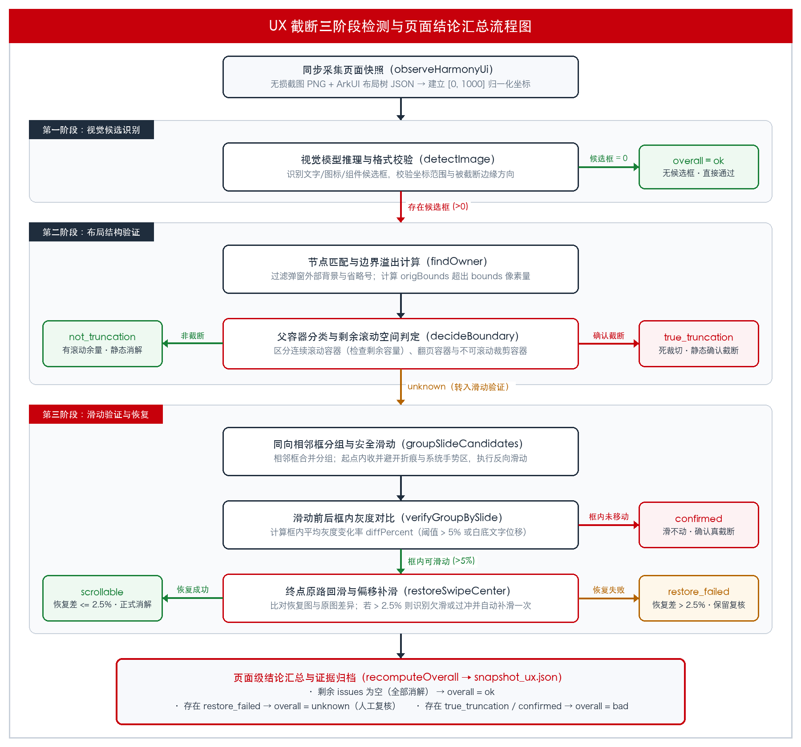
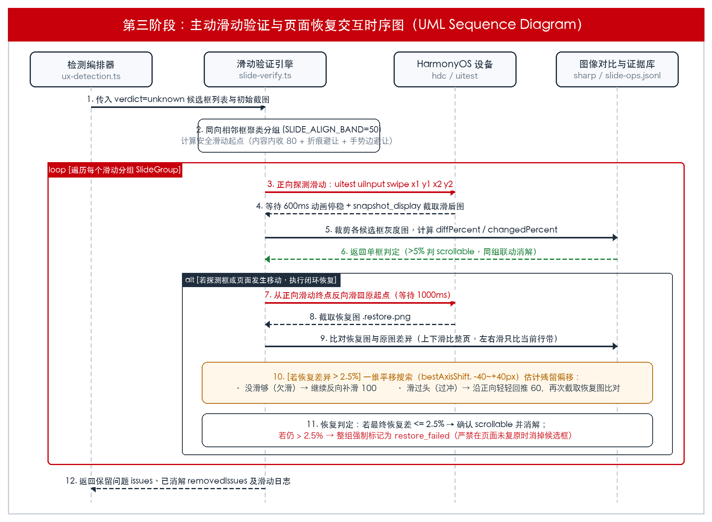
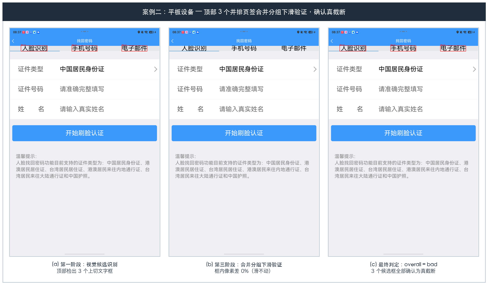
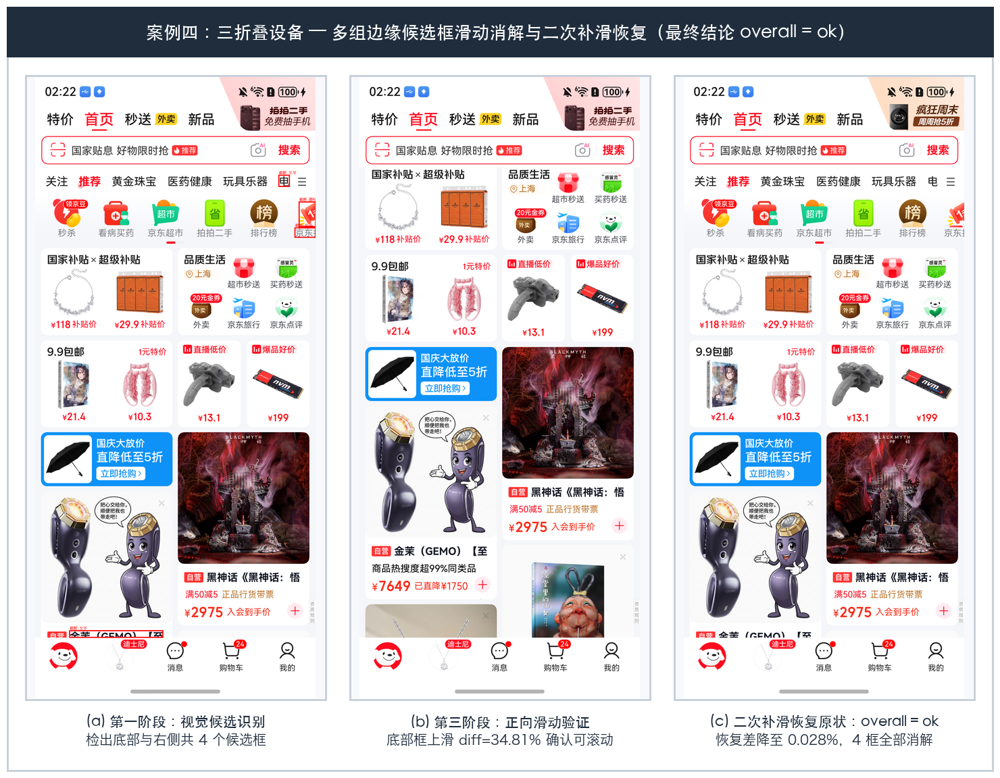

# GUIAgent 多设备 UX 检测系统 — 核心算法详细设计说明

| 文档属性 | 内容 |
|---|---|
| 文档名称 | GUIAgent 多设备 UX 检测系统 — 核心算法详细设计说明 |
| 文档版本 | V2.0 |
| 适用平台 | HarmonyOS |
| 适用设备 | 直板手机、平板、双折叠屏、阔折叠屏、三折叠屏 |
| 编制日期 | 2026-10-14 |

## 1 文档说明

### 1.1 编制目的

本文档作为《GUIAgent 多设备 UX 检测系统软件设计说明书》的算法详细设计补充，对照系统实际工程代码，详细说明页面观察与目标页面确认、多设备屏态适配、以及 UX 截断三阶段检测（视觉候选识别、布局结构验证、滑动验证与页面恢复）的算法流程、计算方法、判定规则、参数配置和典型案例。

### 1.2 核心问题与设计思路

在平板、双折叠、阔折叠和三折叠等多形态设备上，应用界面由于窗口宽高比变化，容易出现文字、图标或交互组件被容器边界裁切的问题。

如果仅依靠视觉语言模型对单张静态截图进行检测，模型很难区分以下两种情况：

1. **真实截断缺陷**：容器尺寸固定且不可滚动，或者列表已经滑到尽头，文字或组件依然被边界切掉一部分；
2. **正常可滚动展示**：横向分类栏、轮播卡片或纵向列表在视口边缘自然露出一部分内容，用户只需滑动即可完整查看。

为了解决这一问题，系统将截断检测设计为依次递进的三个阶段：

1. **第一阶段（视觉候选识别）**：调用视觉检测模型扫描目标页面截图，找出所有疑似截断区域（候选框），保证问题召回率；
2. **第二阶段（布局结构验证）**：结合 HarmonyOS ArkUI 页面布局树（Layout Dump），对比控件的可见边界与原始排版边界，分析父容器的裁剪属性与剩余可滚动空间，直接确认有明确结构证据的真截断，并过滤弹窗背景遮挡、正常省略号和有滚动余量的误报框；
3. **第三阶段（滑动验证与页面恢复）**：对静态布局结构无法直接确认的候选框，在设备上执行反向滑动操作，通过对比滑动前后的像素变化判断内容能否滑出，并在验证后将页面反向滑回初始位置。

## 2 算法模块与代码结构对应关系

系统核心算法由页面观察、页面确认、多设备适配以及三阶段 UX 截断检测组成。各算法模块与核心源码文件、入口函数的对应关系如下表所示。

| 算法模块 | 源码文件 | 核心入口函数 | 功能职责与输入输出说明 |
|---|---|---|---|
| 页面观察与 UI 树化简 | `observe.ts`、`ui-dump.ts` | `observeHarmonyUi`、`simplifyUiDumpTree` | 同步采集无损屏幕截图与 ArkUI 布局树，输出归一化组件树文本与页面摘要 `uiHash` |
| 页面确认与异常恢复 | `page-oracle.ts`、`recovery.ts` | `evaluatePageOracle`、`decideRecovery` | 校验当前页面是否满足目标页面规则，识别偏航或无响应并生成恢复动作 |
| 多设备形态与屏态控制 | `device-profile.ts`、`emulator-fold.ts` | `detectDeviceFormFactor`、`getFoldStateConfigs` | 识别直板机、平板及折叠屏型号，控制单屏、双屏、三屏展开态切换与重排等待 |
| 第一阶段：视觉候选识别 | `ux-detection.ts`、`image-utils.ts` | `detectImage`、`parseDetectResult` | 对齐图像尺寸并调用视觉检测模型，校验输出格式，生成初始疑似截断候选框 |
| 第二阶段：布局结构验证 | `layout.ts`、`verifier.ts`、`id-binder.ts` | `parseLayout`、`verifyTextTruncations` | 对比控件可见边界与原始排版边界，分析父容器裁剪属性与剩余滚动空间，确认或过滤候选框 |
| 第三阶段：滑动验证与恢复 | `slide-verify.ts` | `runActiveSlideVerification`、`verifyGroupBySlide` | 对待确认候选框分组执行反向滑动，对比像素变化判断能否滑出，并反向回滑恢复页面 |
| 结论汇总与报告生成 | `ux-detection.ts`、`ux-detect-runner.ts` | `runObserveUxDetection`、`recomputeOverall` | 汇总三阶段验证结论，输出最终检测报告 JSON 与问题标注截图 |

## 3 总体检测流程与状态判定规则

### 3.1 三阶段检测主流程

系统在确认进入目标页面后，按图 1 所示的三阶段活动流程执行检测与结果汇总：



各阶段的执行步骤对应如下：

```text
[同步采集] 截取无损 PNG 屏幕截图 + 导出 ArkUI 布局树 JSON
      ↓
[坐标对齐] 读取截图实际像素宽高 (W, H)，建立 0~1000 归一化坐标空间
      ↓
========================================================================
第一阶段：视觉候选识别 (detectImage -> parseDetectResult)
========================================================================
  1. 输入目标页面截图，识别疑似截断区域（截断-文字 / 截断-图标 / 截断-组件）
  2. 校验输出 JSON 结构、坐标范围 [0, 1000] 及被截断边缘方向 (top/bottom/left/right)
  3. 若候选框数量为 0  --->  直接输出页面结论 overall = "ok"
      ↓ (存在候选框)
========================================================================
第二阶段：布局结构验证 (verifyTextTruncations)
========================================================================
  1. 将候选框归一化坐标换算为布局树像素坐标
  2. 弹窗/浮层背景过滤：若候选框落在前景弹窗外部的背景遮挡区 ---> 判为 not_truncation（消解）
  3. 文本节点匹配：查找与候选框重叠的文本节点，排除含省略号 (...) 或完整单字的误报
  4. 边界与容器分析：对比节点可见边界 bounds 与原始边界 origBounds，向上查找裁剪容器：
     - 连续滚动容器且仍有剩余滚动空间 ---> 判为 not_truncation（消解）
     - 不可滚动裁剪容器 / 翻页容器 / 滚动已到底 ---> 判为 true_truncation（确认截断）
     - 未能匹配节点或静态布局无法确定滚动空间 ---> 判为 unknown（转入第三阶段）
      ↓ (对 verdict == "unknown" 的候选框)
========================================================================
第三阶段：滑动验证与页面恢复 (runActiveSlideVerification)
========================================================================
  1. 解析滑动方向：取被截断边缘的反方向（右切向左滑、左切向右滑、下切向上滑、上切向下滑）
  2. 相邻候选框分组：将同一方向、同一行或同一边缘带的候选框合并为一组，共用一次滑动
  3. 规划滑动起止点：向内容区内收，避开系统手势边缘区、顶部页签栏及折叠屏中轴线
  4. 执行滑动并对比像素：
     - 框内像素平均变化率 > 5%（或页面移动且局部文字明显位移） ---> 暂判为 scrollable（可滑动）
     - 框内像素无明显变化 ---> 判为 confirmed（确认截断）
  5. 页面反向恢复与校验：
     - 若正向滑动未引起页面移动，直接跳过回滑
     - 若页面已移动，从滑动终点反向滑回起点，计算恢复后与原图的像素差异
     - 若差异 > 2.5%，通过一维平移匹配判断“滑少了”还是“滑过了”，自动补滑一次
     - 恢复成功（差异 <= 2.5%）：将 scrollable 候选框正式消解移除
     - 恢复失败（差异仍 > 2.5%）：将该组候选框标记为 restore_failed，保留待人工复核
      ↓
========================================================================
[结果汇总] 根据剩余有效问题重新计算页面级结论 (recomputeOverall)
========================================================================
```

### 3.2 候选框与页面级结论汇总规则

系统在 `recomputeOverall` 中根据三个阶段的执行状态和每个候选框的验证结果，按以下优先级确定页面最终结论 `overall`：

| 优先级 | 条件说明 | 候选框处理方式 | 页面级结论 (`overall`) |
|---|---|---|---|
| 1 | 任一阶段发生运行错误（`status == "error"`）或截图采集失败 | 保留当前已得信息 | `unknown` |
| 2 | 模型未检出候选框，或所有候选框均被第二阶段（`not_truncation`）和第三阶段（`scrollable`）消解 | 移入 `removedIssues`，`issues` 为空 | `ok` |
| 3 | 剩余候选框中存在滑动后截图失败（`capture_failed`）或页面恢复失败（`restore_failed`） | 保留在 `issues` 中，不予消解 | `unknown` |
| 4 | 剩余候选框中存在第二阶段确认截断（`true_truncation`）或第三阶段滑动确认截断（`confirmed`） | 保留在 `issues` 中作为最终问题输出 | `bad` |
| 5 | 仅执行到第二阶段且剩余候选框全部为 `unknown` | 保留在 `issues` 中 | `unknown` |

该规则保证了两个关键底线：
一是**只有拿到明确的可滚动或非截断证据时才消掉候选框**；
二是**一旦滑动验证后页面没能恢复原状，绝不把候选框当成正常情况静默消掉**，而是标为 `unknown` 交由人工复核，防止漏报。

## 4 页面观察、导航确认与多设备适配算法

### 4.1 页面同步观察与归一化坐标空间

1. **无损屏幕截图采集**：
   系统通过 `snapshot_display` 直接从显示合成器获取无损 PNG 截图，避免使用系统截屏快捷键触发分享浮窗或产生 JPEG 压缩伪影。随后读取 PNG 图像的真实像素宽高 `(W, H)`，作为当前快照的基准坐标空间。
2. **归一化坐标转换**：
   为屏蔽直板机、折叠屏和平板之间的分辨率差异，动作指令与模型检测框统一使用 `[0, 1000] × [0, 1000]` 的整数归一化坐标。像素坐标 `(x_px, y_px)` 与归一化坐标 `(x_norm, y_norm)` 的换算关系为：

```text
x_norm = clamp(0, 1000, round((x_px / W) * 1000))
y_norm = clamp(0, 1000, round((y_px / H) * 1000))

x_px   = clamp(0, W, round((x_norm / 1000) * W))
y_px   = clamp(0, H, round((y_norm / 1000) * H))
```

3. **UI 布局树化简与页面哈希（`simplifyUiDumpTree`）**：
   原始 ArkUI 布局树层级较深且包含大量无语义容器。算法对其进行三步化简：
   - 折叠仅包含单个子节点的纯布局容器（如 `Column`、`Row`、`Stack`、`RelativeContainer` 等）；
   - 将可点击控件旁边的兄弟文本节点自动合并为该控件的标签说明（最多合并 5 段文本、140 个字符）；
   - 将当前前台应用包名、窗口名与化简后的树结构拼接计算 SHA-256 摘要（取前 16 位作为 `uiHash`），用于快速判断动作执行后页面是否发生变化。

### 4.2 目标页面确认与异常恢复算法

1. **目标页面匹配（`evaluatePageOracle`）**：
   每个任务可配置目标页面的路径 `pagePath`、必需控件 ID 列表 `requiredIds`、必需 Key 列表 `requiredKeys`、必需文本列表 `requiredTexts` 以及禁止出现的文本列表 `forbiddenTexts`。
   每次观察后，算法逐项检查上述条件，统计满足的条件数 `M` 和未满足的条件数 `E`，计算匹配度：

```text
confidence = M / (M + E)
reached    = (E == 0) 且 (M + E > 0)
```

   只有当所有必需条件全部满足且没有任何禁止文本出现（即 `reached == true`）时，系统才确认到达目标页面并启动 UX 检测。
2. **导航异常分类与恢复（`decideRecovery`）**：
   若动作执行后未到达目标页面，系统根据前后两次观察结果将异常分为三类：
   - 无响应（`no_change`）：动作前后页面内容无变化（例如点击了不可交互区域）；
   - 页面偏航（`wrong_page`）：当前页面路径与目标路径不一致（误入其他页面）；
   - 目标未露出（`wrong_target`）：页面路径未偏离，但尚未露出目标元素。
   在剩余重试次数允许范围内，对无响应和目标未露出重新采集观察并调整动作，对页面偏航执行返回或回到初始入口重新导航。

### 4.3 多设备识别与屏态适配

系统通过读取设备型号属性自动识别设备形态：
- 直板手机与平板：在当前屏幕状态下直接采集快照；
- 双折叠、阔折叠与三折叠：支持单屏态（`single`）、双屏展开态（`dual`）和三屏完全展开态（`triple`）。每个屏态切换后等待 `2000ms` 使窗口重排稳定，再独立采集截图和布局树并分别执行三阶段检测。

## 5 UX 截断三阶段检测算法详细设计

### 5.1 第一阶段：视觉候选识别与格式校验

#### 5.1.1 图像尺寸对齐与模型推理
系统支持调用专用截断检测服务接口或通用视觉大模型接口。当需要将图像编码发送给视觉大模型时，算法会先将图像宽高对齐到模型视觉块大小（`PATCH_SIZE = 28`）的整数倍，并将最大边长控制在 `MAX_DIMENSION = 1008` 以内：

```text
aligned_w = round(orig_w / 28) * 28
aligned_h = round(orig_h / 28) * 28
```

这样可以避免模型内部二次缩放造成边界框坐标偏移。

#### 5.1.2 审查范围与三类截断定义
模型按照统一规则扫描截图：
1. **审查范围排除**：若页面上存在居中弹窗、底部弹窗、操作菜单或侧滑菜单，只检查弹窗或侧边栏内部区域，弹窗外的背景页面全部排除；
2. **问题分类标准**：
   - `截断-文字`：具体字符的字形主体被容器或屏幕边界切掉一部分（正常换行、省略号 `...`、图片内嵌艺术字、底部系统导航条遮挡背景字均不算截断）；
   - `截断-图标`：功能性小图标或头像主体被边界裁切；
   - `截断-组件`：具有独立点击或交互语义的完整控件被边界裁切。

#### 5.1.3 响应解析与数据校验（`parseDetectResult`）
模型返回文本后，`extractJsonFromText` 先提取 JSON 内容，再由 `parseDetectResult` 执行严格校验：
- `overall` 必须为 `"ok"` 或 `"bad"`；且 `overall == "ok"` 时 `issues` 必须为空数组，`overall == "bad"` 时 `issues` 至少包含一项；
- 每个问题的 `bbox` 必须是长度为 4 的数值数组 `[x1, y1, x2, y2]`，四个值均在 `[0, 1000]` 范围内，且严格满足 `x1 < x2` 且 `y1 < y2`（若坐标反向或越界则直接报错，不自动截断修正，避免框到错误区域）；
- 每个问题必须指明被截断的边缘方向 `truncated_edges`（取值为 `top`、`bottom`、`left`、`right`）。

### 5.2 第二阶段：布局结构验证算法

第二阶段利用 ArkUI 布局树（`dumpLayout`）中的精确几何信息，对候选框进行静态结构验证。

#### 5.2.1 布局树解析与坐标映射（`parseLayout`）
系统采用非递归前序遍历解析 ArkUI 布局树 JSON，生成扁平节点数组 `LayoutNode[]`。每个节点提取以下核心属性：
- `bounds`：节点在屏幕上的**实际可见矩形** `[left, top, right, bottom]`（像素坐标）；
- `orig_bounds`：节点被父容器裁剪前的**原始排版矩形**（若节点未被裁剪，则与 `bounds` 相同）；
- `clip`（是否开启边界裁剪）、`scrollable`（是否可滚动）、`type`（组件类型，如 `Text`、`Scroll`、`List`、`Swiper` 等）、`text`（文本内容）、`id` / `key`。

随后，`norm1000ToLayout` 将第一阶段候选框从 `0~1000` 归一化坐标转换为当前屏幕的像素矩形 `query`。

#### 5.2.2 步骤一：前景弹窗/浮层背景遮挡过滤（`evaluateForegroundOverlayBackground`）
当页面弹出半透明遮罩或底部面板时，面板边缘可能会遮住下方背景页面的文字，视觉模型有时会将其误报为截断。算法通过布局树层级自动识别并过滤此类误报：
1. **寻找前景浮层卡片（`findForegroundOverlays`）**：
   - 查找组件类型属于浮层宿主（`Dialog`、`Popup`、`Sheet`、`SheetPage`、`Modal`、`ActionSheet`、`Menu`、`Panel` 等）的节点；或者查找面积占全屏 `60%` 以上的可点击遮罩层及其上方的兄弟卡片节点；
   - 在其中定位面积占屏幕 `4% ~ 70%` 的实际弹窗卡片区域 `card`。
2. **判断候选框位置**：
   计算候选框 `query` 落在弹窗卡片 `card` 内部的面积占比：

```text
insideRatio = Area(intersect(query, card)) / Area(query)
```

   如果 `insideRatio < 0.15`，且候选框没有命中浮层自身的任何文本控件，说明该候选框位于**弹窗外部的背景被遮挡区域**，直接判定为非截断：
   - `verdict = "not_truncation"`
   - `subtype = "overlay_background_occlusion_out_of_scope"`

#### 5.2.3 步骤二：匹配文本节点并计算边界溢出（`findOwner`）
1. **候选文本节点召回（`collectRegionCandidates`）**：
   遍历所有可见的文本类节点（`Text`、`TextClock`、`TextInput`、`TextArea`、`Search`、`RichText`、`Span`、`Button`），计算候选框覆盖率 `queryCoverage` 和节点覆盖率 `nodeCoverage`：

```text
queryCoverage = Area(intersect(query, node.bounds)) / Area(query)
nodeCoverage  = Area(intersect(query, node.bounds)) / Area(node.bounds)
```

   保留满足 `queryCoverage >= 0.02` 或 `nodeCoverage >= 0.10` 的文本节点。
2. **计算四方向隐藏溢出量（`hiddenExtents`）**：
   对比每个候选文本节点的可见矩形 `bounds` 与原始排版矩形 `orig_bounds`，计算左、右、上、下四个方向被裁掉的像素宽度：

```text
hidden_left   = max(0, bounds.left   - orig_bounds.left)
hidden_right  = max(0, orig_bounds.right  - bounds.right)
hidden_top    = max(0, bounds.top    - orig_bounds.top)
hidden_bottom = max(0, orig_bounds.bottom - bounds.bottom)
```

3. **向上查找裁剪容器边界（`collectBoundaries`）**：
   若某个方向 `dir` 的隐藏溢出量大于容差 `CLIP_TOLERANCE_PX`（`4px`），算法从该文本节点向上遍历父节点链，寻找真正造成此次裁切的容器节点 `boundary`：
   - 文本节点的 `orig_bounds` 在该方向超出了容器边界 `4px` 以上；
   - 文本节点的可见边与容器的同侧边贴合，且候选框 `query` 也贴合该边（距离不超过自适应容差 `max(5, min(16, 0.2 * 文本高度))` 像素）；
   - 容器开启了裁剪（`clip == true`）、或支持滚动（`scrollable == true`）、或属于视口组件（`Scroll`、`List`、`Grid`、`WaterFlow`、`Swiper`、`Tabs` 等）。
4. **节点匹配综合评分（`ownerScore`）**：
   若有多个节点满足条件，综合隐藏溢出像素量、候选框与裁剪边的贴合程度、容器语义类型、重叠面积比和节点深度计算匹配得分：

```text
score = 40
      + min(24, hiddenExtent / 2)
      + (候选框跨越裁剪边 ? 12 : 候选框贴合裁剪边 ? 7 : 0)
      + (可见边与裁剪边距离 <= 1px ? 8 : <= 5px ? 4 : 0)
      + (容器为滚动或切换视口 ? 5 : 0)
      + min(7, 7 * nodeCoverage)
      + min(3, 3 * queryCoverage)
      - 0.1 * depth
```

   取最高分节点作为匹配对象（若最高分与第二名分差小于 `3` 分且不属于同一裁剪边界，则记为归属不明确 `ambiguous_clipping_owner`，转入第三阶段验证）。

#### 5.2.4 步骤三：省略号与单字完整框过滤
对匹配到的文本节点，优先执行两项误报排除：
1. **省略号排除（`ellipsisVisible`）**：若节点文本中包含 `"..."`、`"…"` 或 `"⋯"`，属于前端正常的省略展示，判定为 `not_truncation`（`out_of_scope_ellipsis_candidate`）；
2. **完整单字排除（`fullVisibleGlyph`）**：若节点未发生边界溢出，且候选框刚好框住了一个完整显示的独立字符（无边缘外探），判定为 `not_truncation`（`full_visible_glyph_no_partial_clipping`）。

#### 5.2.5 步骤四：根据容器类型与剩余滚动空间判定结果（`decideBoundary`）
确定文本节点在方向 `dir` 上被容器 `boundary` 裁切后，根据容器类型分类判定：

1. **不可滚动的普通裁剪容器（`local_clip` / `text_self_clip`）**：
   容器开启了 `clip` 但不支持滚动，或者文本节点自身宽高固定导致溢出被切。由于用户无法通过滚动看到被切掉的部分，直接判定为**确认截断（`true_truncation`）**，子类型为 `local_non_scroll_glyph_clip` 或 `text_self_glyph_clip`。
2. **翻页或标签切换容器（`page_or_context_switch_viewport`）**：
   容器为 `Swiper`、`Tabs` 或 `TabContent`。在这类容器上滑动会触发整页切换，无法通过连续平移露出当前被切掉的半个字符，直接判定为**确认截断（`true_truncation`）**，子类型为 `context_switch_cannot_reveal_same_glyph`。
3. **连续滚动容器（`continuous_scroll_viewport`）**：
   容器为 `Scroll`、`List`、`Grid` 或 `WaterFlow`，且滚动轴向（`inferScrollAxis`）与被裁切方向一致。此时调用 `scrollCapacity` 计算该方向是否还有**剩余可滚动空间**：
   - 计算容器的有效可视区域 `effectiveViewport`（容器自身 `bounds` 与所有开启了 `clip` 的祖先容器 `bounds` 的交集）；
   - 计算容器内所有子项的整体内容边界 `scrollContentLimit`（合并所有子项的排版矩形）；
   - **判断剩余容量**：
     - 如果内容边界在被裁切方向上仍超出有效可视区域（例如右切时 `content.right > viewport.right + 1`），说明**容器还没滑到底，被切内容可以通过连续滚动完整露出**，判定为**非截断（`not_truncation`）**，子类型为 `continuous_scroll_glyph_clipping_recoverable`；
     - 如果内容边界已经没有超出可视区域，说明**已经滑到尽头但文字仍然被切**，判定为**确认截断（`true_truncation`）**，子类型为 `scroll_exhausted_glyph_clipping_persists`；
     - 如果布局树未提供完整的子项边界（如懒加载列表），无法静态判断剩余空间，则返回**待确认（`unknown`）**，交由第三阶段实际滑动验证。

#### 5.2.6 补充机制：基于几何与稳定标识的节点绑定（`bindByStableId`）
在动态内容页面中，页面文字可能随推荐内容变化。系统同时实现了不依赖 `text` 字符串的节点绑定算法 `bindByStableId`：综合候选框与节点可见边界的交并比（权重 `0.35`）、与原始边界的交并比（权重 `0.25`）、原始边界覆盖率（权重 `0.25`）以及中心点距离（权重 `0.15`）进行匹配，并支持继承父级行容器的稳定 `id` 或 `key`。当候选框同时跨越两个独立标题（覆盖率均 `>= 0.40`）时主动放弃静态绑定，避免绑错节点。

### 5.3 第三阶段：滑动验证与页面恢复算法

对于第二阶段返回 `unknown` 的候选框（包括静态布局未暴露 `orig_bounds` 溢出的文本、以及图标和组件候选框），系统在真机或模拟器上执行主动滑动验证。各模块之间的交互时序如图 2 所示：



#### 5.3.1 滑动方向确定（`resolveSlideDirection`）
为了把隐藏在边界外的内容拉进屏幕内，手指滑动方向应当与被截断边缘的方向**相反**：
- 右边缘被截断（`right`） -> **向左滑（`left`）**
- 左边缘被截断（`left`） -> **向右滑（`right`）**
- 下边缘被截断（`bottom`） -> **向上滑（`up`）**
- 上边缘被截断（`top`） -> **向下滑（`down`）**

若候选框未附带方向标签，则根据候选框在屏幕中的位置自动推断：贴近屏幕左右极边缘（归一化坐标 `<= 15` 或 `>= 985`）时向屏幕内部水平滑动；其余情况按候选框中心偏离屏幕中心的主轴方向，向屏幕中心侧滑动。

#### 5.3.2 相邻同向候选框合并分组（`groupSlideCandidates`）
同一个页面常常在同一排或同一侧边缘同时检出多个候选框（例如顶部同一排的 3 个标签、底部同一排的 6 个图标、或右侧边缘一列露出一角的卡片）。如果逐个框分别滑动，不仅耗时长，而且前一次滑动会改变后一个框的位置。

因此，算法将滑动方向相同、且空间位置相邻（对齐带宽 `SLIDE_ALIGN_BAND = 50`）的候选框合并为一个滑动组 `SlideGroup`，计算它们的并集矩形 `unionBbox`，**每组只执行一次滑动和一次恢复**：
1. **上下滑动（`up` / `down`）**：只要两个候选框中心点的纵向距离 `|centerY_a - centerY_b| <= 50`，即归为同一组；
2. **左右边缘窄框列（`isEdgePeek`）**：宽度 `<= 50` 且贴近屏幕右边缘（`>= 985`）或左边缘（`<= 15`）的候选框，只要横向距离 `|centerX_a - centerX_b| <= 50`，合并为同一组；
3. **普通左右滑动（`left` / `right`）**：要求横向距离和纵向距离同时小于等于 `50`，确保滑动手势落在该水平滚动条所在的同一行内。

#### 5.3.3 滑动起点计算与干扰区域避让（`computeGroupSwipeCenter`）
如果直接从候选框中心开始滑动，手指很容易落在不可滑动的悬浮标题栏上、折叠屏折痕上，或者触发 HarmonyOS 的系统手势（侧滑返回、下拉通知栏、上滑回桌面）。算法按以下五步确定安全的滑动起点：

1. **贴边窄框内收与大卡片长行程滑动**：
   - 当候选框贴近屏幕左右边缘时，将滑动起点向屏幕内部移动到归一化横坐标 `320`（向右滑）或 `680`（向左滑），并将滑动距离从默认的 `100` 增加到 `180`；
   - 若边缘候选框纵向跨度较大（高度 `>= 80`）且非超宽屏，说明是横向分页大卡片（短距离滑动松手后会弹回原位），算法自动将滑动距离加大到 `450`，并设置滑动速度 `velocity = 2500 px/s` 以克服卡片回弹。
2. **上下滑动向内容区内收（`SWIPE_CONTENT_INSET = 80`）**：
   向上滑时将起点设置在候选框上沿再往上 `80` 单位处（`union[1] - 80`），向下滑时设置在候选框下沿再往下 `80` 单位处（`union[3] + 80`），确保手指落在可滚动的列表内容区，而不是固定不动的顶部页签或底部栏上。
3. **折叠屏中轴线避让**：
   若滑动起点横坐标靠近屏幕正中央（`|x - 500| < 60`），在双折叠屏上容易落在左右分栏缝隙或折痕区，算法自动将横坐标向所在半屏偏移 `80` 单位。
4. **系统手势边缘安全区避让（`applyEdgeAvoidance`）**：
   根据屏幕像素宽高 `(W, H)` 计算四边系统手势安全边距：

```text
左右手势安全边距 = max(60,  round(0.04 * W)) 像素
顶部手势安全边距 = max(110, round(0.10 * H)) 像素
底部手势安全边距 = max(160, round(0.14 * H)) 像素
```

   若滑动起点落入上述安全边距内，自动将其移入安全边界内侧。
5. **水平滚动行范围锁定**：
   对于普通左右滑动，将调整后的横坐标限制在组并集框左右 `8` 个单位范围内（`[union[0] - 8, union[2] + 8]`），保证手指不会偏离当前水平滚动组件。

#### 5.3.4 滑动前后像素对比与可滚动判定（`verifyGroupBySlide`）
系统通过 `hdc shell uitest uiInput swipe` 执行滑动，等待 `600ms`（`SLIDE_SETTLE_MS`）让滚动动画停稳，然后截取滑动后图片。
对组内每个候选框，分别从滑前图和滑后图中裁剪出候选框对应的像素区域，转为灰度图（共 `N` 个像素），计算三个指标：
- **平均灰度变化百分比（`diffPercent`）**：所有像素灰度差绝对值的平均值除以 `255`；
- **变化像素占比（`changedPercent`）**：灰度发生变化的像素个数占总像素数 `N` 的比例；
- **最大单像素灰度差（`maxPixelDiff`）**：区域内单个像素的最大灰度差值（`0 ~ 255`）。

**单框与同组判定规则**：
1. **常规阈值判定**：若 `diffPercent > 5%`（`DIFF_THRESHOLD_PERCENT`），说明滑动后该区域的画面内容发生了明显移动，判定为**可滚动（`scrollable`）**；否则暂记为**确认截断（`confirmed`）**。
2. **白底胶囊文字补充判定（`promoteSparseScrollWhenPageMoved`）**：
   对于白底黑字的标签或胶囊按钮，滑动后虽然文字移动了，但框内大部分区域仍然是白色背景，会导致整体平均变化率 `diffPercent` 被稀释到 `2% ~ 5%` 之间。因此，当检测到所在行或页面整体确实发生了移动（`pageMoved == true`）时，若该框同时满足：
   - 变化像素占比 `changedPercent >= 12%`
   - 平均灰度变化率 `diffPercent >= 2%`
   - 最大单像素灰度差 `maxPixelDiff >= 80`
   则同样判定为**可滚动（`scrollable`）**。
3. **同组联动消解（`clearConfirmedInMovedGroup`）**：
   同一滑动组内的候选框位于同一个滚动容器或同一排中。如果组内已经有候选框被确认为 `scrollable`，说明该区域确实可以滑动，同组内其余候选框一并标记为 `scrollable`。

#### 5.3.5 页面反向回滑与偏移补偿恢复（`restoreSwipeCenter` 与 `bestAxisShift`）
为了不影响同一页面上后续其他分组的滑动检测，只要正向滑动使探测框或页面发生了移动，系统就会执行反向回滑，将页面恢复到初始状态：

1. **从滑动终点原路滑回**：
   反向回滑的起点设为刚才正向滑动的**终点位置**，沿反方向滑回原来的起点，并等待 `1000ms`（`600ms` 基础等待 + `400ms` 惯性停止等待），然后截取恢复后的图片。
2. **分区域恢复比对**：
   - 对于上下滑动：将初始截图与恢复截图缩放至 `256 x 256` 并裁掉顶部 `20` 像素的状态栏时间区域（避免系统时间变化造成干扰），计算整页平均灰度差；
   - 对于左右滑动：**只裁剪当前滑动组所在的水平行带区域**进行比对（`compareRestoreRow`），避免页面其他位置的自动轮播广告图干扰恢复判断。
   - 若平均灰度差 `<= 2.5%`（`RESTORE_DIFF_THRESHOLD_PERCENT`），则判定**页面恢复成功**。
3. **未停准时的偏移计算与二次补滑（`estimateRestoreShift` 与 `chooseRestoreRetry`）**：
   由于列表滚动具有惯性，第一次反向回滑有时会出现**“没滑够（欠滑）”**或**“滑过头（过冲）”**，导致恢复差异大于 `2.5%`。此时算法自动计算残留偏移方向并补滑一次：
   - 截取操作所在半屏区域并缩放到 `48 x 96` 灰度图；
   - 在滑动方向上按步长 `-40 ~ +40` 像素平移恢复图，寻找与初始图平均灰度差（SAD）最小的平移量 `shift`；
   - 如果最小差值比不平移时显著降低（降低幅度 `peakGain >= 8` 且 `|shift| >= 4` 像素）：
     - 若偏移方向表明**还没滑回原位（欠滑）**，继续沿反向补滑一次标准距离（`100`）；
     - 若偏移方向表明**已经滑过了头（过冲）**，则反过来沿正向轻轻回推一次短距离（`60`）；
   - 补滑后再次检查恢复差异：若降到 `2.5%` 以内则恢复成功；若仍然大于 `2.5%`，则将该组所有候选框标记为 **`restore_failed`**，保留框并将页面结论记为 `unknown`。

## 6 结合实测案例的算法过程说明

下面结合多设备实测中的 5 个典型案例，配合实测截图说明各阶段算法在实际运行中的具体数值和判定过程。

### 6.1 案例一：布局结构验证直接确认文字截断（三折叠设备）

- **测试场景**：三折叠设备单屏模式（分辨率 `1008 x 2232`），本地生活应用首页中部功能区右侧「火车票」入口文字被右边界裁掉一半。
- **第一阶段（视觉候选识别）**：
  检测模型识别出右侧边缘文字截断候选框 `bbox = [806, 345, 1000, 391]`，方向为右边缘截断。
- **第二阶段（布局结构验证）**：
  1. 候选框换算为屏幕像素区域 `[812.4, 770.0, 1008.0, 872.7]`；
  2. `findOwner` 匹配到布局树中的 42 号文本节点（`type: "Text"`，`text: "火车票"`）：
     - 节点在屏幕上的实际可见边界 `bounds` 为 `[813, 770, 1008, 889]`（右边缘停在屏幕最右侧 `1008` 像素处）；
     - 节点未裁剪前的原始排版边界 `orig_bounds` 为 `[813, 770, 1121, 889]`（完整显示需要延伸到 `1121` 像素处）；
     - 计算得出右侧被裁切隐藏的像素宽度为：`1121 - 1008 = 113 像素`（远大于 `4` 像素容差）；
  3. 向上查找父容器，定位到 31 号容器节点（`bounds = [0, 95, 1008, 2232]`），匹配综合得分为 `97.73`；
  4. `decideBoundary` 判断该容器在该方向属于不可横向滚动的局部裁剪边界（`local_clip`），直接给出结论：
     - `verdict = "true_truncation"`
     - `subtype = "local_non_scroll_glyph_clip"`
- **第三阶段与最终结论**：
  由于第二阶段已经通过布局树几何证据确认为真截断（耗时仅 `7ms`），第三阶段无需对该框重复滑动，最终页面判定为 `overall = "bad"`，保留该截断问题框（见图 3）。


### 6.2 案例二：多框合并分组与滑动确认真截断（平板设备）

- **测试场景**：平板设备（分辨率 `1840 x 2800`），出行购票应用「找回密码」页面顶部并排有三个页签（「人脸识别找回」、「手机号码找回」、「电子邮件找回」），三个页签文字的上半部分全部被上方容器切掉。
- **第一阶段（视觉候选识别）**：
  检测模型在顶部同一排检出 3 个上边缘截断文字框：
  - 候选框 0：`[74, 76, 250, 101]`，`truncated_edges: ["top"]`
  - 候选框 1：`[414, 76, 584, 101]`，`truncated_edges: ["top"]`
  - 候选框 2：`[748, 76, 918, 101]`，`truncated_edges: ["top"]`
- **第二阶段（布局结构验证）**：
  该自定义页签组件在布局树中的 `orig_bounds` 与 `bounds` 相同，未直接暴露溢出量，因此第二阶段对 3 个框均返回 `verdict = "unknown"`，转入第三阶段滑动验证。
- **第三阶段（滑动验证与页面恢复）**：
  1. **方向解析**：上边缘被截断（`top`），因此滑动方向全部设为**向下滑（`down`）**；
  2. **相邻候选框分组**：3 个框的中心纵坐标均为 `88.5`，纵向距离差为 `0 <= 50`，算法将 3 个框合并为同一个滑动组 `groupId = 0`，并集框为 `[74, 76, 918, 101]`，只需执行 1 次下滑；
  3. **滑动起点计算与避让**：
     - 并集框中心为 `(496, 88.5)`；
     - 向下滑向内容区内收 `80` 单位，纵坐标变为 `101 + 80 = 181`；
     - 横坐标 `496` 靠近屏幕中轴线 `500`，自动左移 `80` 单位避让至 `416`；
     - 换算为像素坐标后，从 `(765, 507)` 向下滑动至 `(765, 787)`；
  4. **像素对比与跳过回滑**：
     滑动后，3 个候选框内的像素变化率 `diffPercent` 全部为 `0%`，整页也未发生移动（`pageMoved = false`）。系统据此确认这 3 个页签属于滑不出来的死截断（`slide_result = "confirmed"`），并自动跳过反向回滑步骤（`restore_skipped`）。
- **最终结论**：3 个候选框全部确认为真截断，页面结论 `overall = "bad"`，滑动验证总耗时仅 `2.47 秒`（见图 4）。



### 6.3 案例三：同屏左侧可滑误报消解与右侧真截断保留（双折叠设备）

- **测试场景**：双折叠设备（分辨率 `1080 x 2504`），开发者应用「样例」页面中部的横向滚动分类栏。此时分类栏已经滑到了最右端尽头：
  - **左侧边缘**：停着前一个分类项的右半截（可以向右滑回来看全，属于正常可滚动）；
  - **右侧边缘**：由于容器右边距布局缺陷，即使分类栏已经滑到最右端尽头，最后一个分类项仍然被右边界切掉一部分（属于真实截断缺陷）。
- **第一阶段（视觉候选识别）**：
  检测模型在分类栏左、右两端共检出 4 个候选框：
  - 左端 2 个框：框 0（文字，`[0, 582, 27, 601]`，左切）、框 2（组件，`[0, 572, 75, 612]`，左切）；
  - 右端 2 个框：框 1（文字，`[896, 582, 1000, 601]`，右切）、框 3（组件，`[848, 572, 1000, 612]`，右切）。
- **第三阶段（分组独立滑动验证）**：
  1. **候选框分组**：左端框 `[0, 2]` 合并为第 0 组（向右滑 `right`），右端框 `[1, 3]` 合并为第 1 组（向左滑 `left`）。
  2. **第 0 组（验证左端候选框）**：
     - 因候选框贴近屏幕左边缘，起点横坐标自动内收到 `320`，从像素 `(346, 1482)` 向右滑至 `(540, 1482)`；
     - 滑后对比：框 0 的平均灰度变化率 `diffPercent = 14.43% > 5%`，判定为 `scrollable`；同组的组件框 2 包含较大面积底色，`diffPercent = 4.87%`，根据**同组联动消解规则**一并判定为 `scrollable`；
     - 页面恢复：从终点 `(540, 1482)` 向左滑回 `(346, 1482)`，水平行带恢复差异 `restoreDiffPercent = 0%`，页面完全复原，左端 2 个框被消解移除。
  3. **第 1 组（验证右端候选框）**：
     - 从像素 `(998, 1482)` 向左滑至 `(890, 1482)`；
     - 因为分类栏本来就已经在最右端尽头，向左滑不动，滑后框 1 和框 3 的像素变化率 `diffPercent` 均为 `0%`，全部判定为 `confirmed`（确认截断）。
- **最终结论**：算法成功把同一条分类栏左边可滑的 2 个假阳性框消掉，同时精准保留了右边滑不出来的 2 个真截断框，最终输出 `overall = "bad"`（见图 5）。


### 6.4 案例四：多组误报全部滑动消解与二次补滑恢复（三折叠设备）

- **测试场景**：三折叠设备单屏模式（分辨率 `1008 x 2232`），电商应用首页（正常无缺陷页面）。页面底部露出一半商品卡片，右侧横向栏目露出一半文字和图标。
- **第一阶段（视觉候选识别）**：
  模型共报出 4 个候选框：框 0 位于底部（下边缘截断），框 1、框 2、框 3 位于右侧不同高度的横向栏目（右边缘截断）。
- **第三阶段（三组滑动验证与二次补滑恢复）**：
  1. **第 0 组（底部框 0 向上滑动 + 二次补滑恢复）**：
     - 向上滑动后，框 0 像素变化率 `diffPercent = 34.81% > 5%`，确认为可滚动（`scrollable`）；
     - 第一次向下回滑后，检查发现整页恢复差异 `restoreDiffPercent = 5.93% > 2.5%`（因为商品流列表滚动惯性，第一次回滑没完全停在原位）；
     - 算法触发一维平移匹配并自动执行第二次向下补滑（`restore_retry`），补滑后整页恢复差异降至 **`0.028% <= 2.5%`**，成功恢复原状！
  2. **第 1 组（右侧框 1 向左滑动）**：
     - 向左滑动后 `diffPercent = 30.62% > 5%`，判定为 `scrollable`；向右滑回后行带恢复差异为 `0%`。
  3. **第 2 组（右侧框 2、3 合并向左滑动 + 系统手势区避让）**：
     - 框 2（`[927, 243, 1000, 258]`）与框 3（`[941, 201, 1000, 241]`）距离相近，合并为同一组；
     - 并集框中心原本位于像素横坐标 `971`，落入了右侧系统返回手势区内；`applyEdgeAvoidance` 自动将起点左移至安全边界 `948` 像素处，避免触发系统返回；
     - 向左滑动后两框变化率分别为 `14.26%` 和 `22.15%`（均 `> 5%`），判定为 `scrollable`；向右滑回后行带恢复差异为 `0.005% <= 2.5%`。
- **最终结论**：4 个可滚动的边缘候选框全部被滑动验证消解，`issues` 清空，最终页面判定为 `overall = "ok"`（见图 6）。



### 6.5 案例五：页面恢复失败时的安全保留机制（阔折叠设备）

- **测试场景**：阔折叠设备（分辨率 `1264 x 1848`），电商应用个人中心页面，底部露出一排 6 个圆形功能入口图标。
- **算法过程**：
  1. 第一阶段模型在底部检出 6 个图标候选框（合并为第 1 组，方向为向上滑 `up`）；
  2. 第三阶段向上滑动后，6 个框的像素变化率在 `14.08% ~ 34.21%` 之间，表面上均满足 `> 5%` 的可滚动条件；
  3. 但在向下回滑及二次补滑后，由于该页面底部触发了动态布局展开，恢复后的截图与初始截图仍然存在 `10.07% > 2.5%` 的像素差异（`restoreFailed = true`）；
  4. 根据 3.2 节与 5.3.5 节的安全规则，系统拒绝在页面未恢复的情况下静默消掉这 6 个框，而是将它们的 `slide_result` 标记为 `"restore_failed"`，并将页面级结论设为 **`overall = "unknown"`**，同时保存滑前、滑后和恢复截图供人工复核（见图 7）。


## 7 核心算法参数配置汇总

系统中各算法阶段使用的关键参数、默认值及设计用途如下表所示。

| 所属阶段 | 参数名称 | 默认值 | 单位 | 参数用途说明 |
|---|---|---|---|---|
| 坐标与图像 | `AGENT_COORD_MAX` | `1000` | 归一化单位 | 全局统一归一化坐标系上限 `[0, 1000] x [0, 1000]` |
| 坐标与图像 | `PATCH_SIZE` / `MAX_DIMENSION` | `28` / `1008` | 像素 | 视觉模型输入图像块对齐步长与最大边长限制 |
| 第二阶段（布局） | `CLIP_TOLERANCE_PX` | `4` | 像素 | 判定文本原始边界 `origBounds` 超出可见边界 `bounds` 的最小溢出阈值 |
| 第二阶段（布局） | `EDGE_TOLERANCE_PX` | `5` | 像素 | 判定文本可见边缘与父容器裁剪边缘贴合的基础像素容差 |
| 第二阶段（布局） | `GLYPH_EDGE_TOLERANCE_RATIO` / `MAX` | `0.20` / `16` | 比例 / 像素 | 随文本高度自适应放宽的边缘贴合容差比例与上限 |
| 第二阶段（布局） | `REGION_MIN_QUERY_COVERAGE` / `NODE` | `0.02` / `0.10` | 面积比例 | 候选框与文本节点几何相交的最小召回比例 |
| 第二阶段（布局） | `OWNER_SCORE_MARGIN` | `3` | 分 | 最优匹配文本节点与次优节点的最小得分差距 |
| 第三阶段（滑动） | `SLIDE_ALIGN_BAND` | `50` | 归一化单位 | 相邻同向候选框合并为同一滑动组的坐标距离阈值 |
| 第三阶段（滑动） | `SWIPE_DISPLACEMENT` | `100` | 归一化单位 | 常规滑动探测与反向回滑的距离（占屏幕宽或高的 10%） |
| 第三阶段（滑动） | `EDGE_PEEK_DISPLACEMENT` / `COLUMN` | `180` / `450` | 归一化单位 | 屏幕边缘窄框与整列大卡片横向滑动的距离（防止松手回弹） |
| 第三阶段（滑动） | `SWIPE_CONTENT_INSET` | `80` | 归一化单位 | 上下滑动起点向列表内容区内收的距离（避开固定页签栏） |
| 第三阶段（滑动） | `SLIDE_SETTLE_MS` / `RESTORE_EXTRA` | `600` / `400` | 毫秒 | 正向滑动后的静止等待时间（`600ms`）与回滑后的额外等待时间（`+400ms`） |
| 第三阶段（滑动） | `DIFF_THRESHOLD_PERCENT` | `5.0` | 百分比 | 判定候选框内像素发生明显滚动的平均灰度变化率阈值 |
| 第三阶段（滑动） | `SPARSE_SCROLL_MIN_*` | `12%` / `2%` / `80` | 组合门限 | 白底稀疏文字在页面移动时的辅助判定阈值（变化像素占比 / 平均变化率 / 最大灰度差） |
| 第三阶段（滑动） | `RESTORE_DIFF_THRESHOLD_PERCENT` | `2.5` | 百分比 | 判定反向回滑后页面或水平行带恢复原状的最大允许灰度差异 |
| 第三阶段（滑动） | `RESTORE_SHIFT_MIN` / `PEAK_GAIN_MIN` | `4` / `8` | 像素 / 灰度值 | 触发欠滑（距离 `100`）或过冲（距离 `60`）二次补滑的最小偏移量与匹配增益 |

## 8 检测产物与证据文件说明

每次执行检测任务，系统会在对应任务输出目录下生成全流程结构化证据文件，确保每个阶段的输入、中间判断和最终结论均可独立复核：

| 文件名称 | 所属阶段 | 内容说明 |
|---|---|---|
| `snapshot.png` | 初始观察 | 目标页面原始无损截图 |
| `snapshot_window.json` | 初始观察 / 第二阶段 | ArkUI 原始页面布局树（`dumpLayout` JSON） |
| `snapshot_ui-tree.txt` | 初始观察 | 化简并归一化后的页面组件树文本 |
| `model_http.json` / `model_result.json` | 第一阶段（视觉候选） | 视觉检测模型的原始响应报文与解析校验后的初始候选框列表 `modelIssues` |
| `snapshot_bbox.png` | 第一阶段（视觉候选） | 将第一阶段所有初始候选框绘制在原始截图上的可视化图片 |
| `layout_result.json` | 第二阶段（布局验证） | 每个候选框的布局结构验证明细（匹配到的节点、边界溢出量、父容器类型及判定结论 `verdict`） |
| `slide-ops.jsonl` | 第三阶段（滑动验证） | 滑动验证全过程操作日志：记录候选框分组、起点避让调整、每次滑动命令参数、框内像素变化率及页面恢复比对结果 |
| `snapshot_slide_<dir>_<g>.png` | 第三阶段（滑动验证） | 第 `g` 组候选框执行正向滑动后的屏幕截图 |
| `snapshot_slide_<dir>_<g>.png.restore.png` | 第三阶段（滑动验证） | 第 `g` 组候选框执行反向回滑后的屏幕恢复截图 |
| `slide_result.json` | 第三阶段（滑动验证） | 每个候选框的滑动验证结果汇总（`slide_result`、`diffPercent`、所属分组编号） |
| `snapshot_ux.json` | 结果汇总 | 任务最终汇总报告：包含页面级结论 `overall`、最终保留的截断问题 `issues`、被消解的候选框 `removedIssues` 以及各阶段耗时统计 |
| `snapshot_bbox_final.png` | 结果汇总 | 仅绘制最终确认为截断问题的标注图（当页面结论为 `ok` 时不生成） |
