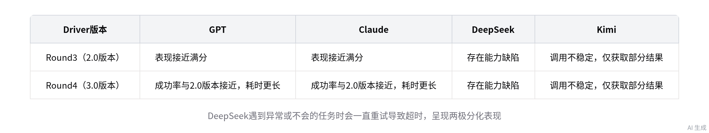

# AI notes: CUA周会 on Nov 25, 2026

> Title: CUA周会
> 
> Time: Nov 25, 2026 \(Wed\) 16:00 \- 16:57 \(GMT\+08\)
> 
> Participants: @刘一晨@陈瀚@丁晨静@兰桂林@李鸣谦@李泽豪@林佳欣@林强@卢乐炜@罗嘉鹏@洛金@马征@彭创@孙伟鑫@王博@吴泽寰@辛昱磊@许辰霆@闫晨阳@么天阔@袁晟友@张荧滢@邹广文杰
> 
> 

> AI\-generated notes might be inaccurate\. Please use with caution\.
> 
> 

# Summary

本次为CUA项目周会，参会成员围绕框架迭代、数据建设、Mock App方案、评测结果、数据合成测试等模块同步进展、讨论问题并明确后续行动，内容如下：

- **框架迭代进展**

    - **3\.0版本核心更新**

        - 核心能力支持：3\.0版本新增background操作能力，同时完成提示词小窗口、系统层级权限弹窗提示等历史问题的修复。

        - 现存已知问题：3\.0版本存在部分弹窗无法操作、剪映APP内driver操作异常的问题，由林强负责修复。

        - 后续功能规划：后续将在agent层级新增窗口类型切换功能，支持agent自主切换不同层级的观察窗口。

    - **相关对接安排**：集群相关更新由伟鑫完成，后续伟鑫负责与RL侧同学对接相关待办事项。

- **数据建设进展**

    - **第一阶段基础数据工作**

        - 进度安排：第一阶段覆盖各应用基础功能面的刷数工作本周完成收尾，当前已在3\.827B模型上开展训练与测试。

        - 现存问题：PS应用最多仅支持2次并行，飞书因登录态频繁掉落、每次任务需重新扫码验证，无法正常批量刷数。

        - 模型表现：3\.8版本工具调用存在系统性错误，评测39个飞书相关任务仅能完成7道。

    - **第二阶段自动化造数工作**

        - 当前方案：采用给定各APP工作流，由coding agent结合工作流生成高层级任务的pipeline，小规模生成的8道任务质量达标。

        - 现存问题：规模扩大后生成的任务存在模板化、难度偏简单的问题，后续将和泽豪沟通探索agent环境探索出题的方案。

    - **待办与问题解决**

        - 任务分配：彭创负责将browser侧历史数据适配到当前codebase的harness，同时牵头解决飞书mock相关问题。

        - 数据过滤问题：此前的两类核心数据过滤问题已解决，当前已支持loss mark标注功能。

        - 云端产物验证问题：Figma、Mail、剪映等应用的部分任务产物存储在云端，无法通过本地状态直接验证，后续将结合MCP接口读取应用状态、抽帧校验、LLM judge等方式针对性处理。

- **Mock App接入方案**

    - **方案迭代情况**

        - 技术实现：基于Electron项目将原有网页版mock应用改造为桌面端APP，设置10个通用应用槽，更换应用时仅需导入对应数据即可，无需重新编译镜像。

        - 运行效果：模型可直接调用CUA driver执行操作，支持多APP联动任务，通过后端网页状态即可完成自动化过程级校验。

    - **后续优化方向**

        - 现存不足：当前mock应用的AXTree结构比真实APP更简单，生成的任务难度偏低，后续将补充MCP工具、底层CLI能力，尽可能拟合真实APP的工作流。

        - 探索计划：后续将测试R1A方案，尝试逆向生成更贴近真实效果的mock应用。

- **评测工作进展**

    - **两轮评测结果**

        - Round3（2\.0版本driver）：GPT、Claude表现接近满分，DeepSeek存在能力缺陷，Kimi因调用不稳定仅获取部分结果。

        - Round4（3\.0版本driver）：整体成功率与2\.0版本接近，但操作耗时更长，存在部分模型仅输出推理内容未调用工具导致框架提前终止的问题。

    - **现存问题与修复**

        - 已知问题：存在agent transport error、50张图片上限、Blender等应用自动化校验无法覆盖全部场景、LLM judge结果存在随机性波动的问题。

        - 修复进展：agent transport error和50张图片上限问题已由孙伟鑫在最新镜像中完成修复，后续将使用新版镜像重测。

    - **后续规划**：后续将扩展任务集，新增Figma、Photoshop、飞书等未覆盖应用以及跨APP联动任务，同步跟进晨阳侧的造数进度。

- **DeepSeek Hybrid版本测试**

    - **当前测试结论**

        - 新旧版本耗时无明显差异，新版CUA工具调用成功率更高，旧版模型更多通过写脚本绕过GUI操作，当前差异表现尚不明确。

        - 模型行为倾向：DeepSeek类模型更偏好使用GUI操作，需要通过提示词引导其优先使用CLI操作，CLI执行失败后再切换为GUI操作。

    - **后续行动安排**：林强负责调整skill模块中相关行为描述，重新打包版本后交由邹广文杰重测此前因限流得零分的题目。

- **数据合成测试进展**

    - **前两批测试结果**：两批合成数据的误判率可控制在5%以内，第一批平均步骤数为63步，第二批为39步，整体任务难度偏简单，准确率偏高。

    - **难度偏低原因与优化方向**

        - 核心原因：任务设计阶段提前把需要模型自行判断、计算的内容直接写明，导致模型仅需按指令执行，缺少思考判断环节。

        - 优化计划：后续调整生成逻辑，移除任务中提前写明的判断类、数值类内容，同时平衡任务描述简化与评分标准的匹配度，避免误判率上升。

# Action items

* [ ] 伟鑫对接RL同学：伟鑫会后和RL团队同学完成相关模块的对接工作，同步3\.0版本框架更新的相关内容（来自刘一晨） @孙伟鑫

* [ ] 确认Driver操作问题：会后确认3\.0版本中无法操作的弹窗，以及剪映APP里异常的driver操作相关问题，后续由林强完成对应修改 @刘一晨 @林强

* [ ] 反馈刷数据问题：张荧滢将刷数据过程中两个应用出现的小问题后续反馈给伟鑫，协调解决对应问题（来自闫晨阳） @张荧滢

* [ ] 沟通数据造题方案：闫晨阳后续和泽豪针对第二阶段数据造题的pipeline方案进行沟通对齐，探索更高效的非模板化造题路径 @闫晨阳

* [ ] 适配browser数据到新框架：彭创将原有browser侧的数据适配到codebase的harness框架上，完成对应迁移适配工作（来自闫晨阳） @彭创

* [ ] 解决飞书mock相关问题：彭创负责处理飞书登录态不稳定无法刷数据的问题，完成飞书相关mock方案的落地（来自闫晨阳） @彭创

* [ ] 三人讨论mock app细节：闫晨阳、刘一晨、彭创三人会后针对mock app的CLI适配相关问题开展专题讨论，对齐方案细节 @闫晨阳 @刘一晨 @彭创

* [ ] 调研验证云端应用校验方案：会后调研Figma、PS这类产物存储在云端的应用，探索通过MCP、读取状态、视频帧校验等方式实现任务完成情况校验的可行方案 @闫晨阳 @张荧滢 @刘一晨

* [ ] 试验CLI方式适配飞书：彭创会后试验通过终端CLI指令操作飞书的可行性，验证该路径是否能满足飞书相关任务的执行要求 @彭创

* [ ] 优化mock APP的拟真度：彭创后续优化现有mock APP方案，尝试为其添加MCP调用能力以及底层bash命令支持，提升和真实应用的拟合度 @彭创

* [ ] 调研R1A逆向mock方案：彭创后续调研基于R1A逆向生成更真实的mock APP的可行性，探索相关落地方式 @彭创

* [ ] 重测新版镜像功能：李鸣谦团队拿到孙伟鑫修复完成的最新镜像后，重新对修复的agent transport error和50张图片上线相关问题进行重测验证（来自孙伟鑫） @李鸣谦

* [ ] 调整skill描述并打包新版本：林强参考闫晨阳团队提供的CLI优先执行的行为模式限定内容，调整CUA相关skill的描述，重新打包对应版本交付给邹广文杰进行测试（来自刘一晨） @林强

* [ ] 调整数据生成难度：泽豪针对当前合成数据任务难度偏低的问题进行调整，将直接写明的判断、计算类内容改为留给agent自主探索处理，平衡难度与评分误判率

# Links

- Docs shared in the meeting: 

    - [First50 DeepSeek Hybrid 轨迹分析（Raccoon Lab CU BU QA 1\.2\.2）](https://sensetime.feishu.cn/wiki/CgbhwOur5iy8rukz1OJcf2iknIc)

    - [CUA周会材料](https://sensetime.feishu.cn/wiki/AIzzw1CCaiUQI5k5DBycnA0jnug)

    - [First50 Round2 Hybrid 执行效率对比](https://sensetime.feishu.cn/wiki/Kf33wuoNKi3LB5kxVGnczLIfnVe)

- Meeting transcript

    - [CUA周会 2026\-11\-25](https://sensetime.feishu.cn/docx/YXCGdozNPoPI1fxPFfUcS2RhnMf)

# Related meeting notes

[AI notes: CUA周会 on Nov 18, 2026](https://sensetime.feishu.cn/docx/LuDodQ2LpoFBlHxgT5BcjHTBnnd)

[AI notes: CUA周会 on Nov 11, 2026](https://sensetime.feishu.cn/docx/PLf7djge3otzq2xSxffcOzaNnoh)

[AI notes: CUA周会 on Nov 4, 2026](https://sensetime.feishu.cn/docx/SA3QdnQlxo2EZpxbB3cc8i1YnBf)

[AI notes: CUA周会 on Oct 28, 2026](https://sensetime.feishu.cn/docx/AmKsd1TINo64fhxTHGTcmlWAnVc)

[AI notes: CUA周会 on Oct 21, 2026](https://sensetime.feishu.cn/docx/TgufdmoOpo5rSExiAdgczytKneu)

[AI notes: CUA周会 on Oct 14, 2026](https://sensetime.feishu.cn/docx/UbbXdUcTOoUd0IxqgWBcjZEdnUf)

[AI notes: CUA周会 on Sep 23, 2026](https://sensetime.feishu.cn/docx/F4ZfdHcqRomMCSxJWsIcITNxnvg)

[AI notes: CUA周会 on Sep 16, 2026](https://sensetime.feishu.cn/docx/Zk5vdQq6yoCQfsxUAL9cfQbinHf)

[AI notes: Browse\-Use周会 on Sep 9, 2026](https://sensetime.feishu.cn/docx/Xo4vdD7i0oEsW3xf9srcKDyynOP)

[AI notes: Browse\-Use周会 on Sep 2, 2026](https://sensetime.feishu.cn/docx/NcZCdBgRLoGriTxVDoWc4q6Kndf)

[AI notes: Browse\-Use周会 on Aug 26, 2026](https://sensetime.feishu.cn/docx/LvRKdrhjuosFCmxNqwKc1RgKnIy)

[AI notes: Browse\-Use周会 on Aug 19, 2026](https://sensetime.feishu.cn/docx/CXltdorzhojmyVxXFe0cAsrLnTZ)

[智能纪要：Browse\-Use周会 2026年8月12日](https://sensetime.feishu.cn/docx/EuZ8dWGCJolksSxv6UGcASgoned)

[AI notes: Browse\-Use周会 on Aug 5, 2026](https://sensetime.feishu.cn/docx/YzradWUcoo4MoaxK6NMcb78Ln0g)

[AI notes: Browse\-Use周会 on Jul 29, 2026](https://sensetime.feishu.cn/docx/SCHpd4yDTomqEyxtIFac51uRnwV)

[AI notes: Browse\-Use周会 on Jul 22, 2026](https://sensetime.feishu.cn/docx/Fl9mdg4Vlol1xzxsuQhc7SzYnjg)

[AI notes: Browse\-Use周会 on Jul 15, 2026](https://sensetime.feishu.cn/docx/MVtEdz5VmoPVxaxBxPRcsLTunvb)

[AI notes: Browse\-Use周会 on Jul 8, 2026](https://sensetime.feishu.cn/docx/KlBWdFj4iokL8oxinDdcA38bnPg)

[AI notes: Browse\-Use周会 on Jul 1, 2026](https://sensetime.feishu.cn/docx/NE8UdJ5GnobZwFxze4bcTlPknSe)

[AI notes: Browse\-Use周会 on Jun 24, 2026](https://sensetime.feishu.cn/docx/UU76dtGxcov3OTx75nAcoyL8ncd)

[AI notes: Browse\-Use周会 on Jun 17, 2026](https://sensetime.feishu.cn/docx/RRQvdKeUbomXmyx6D1ncHhPOnbR)

[AI notes: Browse\-Use周会 on Jun 10, 2026](https://sensetime.feishu.cn/docx/PtwydQ3PsoJI9vx1qCWcwbQ3nfe)

[AI notes: Browse\-Use周会 on Jun 3, 2026](https://sensetime.feishu.cn/docx/I6TIdf4mVoJVa2xpwlXcX6GHnuh)

[AI notes: Browse\-Use周会 on May 27, 2026](https://sensetime.feishu.cn/docx/EgeRdetm8oyGhTxEBsCctO8fn1g)

