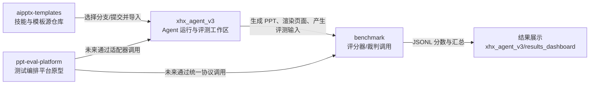

# 测试平台、aipptx-templates 与 xhx_agent_v3 仓库及分支说明

> 面向新人，说明当前工作区内三个主要部分的职责、分支用途、相互关系和使用边界。
>
> 盘点时间：2026-09-20；分支关系已核对 Git 提交父子关系、本地 reflog 和 GitLab `ls-remote` 返回值。
>
> 本文只记录和解释现状，没有切换、创建、合并、删除或修改任何 Git 分支。

## 1. 先记住三层关系

当前相关代码可以按下面三层理解：



简单说：

| 部分 | 主要职责 | 是否是当前 Git 仓库 | 应该把它看成什么 |
|---|---|---:|---|
| `aipptx-templates` | 维护 PPT 生成技能、模板相关资源和模板 SQL/HTML | 是 | 上游技能与模板源仓库 |
| `xhx_agent_v3` | 运行 Agent、接入技能、执行批量测试、保存输出并展示结果 | 是 | 生成运行时和评测工作区 |
| `ppt-eval-platform` | 组织数据集、生成框架、评测配置和任务流程的平台原型 | 否 | 测试编排层原型，目前没有分支 |
| `benchmark` | 对生成结果进行裁判评分，输出分数和汇总 | 当前工作区不是完整 Git 历史 | 外部评分依赖 |

三个主要部分分别处在源代码、运行执行、任务编排三个位置。

## 2. `aipptx-templates`：技能与模板的源仓库

路径：`/home/gui-5d025-2/zyy/aipptx-templates`  
远端：`https://gitlab.bj.sensetime.com/sensecode/tools/aipptx-templates.git`

这个仓库主要维护两类内容：

1. Agent 使用的 PPT 技能，例如 `ppt-maker`、`ppt-creative-mode`、`ppt-no-template-mode` 等。
2. 模板资源及其 SQL/HTML 管理内容。仓库 README 将其定位为 AIPPT V2 模板 SQL 生成工具，模板 HTML 位于 `templates/templates`，SQL 脚本位于 `templates/script`，生成的 SQL 位于 `templates/sqls`。

因此，看到这里的代码时，优先把它理解为“技能和模板的上游来源”。

### 2.1 按时间理解这条分支线

实际顺序是：**wangbo 的 outline → 合并 tzk 的 ppt-v2 → 单独提交 outline.md 契约改造 → 评测准备提交（后来作为 review 分支头）→ local 本地部署版**。

下面按提交时间列出。时间均为北京时间（UTC+8）；“提交时间”和“分支创建/推送时间”分别说明。

| 提交时间 | 提交 | 直接父提交 | 做了什么 |
|---|---|---|---|
| 2026-09-10 17:21 | `5e8fa4d` | `521dcf0` | tzk 的 `dev/tzk/ppt-v2` 分支头，包含此前持续更新的 PPT v2 各模式技能 |
| 2026-09-11 15:37 | `e4b76bb` | `e2e885e` | wangbo 的 outline 分支头，细化用户大纲内容契约；远端 `dev/wangbo/ppt-outline-template` 与 `dev/wangbo/ppt-outline-v2` 均指向它 |
| 2026-09-11 18:46 | `cc8c1e0` | 第一父提交 `e4b76bb`；第二父提交 `5e8fa4d` | 在新建的 `test/ppt-outline-merge` 测试分支上合入 tzk 的 ppt-v2，保留 wangbo 用户大纲流程；提交说明为 `Merge ppt-v2 into outline test branch, preserving user outline workflow` |
| 2026-09-15 16:53 | `fd73ea7` | `cc8c1e0` | 合并后的独立改造提交：`refactor(ppt): make outline.md the sole outline contract`。移除 `outline_contract.json`、源文本副本和旧哈希契约等在skill中的直接文本依赖，让导入、校验及下游制作直接读取当前 `outline.md` |
| 2026-09-17 16:03 | `349d5d4` | `fd73ea7` | `Prepare merged PPT skills for evaluation`：补全三个制作模式的大纲保真规则，并同步相关测试；这是后来 `review/ppt-maker-entry` 指向的提交 |
| 2026-09-18 18:01 | `9a42786` | `349d5d4` | `feat(ppt-agent): add v3.0-v1.1 local deployment edition`：派生本地部署版，移除远程素材/工具依赖与创意模式，保留模型推理调用 |

这条线的直接父子关系如下，方括号标出本次核验时的远端分支名：

```text
e4b76bb  wangbo outline ───────┐
                             ├─ cc8c1e0  合并提交
5e8fa4d  tzk ppt-v2 ───────────┘      │
                                    ▼
                                 fd73ea7  outline.md 唯一契约
                                    │     [test/ppt-outline-merge]
                                    ▼
                                 349d5d4  大纲规则与测试同步
                                    │     [review/ppt-maker-entry]
                                    ▼
                                 9a42786  本地部署版
                                          [ppt-agent-v3.0-v1.1-local]
```

**`cc8c1e0` 与 `fd73ea7` 的区别：** `cc8c1e0` 完成两条开发线的合并，当时还保留额外的大纲契约文件；9 月 15 日又提交了让 `outline.md` 成为唯一依据的代码改造。两者是同一条测试线上的连续提交，只有 `cc8c1e0` 是双父提交的 merge，`fd73ea7` 是普通单父提交。

**review 分支的创建经过：** 本地 reflog 记录如下。

| 时间 | 实际操作 |
|---|---|
| 2026-09-11 18:32 | 从 `origin/dev/wangbo/ppt-outline-template` 创建本地 `test/ppt-outline-merge` |
| 2026-09-11 18:46 | 在本地 test 分支产生合并提交 `cc8c1e0` |
| 2026-09-15 16:53 / 17:02 | 在本地 test 分支提交 `fd73ea7`，随后推送到远端 test 分支 |
| 2026-09-17 16:03 | 仍在本地 test 分支提交 `349d5d4`；远端 test 保持在 `fd73ea7` |
| 2026-09-18 15:44 | 从 `349d5d4` 创建本地 `review/ppt-maker-entry` 并推送；创建分支本身没有新增提交 |
| 2026-09-18 17:18 / 18:01 / 18:02 | 从 `349d5d4` 创建 local 分支，提交 `9a42786`，随后推送 |

`349d5d4` 的实际差异是三个模式的 `SKILL.md` 和三个测试文件，共六个文件。它强化了页型、要点父子层级、不新增可见要点、留白与事实来源等规则，并将测试同步到 Markdown 契约。**该提交没有修改 `ppt-maker` 入口文件、脚本或地址配置**；原文所写的“入口优化、相对路径/地址整理”与提交内容不符。

### 2.2 当前分支：区分本地与远端

`origin/*` 是本地记录的远端跟踪引用。本次另外用 `git ls-remote --heads origin` 直接查询 GitLab，确认下表中远端分支头与这些引用一致。

| 分支名 | 本地分支头 | GitLab 远端分支头（对应 `origin/*`） | 用途与关系 |
|---|---|---|---|
| `master` | `1582edb` | `1582edb` | 历史基础线，用于对比标准技能和模板管理能力 |
| `test/ppt-outline-merge` | `349d5d4` | `fd73ea7` | 合并测试线；本地比远端领先一个评测准备提交 |
| `review/ppt-maker-entry` | `349d5d4`（当前检出） | `349d5d4` | 保存并共享上述大纲规则与测试同步结果，供评审和评测使用 |
| `ppt-agent-v3.0-v1.1-local` | `9a42786`（另一 worktree 检出） | `9a42786` | 直接从 review 所在提交派生的本地部署版 |

因此，“test 和 review 指向同一提交”**只适用于当前这台机器的两个本地分支**。远端 test 在 `fd73ea7`，远端 review 在它的下一个提交 `349d5d4`，两者有实际内容差异。另一台机器从远端 test 新建工作区时，会得到 `fd73ea7` 对应的代码；不能把本机 test 的状态当作远端状态。

查看远端现状可以直接运行 `git ls-remote`，或在 `git fetch` 后检查 `origin/*`。复现某次运行时，应记录实际提交 SHA 和未提交改动，而不能仅记录分支名字。

### 2.3 local 版的含义

`ppt-agent-v3.0-v1.1-local` 中的 **local 表示本地部署能力，不表示“只存在于本机、没有推送”**。这个分支已经推送到 GitLab；`9a42786` 的直接父提交就是 `349d5d4`。

它继承 outline 导入、校验和下游制作流程，保留模板及无模板 HTML 制作；移除联网搜索、搜图、生图、远程下载、远程文档解析、远程截图服务以及创意模式，增加 `local_*` 运行时、本地文件解析、资源处理和环境预检。模型推理仍可调用部署者配置的内网或外网端点，因此这里的本地化不等于禁止一切网络请求。

这也应与远端较早的 `dev/wangbo/ppt-agent-3.0-v1-local`（`e20f598`）区分；本文讨论的是基于 `349d5d4` 派生的 `ppt-agent-v3.0-v1.1-local`。

### 2.4 如何复核这条历史

以下命令只读取状态，分别用于查看父提交、分支位置、创建记录和具体改动：

```bash
cd /home/gui-5d025-2/zyy/aipptx-templates
git show -s --format='%h %p %cI %s' cc8c1e0 fd73ea7 349d5d4 9a42786
git branch -avv
git ls-remote --heads origin test/ppt-outline-merge review/ppt-maker-entry ppt-agent-v3.0-v1.1-local
git reflog show --date=iso test/ppt-outline-merge
git reflog show --date=iso review/ppt-maker-entry
git reflog show --date=iso origin/review/ppt-maker-entry
git show --stat fd73ea7
git show --stat 349d5d4
```

reflog 是本机操作记录，其他机器不一定保留；提交父子关系和提交差异可在包含这些提交的仓库中复核。

## 3. `xhx_agent_v3`：Agent 运行与评测工作区

路径：`/home/gui-5d025-2/zyy/xhx_agent_v3`  
远端：`https://github.com/SenseTime-FVG/xhx_agent_v3.git`

这个仓库承担实际执行工作，主要包括：

- FastAPI、SSE、前端和 AgentV3 运行链路。
- `BaseAgent`、`BaseNode`、工具、沙箱、记忆和模型调用逻辑。
- `skills/` 下实际被当前运行任务加载的技能副本。
- 测试集、批量运行脚本、渲染结果、评分结果和结果看板。
- `results_dashboard` 结果展示服务。它读取 `output/testset_*` 下的测试产物、`batch_summary.json` 和输入 JSONL，并提供本地结果查看页面。

这里的一个关键点是：`xhx_agent_v3/skills/` 是运行时使用的技能副本。它可能来自 `aipptx-templates` 的某个分支或某个提交，但它本身不一定就是技能的唯一源头。

### 3.1 当前分支

| 分支 | 当前用途 | 适合什么时候使用 | 注意事项 |
|---|---|---|---|
| `dev/wangbo/ppt-skill-v1.1-test` | 较早的 PPT 技能 v1.1 测试和评测分析线 | 需要复现较早的技能测试结果，或对比历史行为时 | 当前提交较早，不能直接当成最新评测实现 |
| `exp/otto-remove-file-action-rule` | 当前检出分支；围绕 `<file_action>` 播报协议移除、Agent 行为和评测分析的实验线 | 需要分析 otto 相关行为、文件操作播报和当前评测结果时 | 是实验/分析线，不应直接理解为稳定发布分支；当前工作区还有未提交改动 |
| `feat/portable-ppt-eval-pipeline` | 可移植 PPT 评测流水线方向 | 需要查看批量运行、评测配置、测试集、技能准备和结果导出的整合方案时 | 更接近评测基础设施线，和当前 otto 实验分支的关注点不同 |

当前检出的分支是：

```text
exp/otto-remove-file-action-rule
```

当前 `feat/portable-ppt-eval-pipeline` 在另一个 linked worktree 中被占用。分支列表中出现 `+` 时，通常表示该分支已经被另一个 worktree 检出；这不是分支内容本身的变化，也不应该通过强行切换来处理。

### 3.2 xhx 分支之间的工作重点

可以按下面的方式理解：

```text
dev/wangbo/ppt-skill-v1.1-test
    └── 历史技能评测/分析基线

feat/portable-ppt-eval-pipeline
    └── 批量评测、配置、测试集、流水线和导出能力

exp/otto-remove-file-action-rule
    └── 当前实验与问题分析：file_action、otto 行为、评测分析
```

它们不是严格的“旧版 → 新版 → 发布版”关系。当前命名反映的是当时的开发目的，不能只凭分支名判断哪个分支最稳定。

## 4. `ppt-eval-platform`：测试编排平台原型

路径：`/home/gui-5d025-2/zyy/ppt-eval-platform`

当前这个目录没有 `.git`，执行 Git 分支查询会得到“不是 Git 仓库”。因此：

- 它目前没有可列出的分支。
- 它不能与 `aipptx-templates` 或 `xhx_agent_v3` 按 Git 分支直接比较。
- 目录里的代码和文档应被理解为测试平台原型，而不是已经完成版本管理的独立产品。

从现有设计文档看，平台的目标是成为编排层：

1. 选择数据集和输入类型。
2. 选择生成框架或生成服务。
3. 启动生成、渲染、评测流程。
4. 统一管理任务状态、产物目录和评测配置。
5. 让不同生成框架都遵守统一的结果协议。

平台设计文档定义了多种输入 profile，例如纯文本、文本加文件、文本加 PPTX 模板、文本加报告，以及 PPTX 编辑等；同时也把生成框架和 benchmark 评分解耦。

平台当前更适合被理解为：

```text
平台前端/API
    ├── 调用 xhx_agent_v3 或其他生成框架
    ├── 等待生成和渲染产物
    └── 调用 benchmark 进行统一评分
```

它不应该复制一套 Agent 代码，也不应该把评分实现重新嵌入每一个生成框架。

## 5. 评测链路中各目录的边界

### 5.1 技能源、运行副本和输出目录不是一回事

| 内容 | 位置示例 | 作用 |
|---|---|---|
| 技能源代码 | `aipptx-templates/skills/agent-3.0` 等 | 技能的上游维护位置 |
| 运行时技能副本 | `xhx_agent_v3/skills/...` | 某次 xhx 运行实际加载的内容 |
| 测试输入 | `xhx_agent_v3/data` 或平台数据集目录 | query、文件、模板、报告等输入 |
| 生成结果 | `xhx_agent_v3/output/testset_*` | PPT、HTML、PNG、元数据和单样本结果 |
| 评分结果 | JSONL、`batch_summary.json` 等 | benchmark 输出的分数、失败信息和汇总 |
| 结果展示 | `xhx_agent_v3/results_dashboard` | 查看运行记录和失败 case |

修改 `aipptx-templates` 后，不代表已有 `xhx_agent_v3/output` 会自动变化；已有输出是历史运行产物。反过来，直接修改 `xhx_agent_v3/skills` 也不代表上游技能源仓库已经更新。

### 5.2 统一产物契约

平台设计文档要求每个 query 目录尽量遵守统一产物约定，核心文件包括：

- `page_*.png`：评测所需的页面图片。
- `page_*.html`：可选的页面源文件。
- `query.json`：本次输入和任务元数据。
- `outline.md`：大纲或中间产物。
- `report.md` / `report.json`：可选的报告类输入或中间结果。

这样 benchmark 不需要知道生成框架内部是 xhx Agent、其他 Agent 还是另一种服务，只需要读取统一的结果目录。

## 6. 常见任务应该改哪里

| 需求 | 首选位置 | 说明 |
|---|---|---|
| 修改 PPT 生成技能、outline 契约、技能入口 | `aipptx-templates` | 先确定使用哪条技能分支和哪个提交，再将对应内容导入评测运行 |
| 修改 Agent 节点、工具、模型调用、沙箱或运行逻辑 | `xhx_agent_v3` | 属于运行时问题，不应把逻辑写进模板源仓库 |
| 修改批量评测脚本、测试集准备、结果导出 | `xhx_agent_v3` 的评测流水线相关分支 | 优先查看 `feat/portable-ppt-eval-pipeline` 方向 |
| 修改测试平台页面、任务编排、生成框架适配 | `ppt-eval-platform` | 当前目录还没有 Git 分支，需要先建立版本管理后再多人协作 |
| 修改评分规则、裁判调用或评分 schema | `benchmark` 或评分服务 | 需要同步记录评分协议版本，避免历史结果无法解释 |
| 查看失败 case、页面图片和汇总 | `xhx_agent_v3/output` 与 `results_dashboard` | 这是结果消费位置，不是技能源代码位置 |

## 7. 新人推荐工作流程

### 7.1 只想复现一次评测

1. 在 `xhx_agent_v3` 中确认测试集、模型配置和评测配置。
2. 确认本次使用的技能来源：`aipptx-templates` 的分支和 commit。
3. 检查运行前是否已经把该技能版本准备到 xhx 的运行目录。
4. 执行生成、渲染和评分流程。
5. 在输出目录和 `results_dashboard` 中查看失败 case。

复现时至少要记录四个版本信息：

```text
aipptx-templates 分支 + commit
xhx_agent_v3 分支 + commit
benchmark/评分协议版本
测试集和模型配置版本
```

### 7.2 想修改 PPT 技能

应先在 `aipptx-templates` 中定位技能源，明确是常规技能、本地部署版，还是 outline 合并评测版。修改后记录 commit，再将它作为一次明确的评测输入导入 `xhx_agent_v3`。

不要只修改 `xhx_agent_v3/skills` 后就认为技能源已经更新，也不要把一次评测运行产生的临时副本当成上游源代码。

### 7.3 想修改测试平台

应在 `ppt-eval-platform` 中处理前端、API、任务状态和适配器。平台通过统一接口调用生成框架和 benchmark；生成框架内部实现仍由对应仓库维护。

## 8. 当前仓库状态中需要特别注意的地方

1. `xhx_agent_v3` 当前检出的是实验分支 `exp/otto-remove-file-action-rule`，并且工作区存在未提交改动。当前目录不能直接当成干净的发布快照。
2. `aipptx-templates` 当前检出的是 `review/ppt-maker-entry`（`349d5d4`）。本地 test 与本地 review 同头，但远端 test 为 `fd73ea7`、远端 review 为 `349d5d4`，相差一个提交；不能把远端两条分支当作同一版本。
3. `ppt-eval-platform` 当前没有 Git 历史和分支。新人看到它时，不要使用“切到某个平台分支”的假设。
4. `xhx_agent_v3` 中的 `results_dashboard` 是结果查看器，不等于 benchmark 评分器，也不等于生成 Agent。
5. `aipptx-templates` 中的模板 HTML/SQL 管理和 `xhx_agent_v3` 中用于评测的技能/模板副本有不同生命周期。修改其中一处不会自动同步另一处。
6. 当前分支名主要表达开发意图，不能单独作为“稳定性”或“最新程度”的判断依据；复现结果时必须记录 commit。

## 9. 后续整理建议

以下建议只作为后续治理方向，本文没有执行这些操作，也没有改变任何分支。

### 9.1 为平台原型建立独立版本管理

给 `ppt-eval-platform` 建立独立 Git 仓库，并在 README 中明确它只负责编排、适配器、配置、API 和前端。生成逻辑和评分逻辑继续留在各自仓库。

### 9.2 建立“源代码版本清单”

每次评测自动写入一个 manifest，至少包含：

```json
{
  "skill_repo": "aipptx-templates",
  "skill_commit": "...",
  "agent_repo": "xhx_agent_v3",
  "agent_commit": "...",
  "benchmark_version": "...",
  "dataset_version": "...",
  "model_config": "..."
}
```

这样新人可以从一个结果目录反查它到底使用了哪套技能、Agent 和评分器。

### 9.3 统一分支命名语义

建议以后把分支用途固定成几类，例如：

- `main` / `release/*`：可复现的稳定线。
- `feature/*`：功能开发。
- `eval/*`：评测实验线。
- `hotfix/*`：问题修复。

`review/*`、`test/*`、`exp/*` 可以继续保留历史分支，但新分支最好在 README 或分支说明中注明输入、输出和是否允许作为复现基线。

### 9.4 明确三个状态层级

后续文档和脚本中建议显式区分：

```text
canonical source：上游唯一源代码
run snapshot：某次运行实际使用的代码快照
generated output：该次运行产生的结果
```

目前最容易混淆的就是把运行副本、技能源和历史输出都称作“当前代码”。

### 9.5 明确 test 与 review 的版本用途

`aipptx-templates` 的远端 test 和 review 当前保留了两个连续但不同的版本：`fd73ea7` 是 outline.md 唯一契约改造，`349d5d4` 再补全模式规则与测试。应在评测记录中明确选用哪个提交。本地 test 已领先远端一个提交这一事实，应保留在交接说明中；不能据此把远端 test/review 标为重复分支或历史别名。

## 10. 总结

先去 `aipptx-templates` 找“技能和模板从哪里来”，再去 `xhx_agent_v3` 看“Agent 如何运行和如何产出评测结果”，最后把 `ppt-eval-platform` 理解成“未来统一调度这些能力的平台入口”。遇到结果问题先记录各仓库 commit，再判断是技能、运行时、编排还是评分器的问题。
