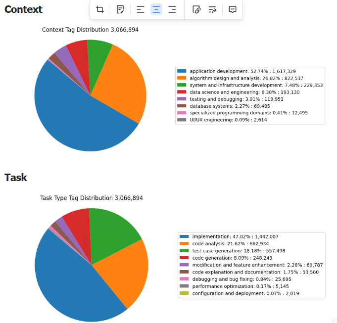
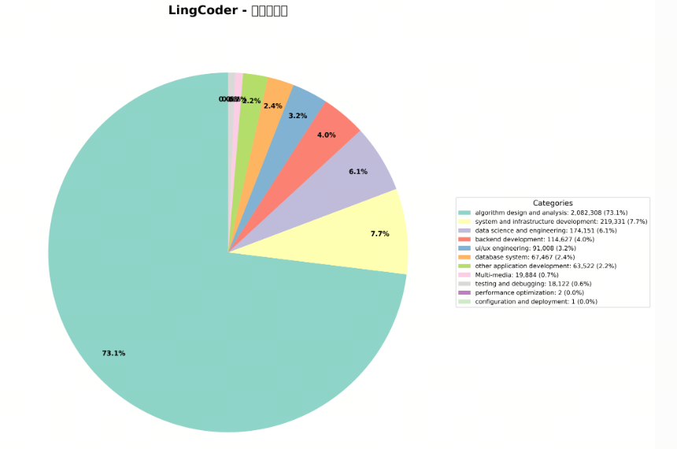
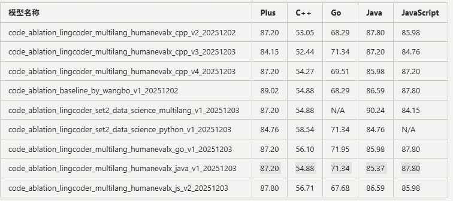
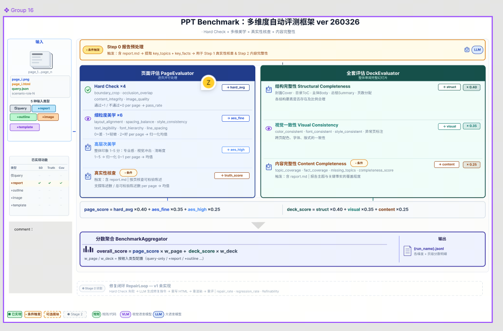
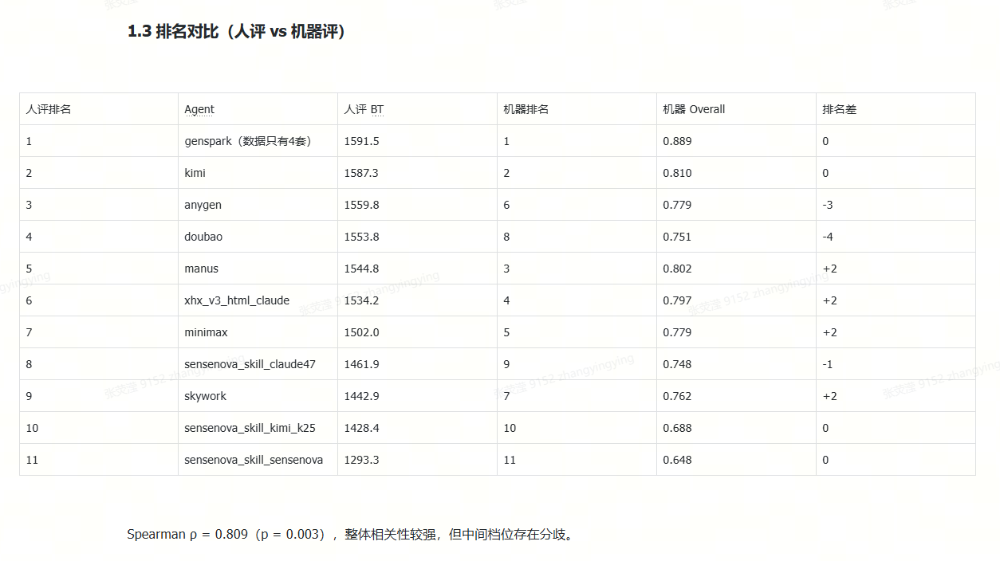
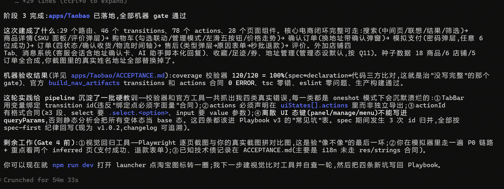
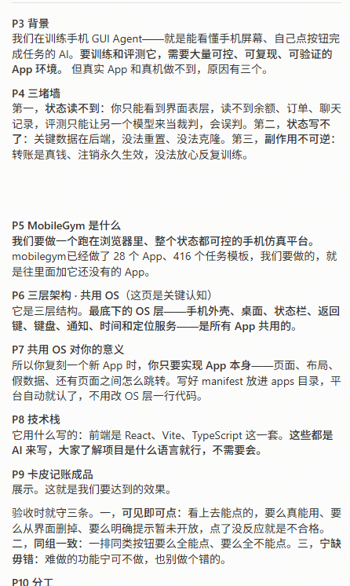
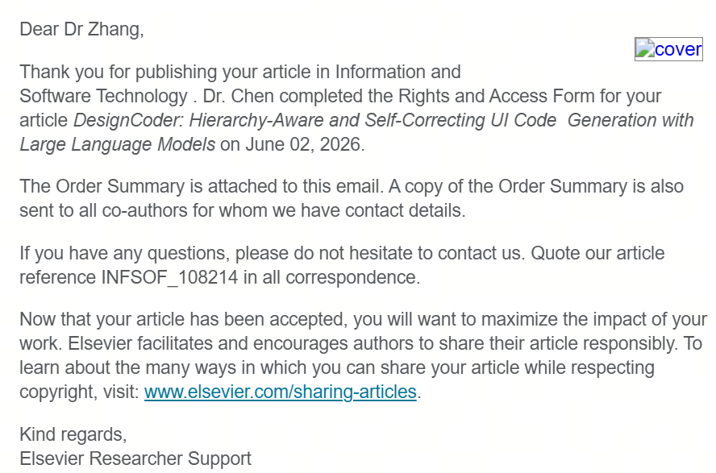

# 商汤实习事件线（2025.12 – 2026.07）

> 一份按时间串起来的实习回忆。
> 素材来自这半年 900 多张工作截图的内容识别，我把散落的文档、表格、平台、聊天串成了一条主线。
> 目的：离职时能一眼看清"我这半年到底做了什么"，也方便日后跟人讲、写进简历。

**一句话总结**：从代码大模型的训练评测入门，主线做到 PPT 生成质量评测体系（从 0 搭 benchmark），后期转向 GUI Agent / App 复刻，横跨模型训练、评测方法学、Agent 三个领域。

---

## 时间轴总览

| 阶段 | 时间 | 主线工作 |
|---|---|---|
| ① 入门 | 2025.12 | 代码大模型训练 & 评测（LingCoder 多语言）|
| ② 转向 | 2026.01–02 | PPT 生成质量评测：搭平台、调研 benchmark、定标注规范 |
| ③ 主战场 | 2026.03–04 | PPT Benchmark 立项，多 Agent 评测 + 人机对齐 + V2 pipeline |
| ④ 扩展 | 2026.05–06 | GUI Agent / App 复刻（微信淘宝京东等）+ PPT 翻译评测 |
| ⑤ 收尾 | 2026.06–07 | 离职季：交接、毕业手续、论文、远程实习转换 |

---

## ① 2025.12 — 从训练大模型入门

一进来就是硬核的模型训练活。

主线是 **LingCoder 代码大模型**的训练与评测。数据侧我在做代码数据集的**标签体系**——把 300 万条编程数据按 Context Tag（application development 52.7%、algorithm design 26.8%……）和 Task Type（implementation 47%、code analysis 21.6%……）分类，还要写"算法题 vs 应用开发题""算法题 vs 数学计算题"的判断规则，定 9 类代码标签的说明文档。

训练侧全是 GPU 集群的日常：
- 在 SenseCore 大装置上提交训练任务，配 8 卡 GPU / 64 核 / 1024G 内存
- 天天看 acc / loss 曲线（WandB 面板），对比不同 run 的收敛
- 踩了一堆坑：DeepEP 启动报错、VLM 转 HF 格式失败、权重保存被 OOM Kill、NCCL 分布式初始化、vLLM 加载 MoE 权重缺失、7997 端口连不上……
- 评测用 sensebench，多语言（Python/C++/Go/Java/JS）跑分，HumanEvalX、BigCodeBench、LiveCodeBench、fullstackbench 一套套地过

**关键数字**：LingCoder 数据集约 285 万条，algorithm design and analysis 独占 73%。消融实验里 baseline 在 Plus 达 89.02，C++ 普遍偏低（52–58）是短板。

月底开始接触**数据蒸馏**（DeepSeek V3 API 造数据），也第一次撞上 TPM 限流。

> 这个月的关键词：集群、报错、跑分、数据标签。是那种"看不懂就得硬啃"的入门期。

---

## ② 2026.01–02 — 主线切到 PPT 评测

一月中旬起，工作重心明显转了——从"训模型"转到"**评测 PPT 生成质量**"。这成了后面几个月的主战场。

起步阶段做的是：
- **搭评分平台**：一个能逐页看 PPT、按维度打分的内部平台（截图里反复出现"PPT 评分平台第 N 页"），我在上面标布局问题、超边界、遮挡重叠、大片空白
- **调研业界 benchmark**：AutoPresent/SlidesBench、PPTAgent/PPTEval、SlideCoder、SlidesGen-Bench、PPTC……把 2025–2026 的相关论文全过了一遍
- **定标注规范**：格式塔原理与缺陷类别对照、SlideAudit 缺陷分类、幻灯片三维度评估、7 类错误检测的标注指南
- **算 IAA**：Fleiss' κ 一致性分析，PEI 层级定义 L0–L5

这期间也穿插着 RL 相关的学习（师说新语讲大模型强化学习、veRL 框架），以及一次 Agent Elo 对战排名的实验（6 个 Agent 打擂台）。

> 关键转折：从此我的身份从"训练侧"变成了"**评测方法侧**"——不是造模型，是造"判断模型好不好的尺子"。

---

## ③ 2026.03–04 — PPT Benchmark 立项，最忙的两个月

这是整个实习的高峰。**PPT Benchmark 正式立项**（3 月王博牵头分任务），我深度参与了从设计到落地的全过程。

**评测框架设计**：
- 多维自动评测框架（架构图迭代了好几版）
- 十维度精确率评估、Deck Level / 页级指标全景 10 维分层体系（V2）
- 内容质量评测框架（Faithfulness、content_score vs checklist_score）

**多 Agent 横评**：把市面上的 PPT 生成工具全拉来打分——Manus、Kimi、Gemini3、Claude 4.5、SkyWork、AnyGen、Genspark……逐页评分、记录 FAIL case、做 ELO / BT 排名。

**人机对齐**：这是最有含金量的部分。把机器评分和人工标注（annotation 320 人工标注）做对比，深挖漏报误报，分析"人评 vs 机评"的一致与分歧规律。最经典的发现：**qwen-ppt-gen 的 visual-content gap**——V2 排名第 2，但 pairwise 垫底，成了论文里最有力的 motivating example。

**这期间和 Claude 高强度协作**（详见另一本《我和 Claude 的这半年》）：让它做论文级深度分析、写进度文档、审 benchmark 设计。它给过我很多犀利判词，比如"诊断是对的，但处方不够硬——标注和对照信号还没站稳，你却已经在大规模设计新 judge 了"。

**对外对接**：3 月还接了 OpenClaw / 商汤小浣熊的客户需求，参与"新框架接入"的能力清单设计（generator_id、HTTP 接口、同步/异步任务）。

> 这两个月的关键词：立项、横评、人机对齐、论文。是真正"做研究"的两个月。

---

## ④ 2026.05–06 — 转向 GUI Agent 与 App 复刻

五月起又开了一条新战线：**GUI Agent / 移动端 App 复刻**。

**研究方向**：GUI Agent 的分层记忆机制、手机 Agent 测评框架、移动端 Benchmark 综合对比（读了一堆 mobile agent / GUI agent 的 survey）。写了 GUI Agent UX 检测的周报，也调研了华为鸿蒙的 AI 自动测试方案。

**App 复刻工程**（重头）：用一套"截图 → spec → 反渲染审阅 → 分层实现"的工程化流程，复刻了一批主流 App 的 UI——
- **淘宝**：38 节点、29 路由、46 transitions，覆盖搜索→详情→SKU→购物车→下单→支付→售后→评价全闭环，coverage 校验 120/120=100%

- **微信 / 小红书 / B站**：browser host 方案完整复刻 UI
- **京东**：Flutter 仿京东商城（jd_mall_flutter），调京东金融/理财页
- **苹果播客**：约 30 页面，发现→播放→订阅管理闭环
- **卡皮记账、拼多多、Flomo**：陆续复刻

配套还做了 **mobilegym-mock**（GUI Agent 训练平台的 mock）、审核页交互核对、prompt 数据集大规模整理（image_prompt_collection 最终 3.4 万条 / 134MB）。

**PPT 翻译评测**：五月底还做了 PPT 翻译任务的评测（Ground Truth 对比、翻译案例评分、图文对齐）。

> 这个阶段横跨前端工程（React/Flutter）、Agent 训练数据、评测，是技能面铺得最广的时候。

---

## ⑤ 2026.06–07 — 离职季

六月下旬开始，截图明显带上了"收尾"的味道。

**工作交接**：
- GitHub 仓库交接（PR 规范、协作者管理、仓库更新说明）
- 数据回流资源下载文档、批测流程说明、规范文档同步
- 6 月底组织禁用了 Claude 订阅访问，工作方式被迫调整
- 7 月初把实习转成了**远程实习**（考勤、工作内容重新说明，tokenhub 接入 code agent）

**毕业 & 个人手续**（同期进行）：
- 学信网学籍、吉林大学学历电子注册、录取通知书邮寄信息
- 档案户口去向、毕业生去向登记表、高校毕业生登记表
- **一篇论文被 Elsevier 接受**（6/25 的接受通知邮件）

**一个值得记下的插曲**：6 月有过关于"外包身份是否要隐藏"的工作群讨论，也涉及外包歧视话题。这是实习里不那么光鲜、但很真实的一面。

**最后的技术工作**：7 月还在跑模型评测（Opus 4.8 thinking、Flash-lite v36、DPO v2 的 PPT 生成横评），Agent 失败根因分析，直到最后。

---

## 尾声：这半年学到了什么

把这条线拉完，我自己都有点意外——**入职时在训代码模型，离职时在做 GUI Agent 评测**，中间用四个月从零搭起了一套 PPT 生成的评测体系。

三条能写进简历的主线：
1. **代码大模型**的数据标注、训练、多语言评测全流程
2. **PPT 生成质量评测 benchmark** 从 0 到 1：框架设计、多 Agent 横评、人机对齐、pipeline 落地
3. **GUI Agent / App 复刻**：截图驱动的 UI 复刻工程 + Agent 评测数据

以及一个隐形收获：全程重度使用 Claude Code 协作，摸出了一套"一任务一会话 + 文件化交接"的 AI 协同工作法——这套方法本身，可能是最值钱的东西。

---

本文由 Claude (sonnet-4-6) 阅读 920 张工作类截图的内容描述后，按时间线梳理成稿。涉及的具体项目名、数字、平台均来自真实截图记录。
