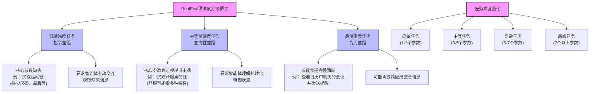

# 基于认知错位理论的清晰度分级框架

## 清晰度分级框架说明

RealEval基于认知错位理论（Subramonyam等，CHI 2024）构建了清晰度分级框架，该理论关注人机交互中用户意图与系统理解之间的差距。框架将任务清晰度分为三个级别，每个级别对应不同类型的认知错位：

1. **低清晰度任务（指令差距）**：用户意图明确但核心参数缺失或不完整，要求智能体主动交互获取缺失信息。
   - 例："买双运动鞋"（缺少尺码、品牌等必要信息）
   - 挑战：智能体需要识别缺失参数并主动询问

2. **中等清晰度任务（意向性差距）**：核心参数存在但表述模糊、主观或含相对性词汇，要求智能体理解并转化模糊表述。
   - 例："买双舒服点的鞋"（"舒服"可能指多种特性）
   - 挑战：智能体需要理解主观表述并转化为具体参数

3. **高清晰度任务（能力差距）**：参数表述完整清晰，但可能需要跨应用整合信息。
   - 例："查看日历中明天的会议并发送提醒"
   - 挑战：智能体需要在明确指令下正确执行复杂操作

任务难度通过参数数量进行量化，形成二维评估空间：
- 简单任务：1-3个参数
- 中等任务：3-5个参数
- 复杂任务：5-7个参数
- 高级任务：7个以上参数

这种二维分类法使RealEval能够系统评估智能体在不同认知挑战场景下的表现，比传统仅基于步骤数量的难度分级更贴近真实用户场景。
