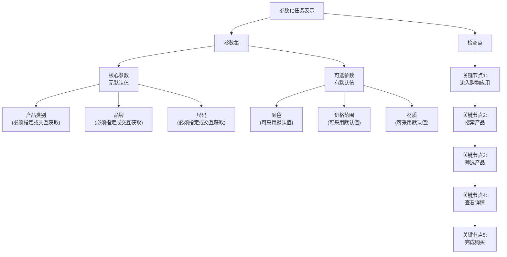

# 参数化任务表示方法示例

## 参数化任务表示示例：购买运动鞋任务

### 1. 参数集定义

| 参数名称 | 值域 | 默认值状态 | 示例值 |
|---------|------|------------|-------|
| **核心参数（无默认值）** |
| 产品类别 | {运动鞋, 休闲鞋, 正装鞋...} | 无默认值 | 运动鞋 |
| 品牌 | {Nike, Adidas, New Balance...} | 无默认值 | Nike |
| 尺码 | {36-46} | 无默认值 | 42 |
| **可选参数（有默认值）** |
| 颜色 | {黑色, 白色, 红色...} | 有默认值 | 黑色 |
| 价格范围 | {0-500, 500-1000, 1000+} | 有默认值 | 500-1000 |
| 材质 | {皮革, 织物, 合成材料...} | 有默认值 | 织物 |

### 2. 任务指令变体

#### 高清晰度指令（所有核心参数明确）
"帮我在电商平台上购买一双42码的Nike黑色运动鞋，价格在500-1000元之间，最好是织物材质的。"

#### 中等清晰度指令（核心参数表述模糊）
"帮我买一双Nike的跑步鞋，要舒适透气的那种，不要太贵。"

#### 低清晰度指令（核心参数缺失）
"我想买一双运动鞋。"

### 3. 检查点序列

1. **进入购物应用**：验证智能体是否成功启动正确的购物应用
2. **搜索产品**：验证智能体是否使用正确的搜索词（如"Nike运动鞋"）
3. **筛选产品**：验证智能体是否应用了正确的筛选条件（如尺码、价格范围）
4. **查看详情**：验证智能体是否选择了符合参数要求的产品并查看详情
5. **完成购买**：验证智能体是否成功将产品添加到购物车或完成购买流程

### 4. 评估方法

* **参数满足度**：计算智能体最终选择的产品满足了多少比例的参数要求
* **路径独立性**：无论智能体采用何种路径（如直接搜索、浏览分类、使用推荐等），只要最终选择的产品满足参数要求即视为成功
* **交互评估**：在低/中等清晰度指令下，评估智能体是否主动与用户交互以获取缺失/澄清模糊的参数
