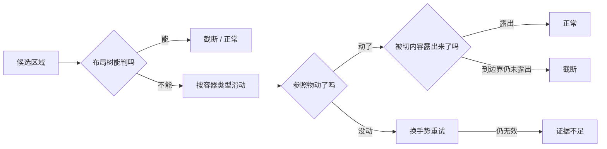

<!-- 数字出处写在各节的隐藏注释里，预览时不显示；id 见 numbers.csv 和 numbers_新增行_待确认.csv。 -->

# 多屏应用的截断检测：研究进展与合作需求

张莹莹 ｜ 2026-11-23

## 1. 我们在解决什么问题

鸿蒙一个页面要在直板、折叠、三折、平板上都显示正确，屏宽一变，文字和按钮就容易被截断。难的地方不在于看出「这里像被切了」，而在于**分清它是真缺陷，还是正常设计**。

比如一个横向列表，最右边一格只露出一半。单看截图很像被切了，但用户往左一滑就能看全，这是很常见的设计。反过来，如果一段文字被切掉半截，所在的区域又滑不动，用户就再也看不到这段内容，这才是缺陷。

| 屏幕上看到的 | 实际情况 | 算缺陷吗 |
|---|---|---|
| 横向列表最右一格只露出一半 | 往左滑就能看全 | 不算 |
| 轮播图露出下一张的边 | 设计如此，翻页能看到 | 不算 |
| 文字末尾显示「…」 | 设计好的省略 | 不算 |
| 文字被切掉半截，所在区域滑不动 | 用户拿不到这段内容 | **算** |
| 底栏文字被窗口底边切掉 | 用户拿不到这段内容 | **算** |

所以我们把判定标准定为：**被切掉的内容，用户在当前屏幕上有没有办法看到。**

现在常见的做法有两种。第一种只看截图，让大模型判断，它会把上面这些正常设计报成缺陷：我们 50 页的端到端测试里，不滑动时报截断的 15 页有 6 页是误报。第二种再看界面结构，必要时去滑一下找反证，网页上已经有研究这样做。

我们发现，到了原生鸿蒙上，第二种做法依赖的两个前提都不总成立：布局树并不总能告诉你内容有没有被切；「滑了没变」也不一定说明真的没有更多内容。下面两节分别讲这两点，然后讲我们的方法、数据和下一步。

**三句话概括：** 折叠屏上「看起来被切了」常常是正常设计，只看截图会产生大量误报。我们量出了布局树在哪些情况下判不了、「滑了没变」为什么不可靠。据此做一个先确认证据可信再下结论的检测方法，并在开源鸿蒙 App 里构造带答案的数据来检验。

<!-- 15 页 6 页误报 D1-007/008，真值，真截断只有 10 页 -->

---

## 2. 发现一：「滑了没变」不能直接当成「真截断」

我们把两批历史数据里 138 个候选框的真机滑动结果，和标注对了一遍：

| 滑动后 | 实际能滑出 | 实际真截断 | 判错率 |
|---|---:|---:|---:|
| 框里变了 → 判能滑出（69 次） | 66 | **3** | 约 4% |
| 框里没变 → 判真截断（37 次） | **11** | 26 | 约 30% |
| 滑动失败或没滑（32 次） | 不计 | 不计 | — |

滑完「框里变了」，判能滑出，69 次错 3 次；滑完「框里没变」，判真截断，37 次错 11 次。也就是说，「变了」基本可信，「没变」错得多。

「没变」有好几种可能：内容真的没了；手势没生效、方向错、已经到边界；滑动作用到了外层容器，候选在另一个容器里；或者候选本身变了、消失了。光看滑动前后两张图，这几种情况分不开。

那手势能不能做到每次都对？做不到，因为滑动的效果由 App 决定。按页吸附的列表一松手就弹回原位；嵌套滚动时，动作可能被外层容器接走；起点压在悬浮按钮上，滑动就变成了点击。这些靠调参数没法根治。

所以方法上不假设手势一定生效。每次滑完，先检查目标所在的容器到底动没动，比如在同一个列表里找一个参照物，参照物动了才说明这一下生效了，「没变」才能当证据。没生效就报「证据不足」，不报截断。

别人的工具里也能看到同样的情况（各是一个例子）：HapTest 的滚动步长是 60 像素，容器只能滚 38 像素，框架直接退出；LLMDroid 点底栏前后都是教学浮层，页面没切换，却记成测过。

拿历史数据事后估算一下：如果先用布局树判，判不了的才去滑，需要滑的框是 56 个，其中误报 2 个、漏报 0 个，另有 17 个滑动失败或没滑，记为「证据不足」。这是在开发数据上事后算的，不是新方法跑出来的成绩。

**目前的局限：** 判错的样本只有 11 个，两批都是开发期数据。接下来要把 37 次「没变」逐条归到上面几种原因里，看这 11 个错误主要来自哪里。

**怎么检验这个判断：** 给每次滑动加上同一视口的参照物再判，「没变」的误判率应该明显低于 30%。如果降不下来，说明这个解释不成立。

<!-- 138 D1-021；3/69、4% D1-022/023；11/37、30% D1-024/025；四格与 32 X-009；56/2/0/17 X-011；两批来源 M14；60/38 D2-059/060 单例；LLMDroid 单例；全部存档重判，人工复核否 -->

---

## 3. 发现二：布局树能判的部分没有判错，但商业 App 的真截断大多判不了

布局树有一些固定的情况判不了，这些情况可以按原因一条条列出来。

我们写了一条判定关系：被切的内容和切它的那条边之间，如果有一个还能往被切方向移动的东西（可滚动列表、翻页轮播、可展开文本），内容就能拿到；没有，就是截断。用这条关系重判 179 个去重后的候选框，布局树能下结论的有 103 个，约 58%，这 103 个都和标注一致。这是开发期数据，判据看过第一轮结果后改过两处，所以我不把它叫作 100% 准确率。

剩下的框落在布局树判不了的情况里。47 个真截断中有 21 个属于这一类，原因分布如下：

| 布局树判不了的原因 | 树上的表现 | 历史数据中的真截断数 |
|---|---|---:|
| 子组件自己裁切 | `bounds` 和 `origBounds` 相同，看不出被切 | 6（这两类在重判里合并统计） |
| 省略号与自裁切 | 两者导出的树完全一样（学弟实测） | ↑ |
| 被兄弟组件盖住 | 遮挡者不在父链上，要看层级和透明度 | 6 |
| 行框和字形不一致 | 行框被裁几像素，字不一定被切 | 2 |
| 懒加载项不在树里 | 还没创建的列表项没有节点 | 0（这批数据没碰到） |
| 翻页容器当前页不导出 | 轮播当前第几页不一定导出 | 0（这批数据没碰到） |
| 内容不在树里（实测新增） | 自绘内容没有节点，如番茄小说 | 5 |
| 找不到裁切者（实测新增） | 没有祖先能解释这次裁切 | 2 |
| **合计** | | **21 / 47** |

设计时我们列了前六类，实际数据里又多出两类。

按 App 拆开看，**商业 App 的 23 个真截断里有 15 个布局树判不了**，其中 12306 的 10 个、滴滴的 4 个全部判不了。也就是说，在这批商业页面上，真有缺陷的地方布局树大多给不出结论，只能靠交互去确认。

**目前的局限：** 这 15 个里有 14 个来自 12306 和滴滴两个 App。布局树判为截断的 26 个里，有 18 个来自我们构造的样例 App。179 个框的标注也不是逐框人工完成的，正常页默认整页没有问题。最接近独立验证的是 9 月验收那批，调判据时没看过，能下结论 24 个、全部正确，但样本小，页面和测试集有重叠，还不能算留出集。

**怎么检验这个判断：** 冻结判据，换一批没见过的 App 重跑。判不了的比例应该仍在 40% 上下，也不需要表外的新类别。

<!-- 179、58%=103、103/103 D1-026/027/028；21/47 D1-032；分类 X-012；15/23、12306、滴滴 X-005；26 里 18 X-004；24/36 X-007；标注来源 X-008；全部存档重判 -->

---

## 4. 我们的方法和论文计划

方法分三步。第一步，用布局树上的判定关系，能判的直接判。第二步，判不了的才去滑，按容器类型选动作：连续列表慢滑，翻页容器按住时截图，可展开文本点展开。第三步，采信结果之前先确认动作生效；确认不了就明确报告「证据不足」。

和已有工作相比，主动滑动本身不是我们的新意，网页和安卓上都有人做过。我们要补的是：滑动这个证据本身可能失效，需要有办法判断它什么时候可信。

论文计划投 ISSTA 2027，摘要 1 月 8 日，全文 1 月 11 日。计划的三项贡献：

| 贡献 | 内容 | 当前状态 |
|---|---|---|
| 实证发现 | 布局树判不了哪些情况；滑动证据在什么情况下失效 | 有历史数据，待留出验证 |
| 检测方法 | 先静态判定，再用带对照的滑动取证，判不了时明确报告 | 静态部分已实现；对照部分待实现 |
| 成对数据集 | 在开源鸿蒙应用源码中注入真截断，并配「看起来相似但正常」的样本，每个样本带源码位置和答案 | 工具已跑通，样本待审核 |

---

## 5. 数据、风险和下一步

现在最大的风险是**真实数据规模**。带截图和布局树的商业真截断只有 6 页 7 个屏态；测试集里的 10 页真截断是我们专门构造的用例；上面那些「能判的都判对了」也都还是开发期数据。

学弟的源码注入已经在 5 款开源应用上跑通，写了 19 种算子，其中 16 种属于截断。流程是先采正常版本的截图和布局树，再改源码、重新构建，采改后的截图和布局树，并保存改动位置和审核记录。他还用原版 UX-Agent 在注入样本上试跑了一次：28 个目标里 26 个可计分，正确报出 1 个、误报 3 个、漏报 6 个。这次用的是替代的小模型，样本也少，不能当成绩，只说明这套数据可以用来暴露检测方法的问题。现在缺的是**审核通过、能直接当测试集用的样本**。

另外我们准备补一个真实缺陷来源：去开源项目的 issue 和修复提交里找真实截断问题，修复前后的源码都在，可以证明这些问题在开发中真实发生过。

| 时间 | 目标 | 负责 |
|---|---|---|
| 11-24 至 11-30 | 第一版审核通过的测试集；冻结判定规则；提出合作需求 | 学弟、我 |
| 12-01 至 12-07 | 测试集扩到 30 页、10 个真截断以上；**12-07 判断论文定位** | 学弟 |
| 12-08 至 12-21 | 实现带对照的滑动；完成三档对比和消融实验；在真实 App 上找新问题 | 我、学弟 |
| 12-22 至 01-07 | 写作和补实验 | 我 |
| 01-08 / 01-11 | 提交摘要 / 全文 | 我 |

如果 12 月 7 日测试集够规模，就按方法论文写；不够，就把定位改成「数据集 + 实证研究」，或者转投 3 月的 ASE。

想请学长帮忙把关两件事：

1. 截断检测这篇作为主攻，探索、页面图和方向四先作为配套，这个安排是否合适。
2. 方向四（桌面多通道受阻与核验）还要不要继续投入。它对这条主线的价值，主要在于提供「动作做了但没生效」这类失败形态的证据。

<!-- 6 页 7 屏态 X-013；10 页构造用例 D1-003/004；5 款 X-014；19/16 X-015；TP1/FP3/FN6 X-017，替代模型 -->

---

## 6. 回应合作群：UX 缺陷的成因和合作接口

群里彭老师和董师兄希望了解缺陷背后的源码级案例和成因。先说明来源：我们没有商业 App 的源码，能给出「代码 → 缺陷」对应的是学弟在开源鸿蒙 App 里做的白盒注入，以及我们自己的代码工坊样例 App；商业 App 只能看到布局树，成因是从布局树反推的。

### 6.1 截断的成因归纳

判断截断用的还是前面那条关系：被切的内容和切它的边之间，有没有能往被切方向移动的东西。

| 缺陷机制 | 源码层成因（ArkUI） | 怎么触发 | 视觉表现 | 视觉以外的特征（布局树） | 例子 |
|---|---|---|---|---|---|
| 父容器裁切、中间没有可动视口 | 父 `clip(true)` + 子 `offset/translate` 推出边界；或 `width` 写死、文字变长、`maxLines(1)` 无省略 | 文字变长、屏宽变窄、切屏态 | 半个字被切 | 子节点 origBounds 超出父 bounds，父链上没有可滚容器，**树上能直接判** | 样例 g01：裁切者跟着列表一起动，滑动后画面变了，但仍是真截断 |
| 子组件自裁切不导出 | 文字控件自身 `maxLines` + `textOverflow: Clip`、固定宽 | 同上 | **整字消失**（父容器裁切才切半个字） | bounds 与 origBounds 相同，树上看不出 | 58 同城浮条「务」字消失；12306 三处 |
| 省略号与自裁切同构 | `textOverflow: Ellipsis` 与 `Clip` 两种写法 | — | 一个合法，一个是缺陷 | **导出的树完全一样**，要靠交互或文字测量 | 学弟 11-09 实测（单例） |
| 窗口尺寸没更新 | 视口宽度写死，或缓存了首次测量的宽度 | 折叠、展开、旋转 | 内容超出当前窗口 | 内容范围超出当前窗口边界 | 点评「火车票」与固定宽视口的构造相近 |
| 被兄弟组件盖住 | 吸顶栏、悬浮按钮等叠在上层 | 滚动后吸顶、切屏态后重排 | 内容被盖 | 盖它的节点不在父链上，要看兄弟层级和透明度 | 淘宝价格行被吸顶栏盖住 |
| 行框与字形不一致 | 行高大于字形 | — | 字其实没被切 | 行框被裁几像素不等于字被切（例：行框多 7px，单例） | 淘宝价格行 |
| 内容不在树里 | 自绘 / 画布渲染 | — | 截断看得见 | 节点缺失或框对不上 | 番茄小说 |

### 6.2 真实开发里出过的同类错误

学弟从上游开源项目找了几例原有 issue 和修复提交，和我们的注入无关，说明这些约束错误在开发中真实存在。这几例是安卓 / Flutter / RN 项目，不是鸿蒙。

| 上游问题 | 修复怎么改的 | 对应的机制 |
|---|---|---|
| LocalSend 文件信息弹窗，长文件名在小窗口溢出 | 表格外包一层横向滚动 | 内容固定、视口变小；加滚动后变成「能滑出」 |
| AnkiDroid 横屏下拉文字被裁 | 同时改文字高度、样式和内边距 | 裁切由高度和内边距共同造成 |
| react-native-image-viewing 旋转后图片只显示一部分 | 用户报告初始方向的尺寸被固定 | 窗口变化后还用旧尺寸，和折叠屏切屏态是同一类触发 |

学弟也拿商业截图做过对照：美团底栏「收藏 / 浏览」和窗口底边裁切的构造关系相近，点评「火车票」和固定宽视口的构造相近；12306 那例还没对上，记为未对应。

### 6.3 学弟的注入为什么能回答「代码 → 缺陷」

算子按机制分组：自身文字约束、省略表达、父子尺寸与边界、位移与内容扩张、屏幕与视口约束，再加两类难负例（同方向滑动能恢复、只裁掉组件留白）。所以每个样本都带着「改了哪行源码、运行后什么样、布局树字段怎么变、滑动后能不能恢复」，正好对应群里说的根因、触发、表现和非视觉特征。

运行时打点方面，他的流水线默认先插桩再构建，在开源应用上可以加；商业应用上拿不到。目前还没有打点数据。另外，被兄弟组件盖住这一类他现在排除在截断范围外，我们历史数据里有 6 个真截断属于这一类，范围还要对齐。

### 6.4 我们能提供什么

| 内容 | 现状 |
|---|---|
| 截断机制归纳表（6.1） | 已有，可继续细化到具体案例 |
| 源码级缺陷样本：源码改动、运行截图、布局树、答案 | 工具已跑通，审核通过后提供 |
| 运行时打点：在开源应用的注入样本上记录 | 流水线支持插桩，尚未采集 |

### 6.5 希望合作方支持什么

我们手上的商业真截断只有 6 页 7 个屏态，这是目前最大的短板。下面按获取难度从低到高排列：

| # | 需求 | 具体内容 | 用途 |
|---|---|---|---|
| 1 | 问题确认 | 我们在真实 App 上报出疑似截断，请对方判断是否成立 | 形成「被确认的真实缺陷」 |
| 2 | 脱敏的问题归纳 | 历史截断问题的类型、屏态、触发条件、修复方式，不需要源码和原图 | 校验我们的成因分类和注入算子 |
| 3 | 更多真实样本 | 带截图和布局树的截断页面，仅内部评测，论文只报统计 | 真实性对照 |
| 4 | 运行时打点说明 | 能拿到哪些字段，有没有样例 | 判断能否作为视觉以外的特征 |
| 5 | 使用边界 | 哪些材料可用于论文、以什么形式呈现 | 提前确认合规 |

想请学长确认：这几项里哪些可以提、由谁对接；上面的归纳粒度够不够，还是要具体到每个案例的截图和布局树；运行时打点要不要现在加进注入流程。如果可行，希望 12 月 5 日前拿到第一批，赶上 12 月的实验。

<!-- 7px D1-033 单例；6 页 7 屏态 X-013；X-012、X-014、X-015 -->

---

## 7. 可能被问到的问题

| # | 问题 | 回答 | 证据到哪一步 |
|---|---|---|---|
| 1 | 解决什么问题，为什么重要？ | 一个页面要在多种屏幕上显示正确，屏宽一变就容易截断。自动检测最大的麻烦是误报，很多「看起来被切」其实是正常设计 | 不滑动时报截断的 15 页里 6 页误报；只看截图 recall 53% |
| 2 | 现有方法为什么不行？ | 只看图分不清正常设计；布局树有一批情况判不了；滑一下「没变」也不可信 | 历史数据：21/47 判不了，商业 App 15/23；「没变」错 11/37 |
| 3 | 方法是什么？ | 按用户能不能拿到内容来判。布局树能判的直接判，判不了的才滑；用同一列表里的参照物确认手势生效，否则报证据不足 | 静态判据已在历史数据上跑过；参照物规则还没实现 |
| 4 | 滑动复核不是有人做过吗？ | 做过。网页上有 ReFLAIR，论文报告去掉探索后 precision 变化 −40.08%；安卓上有 SUDFinder。我们针对的是滑动结果本身可能无效，并给出检查办法 | 差距要靠消融实验证明 |
| 5 | 数据从哪来，像不像真的？ | 在开源鸿蒙应用源码里注入，并配看起来相似的正常样本；再用商业截图和开源项目有修复记录的真实问题做对照 | 工具跑通 5 款应用；审核通过数待定；商业真截断 6 页 7 屏态 |
| 6 | 怎么证明方法有用？ | 同一批数据比三档：只看截图、加布局树、再加交互复核；然后去掉参照物做消融；最后在真实 App 上找新问题 | **还没做**。替代模型试跑 28 个目标，只能算试通 |
| 7 | 103/103 是不是过拟合？ | 判据没有可调参数，但看过第一轮结果后改过两处，标注也不是逐框人工，所以只说开发数据上能判的都对上了，留出验证在注入集上做 | 9 月那批能判的 24 个全对，样本小，不叫留出 |
| 8 | 滑动判错，是不是工程没做好？ | 一部分是。旧流程对所有框都去滑，再相信「没变」；滑错的 14 个里有 12 个布局树本来能判，所以改成先判再滑。另一部分来自手势本身无法保证生效，所以核验不能省 | 历史数据重判 |
| 9 | 现在还差什么？ | 审核通过的测试集、参照物规则、三档对比和消融、真实 App 上的新发现 | 见第 5 节排期 |
| 10 | 来得及吗，最坏情况呢？ | 12 月 7 日测试集够 30 页、10 个真截断就按方法论文写；不够就改成数据集 + 实证研究，或转投 ASE | 计划 |
| 11 | 是不是一直在训模型？ | 不是。这篇不涉及训练，上面的数都是用已有数据离线算的 | — |
| 12 | 开合呢？ | 开合判的是切屏前后内容和状态有没有保住，和截断是两类判定，按横向交付推进，不进这篇 | 见附录 A |
| 13 | 为什么要合作方支持？ | 注入数据证明方法能跑，真实缺陷证明问题真实存在。现在商业真截断太少，有对方确认的问题才完整 | 见 6.5 |

<!-- D1-007/008、D1-014、D1-032、X-005、D1-024、D1-036、X-014、X-013、X-017、X-007、X-010 -->

---

## 附录 A：开合（问到时展开，不属于这篇论文）

开合判定的是切屏前后内容和状态有没有保住。目前看到三种典型情况，都是个例：

| 样子 | 我们看到的 | 专家建议的根因标签（正式口径待确认） | 触发：用户状态 × 设备操作 |
|---|---|---|---|
| 状态丢了 | 弹窗折叠后消失，展开回来也没有 | 状态不连续；专家另建议新增「已打开的面板或弹层被关闭」 | 先打开弹层，再开合 |
| 操作入口丢了 | 筛选面板切换后「重置 / 确定」一直不出现 | 接近未重排或弹窗未适配（这一格是我们的判断） | 打开筛选面板，再开合 |
| 内容被挤走 | H5 页面展开后等比放大，一屏只剩头部 | 等比放大挤出 | 折叠 → 展开 |

视觉以外的特征目前只有布局树。折叠往返后，模型判有问题且两棵树都取得到的 252 组里，69 组文字保留率低于 0.8；模型判没问题的 508 组里只有 10 组。这个信号不用看图就能算，但对照的是模型标签，还没有人工复核。

彭老师提到用户操作和折叠、横竖屏的异常交互可能是根源。专家也要求进页面前预置五种状态：列表满一屏、输入一半、勾选、打开评论或弹层、暂停视频。我们 1373 次开合测试里有意预置的只有 168 次，约 12%，所以现有数据对这类根源覆盖还不够。

已有 13 个 App、849 组模型初筛结果，其中 266 组判有问题，人工复核尚未完成，201 组只命中「展开后等比放大挤出首屏算不算」这一条，口径还没对齐，所以目前只能叫初筛。

<!-- 三种情况来自 11-03 稿，单例；D2-022/023；D2-046/047；D2-001/002/004；X-001；人工复核 0 D2-050 -->

## 附录 B：探索方向的一个发现（问到时展开，不属于这篇论文）

这是另一条线（以 UX 问题为目标的自动探索）的动机证据。探索工具要报告「覆盖了多少页面」，前提是能认出两个画面是不是同一页。

我们发现按布局认页面，在唯品会上同时存在合并过头和拆分过头：35 个模板只对上人工清单 46 页里的 10 页；10 个模板各混了几个功能，15 个功能各被拆成多个模板，购物车和商品详情各拆成 6 个。拿 GPT 命名的 27 个功能作参照，阈值从 0.4 调到 0.75，调和分数一直在 72% 到 77%，换结构、文字、图像哈希等信号也没有突破。

目前只有 1 个 App 有人工清单，阈值曲线的参照也是模型命名，所以暂时只能说「至少在唯品会上，按布局算覆盖率会算错」。

<!-- 10/46 D3-006；35 D3-008；D3-011/012/013；27 功能 D3-015；0.4–0.75 D3-021；72–77% D3-022 -->
