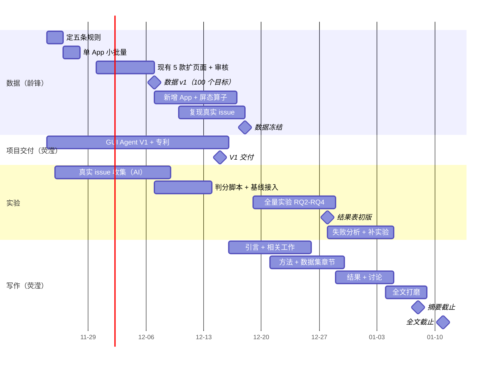

类型：核心 ｜ 归属：截断论文（投 ISSTA 2027：摘要 01-08，全文 01-11，正文 18 页） ｜ 状态：11-23 晚重写，荧滢改

> 论文的目标、分工和排期都看这一页。正文草稿在 `论文初稿_v0.md`，写文档的规矩在 `写作偏好.md`。

# 截断论文全貌

## 一、一页看懂

**我们要回答的问题：** 手机和折叠屏上，一段内容看起来被切了，它到底是真缺陷，还是正常设计？现有的自动检测方法能分清吗？

举个例子。横向列表最右边的卡片只露出一半，看上去像被切了，往左滑一下就完整了，这是正常设计。如果检测工具也去滑一下，画面没变，它通常会判定「内容真的没了」。可画面没变还有别的可能：手势没生效、滑错了容器、已经到了边界。所以「滑了没变」这条证据本身不一定可信。

**这篇论文做三件事：**

1. **看清真实情况：** 真实的截断有哪些类型，布局树在哪些类型上判不了。
2. **造一套带标准答案的数据集：** 在开源鸿蒙 App 的源码里注入截断，同时配上「看起来像截断、其实没问题」的负例。
3. **用这套数据集测现有方法：** 量出它们错在哪，尤其是滑动得到的证据什么时候会失效。

**论文类型：基准 + 实证研究。** 我们不主推一个新的检测智能体，自己的小方法只作为比较对象之一。这样写聚焦，也避开了审稿人对智能体实验的常见质疑。

**现在到哪一步：**

| 部分 | 状态 |
|---|---|
| 动机证据 | 已有存档数据：滑后「变了」错 3/69，「没变」错 11/37；商业 App 的 23 个真截断里 15 个布局树判不了 |
| 注入工具 | 已跑通，5 款开源 App、19 个算子 |
| 数据集 | **最缺。** 25 组修改都还没审核，可用样本为 0 |
| 真实 issue 研究 | 只有 4 个上游修复案例 |
| 基线实验 | 只有一次替代模型试跑，不能引用 |
| 论文正文 | 有初稿，结果部分待实验 |

<!-- 出处：D1-022/024、X-005、X-014、X-015、X-016。 -->

## 二、ISSTA 这类论文靠什么录用

软工会议的审稿意见不公开，下面的判断来自已录用论文、ISSTA 2027 官方征稿和 120 位审稿人的调查（Bogner & Verdecchia 2026）。

**最值得对标的是 DroidFixBench（ISSTA 2026）。** 它和我们同类：手机 GUI 缺陷、源码注入、可执行基准。它的规模和贡献是：

- 50 个真实缺陷 + 46 个注入缺陷，比较 5 个现有工具。
- 注入算子直接用现成工具，也没有提出新方法。
- 没有报告新发现的 bug，贡献是基准、实证、失败分析和公开数据。
- 最有记忆点的结论是**真实缺陷比注入缺陷难得多**：同一工具在注入集上修对 39/46，在真实集上只有 6/50。

**同类论文的规模：**

| 论文 | 会议 | 数据规模 | 比较对象 | 新发现的 bug |
|---|---|---|---|---|
| DroidFixBench | ISSTA 2026 | 50 真实 + 46 注入 | 5 | 没有 |
| Are Web Agents Good Testers | ISSTA 2025 | 3 个 Web 应用，113 个用例 | 2 个智能体 × 3 个模型 | 没有 |
| WebTestPilot | FSE 2026 | 4 个应用，100 个注入故障 + 23 个历史故障 | 3 | 8 |
| ReFLAIR | FSE 2026 | 24 个网页 | 5 工具 + 2 模型 | 未报开发者确认 |

**对我们意味着什么：**

| 审稿人看重 | 我们怎么做 | 优先级 |
|---|---|---|
| 真实和注入两组放在一起比 | 真实组 + 注入组，报告两组的差异 | **必须** |
| 每条样本可信：能构建、能复现、有标准答案 | 审核流程、五类标签、漏斗统计 | **必须** |
| 至少比较 3～5 种方法 | 5 种方法，统一数据、模型、预算 | **必须** |
| 不只报分数，要解释为什么错 | 两人独立给失败样本分类，报一致率 | **必须** |
| 数据集不是为自己的方法定制的 | 算子冻结后才跑新 App；真实 issue 独立收集 | **必须** |
| 公开数据和工具 | 只放开源 App 部分 | **必须** |
| 发现新的真实 bug | 评测型论文可以没有，有则加分 | 有余力再做 |
| 样本量越大越好 | 同类论文 100 条左右就够，质量优先 | 够用即可 |

ISSTA 的初审由两位审稿人先看，两位都负面就直接早拒。所以**前两页必须让人看到反例和核心结论**。

## 三、论文结构

**暂定主线：** 交互式检测默认「动作之后的画面」是可靠证据，我们用带标准答案的基准量出这个假设什么时候不成立。

| 研究问题 | 回答什么 | 用什么数据 | 产出 |
|---|---|---|---|
| **RQ1 真实截断** | 真实截断有哪些成因和表现，布局树在哪些类型上失效 | ≥60 个带修复提交的开源 issue + 商业案例统计 | 成因分类表 |
| **RQ2 注入可信吗** | 注入的缺陷和真实缺陷像不像 | 注入集 vs 真实集 | 配对图、分布对比、方法成绩对比 |
| **RQ3 现有方法多准** | 只看图、图 + 布局树、再加滑动，各能做到什么程度 | 全部数据 | 主结果表 |
| **RQ4 交互证据何时失效** | 「滑了没变」分几种原因，加了对照后能改善多少 | 能滑出、手势失败、已到边界等样本 | **论文最核心的结论** |
| RQ5 真实发现（加分项） | 能否在开源 App 上找到新问题 | 原样安装到折叠屏 | 问题清单 |

**贡献写法：**

1. 第一份针对原生多屏态截断的实证：成因分类和布局树盲区。
2. 第一批成对的可执行截断基准：同一位置的真缺陷和难负例，都带源码级答案。这里的「第一」要等相关工作核完再写。
3. 对现有方法的系统评测，量出交互证据失效的条件。
4. 公开的数据、注入工具和判分脚本。

**写算子来源时的规矩：** 可以写「算子生成的截图和布局树与真实缺陷相似」，并给出配对证据。不写「算子来自合作方源码」，因为我们没有看过这些源码。

## 四、数据集要做成什么样

| 组成 | 投稿目标 | 现状 | 负责 |
|---|---|---|---|
| 注入正例（真截断） | ≥100 个，每种机制 ≥5 个 | 待审核 | 龄锋 |
| 负例（能滑出、只裁空白、合法省略） | ≥100 个，尽量和正例同位置配对 | 待审核 | 龄锋 |
| App 和页面 | ≥8 款，≥60 页。现有 5 款作开发集，新增 ≥3 款只作测试集 | 5 款，11 页 | 龄锋 |
| 屏幕形态 | ≥3 种（直板、折叠、平板等） | 待确认 | 龄锋 |
| 真实 issue | ≥60 个，带修复提交 | 4 个 | 荧滢 + AI |
| 可复现的真实缺陷 | ≥15 个，能在鸿蒙上跑起来 | 0 | 龄锋 |

DroidFixBench 从 30 个候选 issue 里筛出 13 个能用，通过率约四成，所以「60 个 issue，复现 15 个」是留了余量的。

## 五、龄锋的工作：重点在哪

### 5.1 他的工具做什么

拿一个能编译的开源鸿蒙 App，自动改源码，造出带标准答案的显示缺陷。

1. 配好 App 和「怎么走到某页」的操作路径。
2. 给组件加追踪 ID，让源码和运行时的布局树能一一对上。
3. 对每个组件，试哪些**算子**能用。算子是一种固定的造缺陷手法，比如把文字高度改矮再开启裁切。
4. 自动算参数，比如切掉多少。
5. 在一页上挑几个互不干扰的缺陷，打成安装包。
6. 装到设备上，保存修改前后的截图和布局树。
7. 人工检查，去掉没造成功的，重新打包。

**19 个算子分五类：**

| 类别 | 个数 | 例子 | 在数据集里的角色 |
|---|---:|---|---|
| 真截断 | 9 | 限宽、限高、父容器裁切、平移出界、贴屏幕边 | 正例，可直接批量 |
| 屏态相关截断 | 3 | 切屏后还用旧宽度 | 正例，还要移植到真实 App。这是折叠屏场景的特色，值得优先 |
| 省略号 | 2 | 限宽或限行后显示「…」 | 按设计判断，可能是合法省略 |
| 难负例 | 2 | 能滑出来、只裁空白 | 看着像截断，其实没问题 |
| 遮挡 | 3 | 被别的组件盖住 | 不在本文范围 |

### 5.2 为什么他的工作最关键

这篇论文的主体就是数据集。RQ2、RQ3、RQ4 都要等它，它晚一周，后面全部晚一周。他现在的工具已经够用，**接下来的价值在于产出审核通过的样本，不在于继续打磨工具。**

合作方的代码不用等。荧滢会在周例会上要，拿到了就用来加强 RQ1，拿不到也不影响主线。

**他的工作按重要性排：**

| 排序 | 工作 | 为什么重要 |
|---|---|---|
| 1 | 把样本做可信：规则、审核、漏斗 | 样本不可信，后面所有实验都作废 |
| 2 | 负例做扎实，尤其是能滑出和手势失败 | 这是我们区别于其他数据集的地方，也是 RQ4 的原料 |
| 3 | 新增 App 作测试集 | 回应「数据集是为自己定制的」 |
| 4 | 复现真实 issue | 让「真实 vs 注入」这个对比成立 |
| 5 | 屏态算子移植 | 折叠屏特色 |
| 6 | 跑基线和整理公开数据 | 论文实验和数据公开 |

### 5.3 批量前要定的五条

这几条批量后再改，样本就要全部重做。

| # | 要定什么 | 为什么 | 建议 |
|---|---|---|---|
| 1 | 去掉注入痕迹 | 组件 ID 带 `truncator_`，检测方法读布局树时可能直接认出改动位置 | 导出时正常版和缺陷版统一换成中性 ID。部分到页检查依赖这些 ID，要一起改 |
| 2 | 五类标签 | 每个目标要有唯一答案 | 真截断、能滑出、只裁空白、合法省略、证据不足。**滑动没成功的样本标证据不足**，留给 RQ4 |
| 3 | 开发集和测试集 | 算子是看着现有 App 设计的，用它们测试会高估效果 | 按 App 划分，算子冻结后才跑测试集 |
| 4 | 审核方式 | 论文要人工标准答案，AI 目视不算 | 龄锋全审，荧滢独立抽查 20%，报告一致率 |
| 5 | 判分脚本 | 不用大模型当裁判 | 按「目标 + 被切方向」判对错，所有方法共用 |

### 5.4 他汇报里的六个讨论点

| 问题 | 现在的设定 | 建议 | 理由 |
|---|---|---|---|
| **算子有没有现实依据** | 部分有商业对应，有一例（布局树里找不到该组件）对应不上 | 不要求每个都有。列一张「算子 ↔ 真实案例」表，对不上的如实写 | 用来设计算子的案例不能再当证明，要留一批他没看过的真实案例 |
| **一页放几个缺陷** | 每 App 12 组，每页 3 组，面积 ≤30% | 不改。结果按单缺陷页和多缺陷页分开报告 | 这样能回答「缺陷之间会不会互相干扰」 |
| **切多狠** | 边缘切入 20%，宽度保留 65%，分数阈值 80% | 主数据集固定这组值。另取一个 App 做轻、中、重三档（15%、20%、30%） | 不找最优参数，避免为结果调参。三档还能得出「多轻的缺陷开始查不出来」这个结论 |
| **复杂布局先支持哪类** | layoutWeight、动态数据、百分比等直接拒绝 | 继续拒绝，统计被拒原因，只扩展占比最高的一类 | 扩展算子会拖慢批量 |
| **审核成本和统计** | 工具已有 | 按五步记漏斗：构建成功、到达页面、内容确实变了、恢复证据、审核接受 | 论文要报，也能预估还要多久 |
| **接下来先补什么** | 屏态算子只在专项工程 | 先移植到 2～3 款真实 App，复杂背景暂时拒绝 | 屏态变化是这篇的特色 |

### 5.5 今晚要问他

1. UX-Agent 用的哪个版本？他的报告写的是 `565033c`，之后要换最新版，模型换 GPT 5.6 以上。之前的试跑结果不再引用。
2. 从候选到审核通过的比例大概多少？
3. 还能找到几款能编译的开源鸿蒙 App？
4. 到 01-08 每周能投入几天？期末考试是什么时候？
5. 能不能提供 10 个 V1 测试 case？用开发集 App，尽量不占批量时间。
6. 论文的分工和署名怎么定？

## 六、排期

以 01-08 摘要、01-11 全文倒排。11-24 到 01-08 共 33 个工作日。

### 6.1 每周要到哪

| 周 | 龄锋 | 荧滢 | 周末应看到 |
|---|---|---|---|
| **11-24～11-29** | 五条规则；单 App 小批量 | 搭 V1 框架；周例会要源码和 5 个子工具用法；派 AI 收 issue | 漏斗数据，知道通过率 |
| **11-30～12-06** | 现有 5 款扩页面，审核 | V1 寻路跑通；抽查第一批样本 | 约 100 个审核通过的目标 |
| **12-07～12-13** | 新增 App；屏态算子；判分脚本 | V1 接入 7 类检测，跑 10 个 case；裁定 issue 分类 | 判分脚本可用，issue ≥60 |
| **12-14～12-20** | 复现真实 issue；**12-18 数据冻结** | **12-15 交 V1 和专利**；开始写引言 | 数据集定稿 |
| **12-21～12-27** | 跑全量基线 | 写方法和数据集；抽查结果 | RQ2、RQ3 出数 |
| **12-28～01-03** | 补实验；整理公开数据 | 失败分类（和龄锋各标一遍）；写结果 | 全部结果表 |
| **01-04～01-08** | 公开数据包、匿名化 | 全文打磨，核对引用，**01-08 交摘要** | 可投稿版本 |
| **01-09～01-11** | 检查数据包 | 最后校对，**01-11 交全文** | 投出 |

### 6.2 工作量

| 工作 | 荧滢（人天） | 龄锋（人天） |
|---|---:|---:|
| 规则、小批量、扩页面、审核 | 1.5 | 9 |
| 新增 App、屏态算子 | 0 | 4 |
| 真实 issue：收集和分类（AI 先做） / 复现 | 2 | 3 |
| 判分脚本、基线、全量实验 | 1 | 5 |
| 结果分析、失败分类 | 3 | 1 |
| 公开数据包 | 0.5 | 1.5 |
| 写作 | 8 | 0 |
| **ISSTA 合计** | **16** | **23.5** |
| 项目 V1 + 专利（不算论文） | 9 | 按 5.5 第 5 条确认 |

人天是估算，等龄锋的通过率和时间确认后再调。

### 6.3 两个检查点

- **12-07：** 如果审核通过的目标不到 50 个，就砍屏态算子和可复现真实缺陷的数量，优先保住主数据集。
- **12-28：** 如果 RQ3、RQ4 的主表还没出来，就改投 ASE 2027（全文 03-10，正文 10 页）。同一篇不能同时投两个会。

## 七、其他方向和这篇的关系

- **开合：** 不进这篇。屏态变化引起的截断由屏态算子覆盖。
- **探索（SE2）：** 暂不单独成文，理由见文末决定表。
- **截断智能体：** 不作为这篇的内容，AI 方向另议。

## 八、已定和待定

| 事项 | 状态 |
|---|---|
| 投稿目标 | **已定：ISSTA 2027** |
| 论文类型 | 基准 + 实证，代码判分，不主推智能体 |
| 开合 | 不进这篇 |
| 探索 | 建议暂停成文：赛道拥挤，「UX 问题集中在某些状态」的前提未成立，且依赖判定器先做准。投稿后可用一天离线统计再决定 |
| 分工和署名 | **待今晚定** |
| 商业案例和 179 框统计能否进论文 | **待确认**，确认前论文里匿名 |
| 遮挡是否算截断 | 暂按排除写 |
