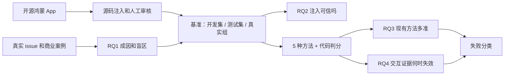
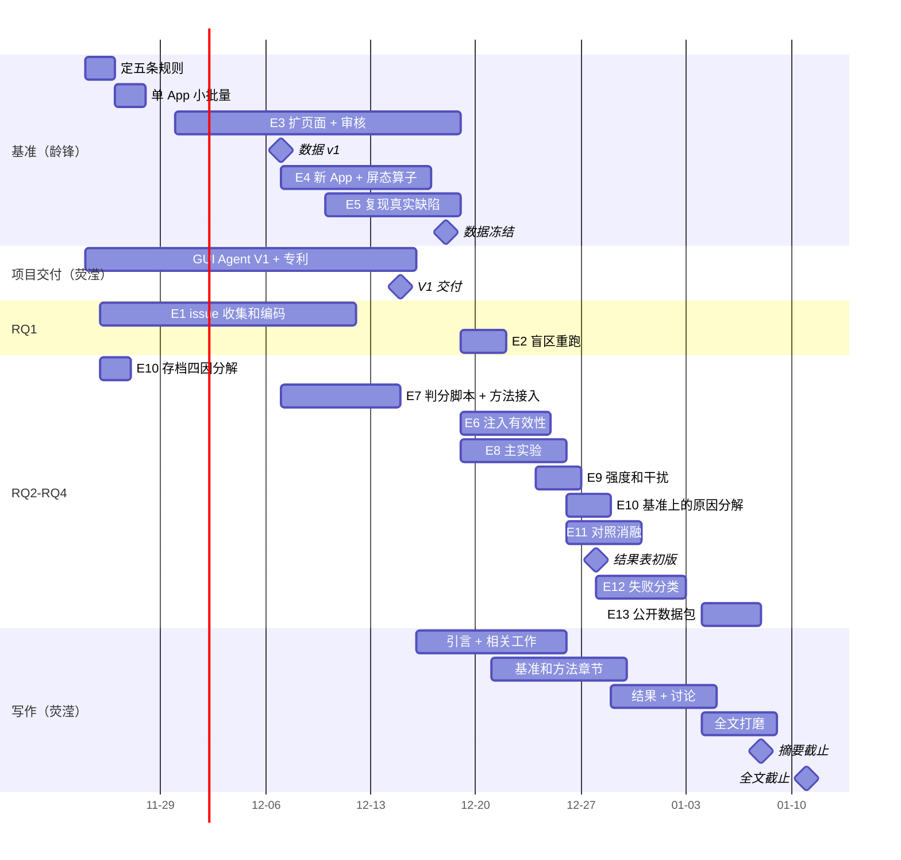

类型：核心 ｜ 归属：截断论文（投 ISSTA 2027：摘要 01-08，全文 01-11，正文 18 页） ｜ 状态：11-23 晚补全，荧滢改

> 这一页讲清楚我们在做什么、为什么做、学哪些论文、要做哪些实验、谁什么时候做完。论文正文草稿在 `论文初稿_v0.md`（v0.3），和这一页口径一致。

# 截断论文全貌

## 一、一页看懂

**一句话：** 交互式 GUI 检测默认「动作之后的画面」是可靠证据。我们做一套带标准答案、能真实交互的截断基准，量出这个假设什么时候不成立。

**暂定题目：** 画面没变，说明了什么？多形态应用截断检测的基准与实证研究

**一个例子。** 折叠屏上，横向列表最右边的卡片只露出一半。

- 如果往左滑能看全，这是正常设计。
- 如果父容器把它切了，用户怎么操作都看不到，这是缺陷。
- 检测工具分不清，于是去滑一下。滑完画面没变，它就判定「内容真的没了」。
- 可画面没变还可能是：手势没生效、滑到了外层容器、轮播松手后弹回原位。这些情况下内容其实拿得到。

**所以这篇论文的问题是：** 现有方法到底能不能分清真截断和正常设计？它们依赖的交互证据什么时候会骗人？

**我们做四件事：**

| # | 做什么 | 对应 |
|---|---|---|
| 1 | 研究真实截断：有哪些成因，布局树在哪些情况下判不了 | RQ1 |
| 2 | 构建基准：在开源鸿蒙 App 里注入真截断和难负例，并验证注入的缺陷像真实缺陷 | RQ2 |
| 3 | 系统评测：只看图、图加布局树、再加滑动，各能做到什么程度 | RQ3 |
| 4 | 找出失效条件：「滑了没变」分几种原因，加一个简单对照能改善多少 | RQ4 |

**论文类型：** 基准 + 实证研究。判分全部由代码完成，不用大模型当裁判。我们不主推新的检测智能体，自己的小方法只作为比较对象之一。

## 二、动机：为什么要做这件事

### 2.1 问题真实存在

鸿蒙主打一次开发、多端部署，同一个页面要在直板、双折、三折、平板上都显示正确。屏幕宽度一变，文字、按钮和列表就容易被切掉，靠人逐台设备检查成本很高。开源项目里也能看到开发者反复修这类问题，例如 LocalSend 的文件信息弹窗被长文件名撑破，react-native-image-viewing 旋转后仍用旧窗口尺寸，图片只显示一部分。

### 2.2 现有三层做法，每一层都有判不了的地方

| 做法 | 能做什么 | 它在哪里出错 | 我们手里的证据 |
|---|---|---|---|
| **只看截图** | 发现「看起来被切了」 | 分不清能滑出的正常露边 | 不滑动时报截断的 15 页里 6 页是误报；UI-Lens 200 张样本上召回率 53% |
| **加布局树** | 回答「谁切了谁」 | 组件自裁切不导出、自绘内容不在树里、省略号和裁切长得一样 | 开发存档 47 个真截断里 21 个落在判不了的类型；商业 App 23 个真截断里 15 个判不了 |
| **再加滑动** | 用交互找反证 | 默认「滑了没变 = 内容没了」 | 滑后「变了」的结论错 3/69（4%），「没变」的结论错 11/37（30%） |

<!-- 出处：D1-007/008、D1-014、D1-032、X-005、D1-022/024、X-009。这些是开发存档，正式结论要在基准上重新量。 -->

最后一行是这篇论文的出发点。**同样是滑动，「变了」基本可信，「没变」错得多得多。** 而目前的方法大多直接相信「没变」。GUI 智能体领域也观察到类似现象：一项对公开榜单失败轨迹的审计发现，真失败里最大的一类是「重复做没有变化的动作」，占 122 条中的 29.5%（预印本，该分类的标注一致性中等）。

### 2.3 别人做到哪，还缺什么

| 工作 | 已经做到 | 还没回答的 | 我们接着做什么 |
|---|---|---|---|
| **ReFLAIR**（FSE 2026） | 网页上滚动、展开，为疑似缺失找反证 | 作者自己写明轮播和滚动吸附会造成误判 | 量化这类误判的条件 |
| **VeriGUI**（arXiv 2026） | 智能体核对动作效果，把画面不变当作动作失败 | 不区分「真到边界」和「动作无效」 | 把「没变」拆成几种原因 |
| **UI-Lens**（CVPR 2026） | 专家标注的显示缺陷基准，含正常露边负例 | 样本是静态图片，不能交互恢复 | 提供可交互的样本 |
| **SUDFinder**（TSE 2026） | 从 308 条真实问题总结规律，检测设置变化引起的显示问题 | 面向 Android XML 布局 | 面向原生多屏态 |
| **DroidFixBench**（ISSTA 2026） | 真实 + 注入的可执行 Android UI 缺陷基准 | 任务是修复，不评测发现缺陷 | 任务改为判定，加成对难负例 |

**缺口：** 要回答「滑了没变到底说明什么」，样本需要同时满足四点：跑在真实应用里、可以交互、带源码级答案、同一位置有真缺陷和外观相近的负例。目前的公开基准没有同时做到这四点。这一判断来自我们已读的论文，投稿前还要再检索一遍。

## 三、预期贡献和预期发现

### 3.1 贡献

| # | 贡献 | 具体是什么 | 现在有什么 | 还缺什么 |
|---|---|---|---|---|
| C1 | 实证研究 | 原生多屏态截断的成因分类和布局树盲区 | 4 个上游案例；存档盲区统计 | ≥60 个真实 issue，开源数据上重跑 |
| C2 | 基准 | 成对、可执行、带源码答案的截断数据集，含真实组 | 注入工具已跑通 | 审核通过的样本 |
| C3 | 系统评测 | 统一数据、预算和代码判分，比较 5 种方法，量出交互证据失效的条件 | 存档上的方向性结果 | 全部实验 |
| C4 | 公开工件 | 数据、注入工具、判分脚本和原始结果 | 工具代码 | 匿名化打包 |

### 3.2 我们预期发现什么，不成立怎么办

顶会实证论文的价值在于结论能被数据推翻。下面每条预期都写了推翻条件，不成立就按实际结果改写。

| 预期发现 | 用什么检验 | 如果不成立 |
|---|---|---|
| F1 布局树的盲区可以归成少数几类，真截断集中在这些盲区 | E1、E2 | 改报盲区的实际分布 |
| F2 注入缺陷的难度和真实缺陷相关，但真实缺陷更难 | E6 | 差异很小，结论改为「注入组能较好代表真实组」 |
| F3 只看图在能滑出的样本上误报最多；加滑动能找回盲区，同时引入新的误判 | E8 | 如实报告哪一层真正有用 |
| F4 「没变」比「变了」更不可靠，错误集中在几种可识别的原因 | E10 | 存档现象未复现，主线改为 RQ2、RQ3 |
| F5 一个简单对照就能纠正其中一部分错误 | E11 | 说明这个问题需要更强的方法，留给后续工作 |

## 四、我们学哪些论文的哪一步

我们读的是 Testing-Survey 里已录用论文的笔记。软工会议审稿意见不公开，所以直接看录用论文实际做了什么。

| 论文 | 它是怎么做的 | 我们照着做什么 |
|---|---|---|
| **DroidFixBench**（ISSTA 2026，最接近） | 50 个真实缺陷 + 46 个源码注入缺陷；比较 5 个工具；两人给 379 个失败补丁分类；公开工件。没有提新方法，也没有报告新 bug | **整体结构。** 真实组 + 注入组 + 工具比较 + 失败分类 + 公开工件 |
| **UI-Lens**（CVPR 2026） | 用 35,308 次预测比较合成和真实样本，准确率 62.82% 对 61.81%，按类别相关系数 0.88；评测 9 个模型 | **E6 证明注入可信。** 同样比较两组成绩并算相关性 |
| **SUDFinder**（TSE 2026） | 先分析 308 条真实问题，归纳规律，再做检测 | **E1 真实 issue 研究** |
| **Are Web Agents Good Testers**（ISSTA 2025） | 3 个 Web 应用、113 条测试。提出更严格的 TruAcc：结论对了但停在错误步骤也不算对；对 26 个失败用例做质性分类 | **E12 判对但依据错。** 这正好对应我们的「没变」问题 |
| **ReFLAIR**（FSE 2026） | 用 Mailinator 一个具体页面开场；比较 5 工具 + 2 模型；分别去掉探索、只滚动、只展开做消融 | **开场写法和 E11 消融** |
| **WebTestPilot**（FSE 2026） | 正常和故障配对，走完流程但没正确报告不算检测成功 | **成对样本和判分规则** |
| **On the Reliability of Computer Use Agents**（预印本） | 同一题重复跑，同时报「跑 1 次成功」和「3 次都成功」：Claude 从 0.702 降到 0.612 | **E8 报稳定性。** 除平均成绩外，报 3 次都判对的比例 |
| **Statistical Precipice**（预印本） | 加一条不看屏幕的重放基线，在 OSWorld 上拿到 71.1%，源模型是 70.6%，说明榜单分不等于视觉决策能力 | **E8 加简单基线。** 不看画面也能得高分，就说明数据集有泄漏 |
| **CUA-Recovery**（预印本） | 把「说出有错」和「任务做完」分开报：认出错误的回合通过 15.6%，没认出的 12.2% | **E11 分开报。** 「发现手势无效」和「最终判对」是两个数 |
| **Who Verifies the Agent's Success Claim?**（预印本） | 同一裁判只增删智能体的完成声明，判定翻转 79 比 1，说明自述会把裁判带偏 | **E12 看日志。** 依据是否正确由运行日志判断，不看模型自己的解释 |

**ISSTA 2027 的硬要求：** 按重要性、原创性、严谨性、可验证性、表达五项审；两位审稿人都负面就早拒，所以前两页要讲清反例和结论；研究中使用 AI 要详细说明；发现虚假引用直接拒稿。

**审稿人最常见的拒稿理由**（120 位审稿人的调查）依次是方法严谨性、贡献或动机不清、新颖性不足、构念效度。对我们来说，最危险的两个问题是「注入缺陷真实吗」和「数据集是不是为自己的方法定制的」，E6 和测试集划分就是回答这两点的。

## 五、一共要做的实验

**被比较的 5 种方法：**

| 方法 | 用什么证据 | 作用 |
|---|---|---|
| M1 截图模型 | 截图 | 只看图的基线 |
| M2 截图 + 布局树模型 | 截图、布局树 | 加结构信息 |
| M3 UX-Agent 最新版 | 截图、布局树、滑动 | 现有检测流程 |
| M4 滑动并相信结果 | 同上 | 复现「没变就判缺失」的策略（ReFLAIR 式） |
| M5 最小对照方法 | 同上，加对照 | 检验失效原因能否被简单修正 |

布局树规则作为不用模型的参照线单独报告。所有模型方法用同一模型（GPT 5.6 以上）、同一批样本、同一预算，重复 3 次，同时报平均成绩和「3 次都判对」的比例。

**另加三条简单基线：** 永远判正常、永远判截断、不看截图内容（只用组件类型和位置猜）。前两条给出分数下限。第三条用来查数据泄漏：如果它的成绩接近模型，说明数据集本身有规律可钻，要先修数据。

**全部实验：**

| 编号 | 实验 | 回答 | 怎么做 | 产出（论文表） | 学谁 | 负责 | 完成 |
|---|---|---|---|---|---|---|---|
| **E1** | 真实 issue 研究 | RQ1 | AI 初筛 ≥60 个带修复提交的 issue，两人独立编码触发条件、根因、修复方式，报一致率 | 表 5 成因分类 | SUDFinder | 荧滢主，龄锋第二编码 | 12-11 |
| **E2** | 布局树盲区重跑 | RQ1 | 判据冻结后，在开源数据上重新统计盲区 | 表 6 盲区 | — | 荧滢 | 12-21 |
| **E3** | 注入和审核 | 基准 | 五条规则定好后批量注入，记录五步漏斗，荧滢抽查 20% | 表 3 数据集 | DroidFixBench | 龄锋主 | 12-18 |
| **E4** | 新增 App 和屏态算子 | 基准 | 新增 ≥3 款只作测试集；屏态算子移植到 2～3 款 App | 表 3 | — | 龄锋 | 12-16 |
| **E5** | 复现真实缺陷 | 基准、RQ2 | 从 E1 里挑 ≥15 个，在鸿蒙上跑起来 | 真实组 | DroidFixBench | 龄锋 | 12-18 |
| **E6** | 注入有效性 | RQ2 | ①算子和真实缺陷的截图、布局树配对；②比较缺陷分布；③比较同一方法两组成绩并算相关 | 表 7 | UI-Lens | 荧滢 + 龄锋 | 12-24 |
| **E7** | 判分脚本和方法接入 | 全部 | 按「目标 + 被切方向」判分；接入 M1～M5 和三条简单基线；**每次动作记录前后的容器偏移和方法日志** | — | WebTestPilot | 龄锋 | 12-14 |
| **E8** | 主实验 | RQ3 | M1～M5 和简单基线跑全量，按缺陷类型、屏态、App 拆开，报 3 次都判对的比例，记录耗时和调用次数 | 表 8 | UI-Lens、ReFLAIR、Reliability、Precipice | 龄锋跑，荧滢看结果 | 12-25 |
| **E9** | 强度和干扰 | RQ3 | 一款 App 做轻中重三档；单缺陷页和多缺陷页分开统计 | 表 8 补充 | — | 龄锋 | 12-26 |
| **E10** | 「没变」原因分解 | RQ4 | 先拆存档里 37 次「没变」，再在基准上统计内容到头、手势无效、外层接走、候选变化四类 | 表 10 | ReFLAIR 的失败分析 | 荧滢 + AI | 存档 11-26，基准 12-28 |
| **E11** | 对照消融 | RQ4 | M4 → 加参照物和锚点 → 加反向手势，看错误率变化；**分开报「发现手势无效」和「最终判对」** | 表 11 | ReFLAIR 消融、CUA-Recovery | 荧滢实现，龄锋跑 | 12-30 |
| **E12** | 失败分类 + 依据正确率 | RQ3、RQ4 | 两人独立给失败样本分类；另算「结论对且依据也对」的比例，**依据由运行日志判断，不看模型自述** | 失败分类图 | DroidFixBench、Web Agents、Self-Report | 两人 | 01-02 |
| **E13** | 公开数据包 | C4 | 匿名化，确认每款 App 的许可证，打包 | 数据可用性 | — | 龄锋 | 01-07 |
| E14 | 真实新问题（加分） | RQ5 | 原样安装到折叠屏，提交确认过的问题 | 表 12 | — | 有余力再做 | — |

## 六、数据集要做成什么样

| 组成 | 投稿目标 | 现状 | 负责 |
|---|---|---|---|
| 注入正例（真截断） | ≥100 个，每种机制 ≥5 个 | 25 组修改待审核，通过数 0 | 龄锋 |
| 负例（能滑出、只裁空白、合法省略） | ≥100 个，尽量同位置配对 | 待审核 | 龄锋 |
| App 和页面 | ≥8 款、≥60 页。现有 5 款作开发集，新增 ≥3 款只作测试集 | 5 款，11 页 | 龄锋 |
| 屏幕形态 | ≥3 种 | 待确认 | 龄锋 |
| 真实 issue | ≥60 个，带修复提交 | 4 个 | 荧滢 + AI |
| 可复现真实缺陷 | ≥15 个 | 0 | 龄锋 |

**这个规模从哪来：** DroidFixBench 是 50 真实 + 46 注入，Are Web Agents 是 113 条用例，所以约 200 条注入样本加真实组，在同类论文里够用。DroidFixBench 从 30 个候选 issue 筛出 13 个能用，通过率约四成，所以 60 个 issue 复现 15 个留了余量。

## 七、龄锋的工作：重点在哪

### 7.1 他的工具做什么

拿一个能编译的开源鸿蒙 App，自动改源码，造出带标准答案的显示缺陷。

1. 配好 App 和「怎么走到某页」的操作路径。
2. 给组件加追踪 ID，让源码和运行时的布局树能一一对上。
3. 对每个组件，试哪些**算子**能用。算子是一种固定的造缺陷手法，比如把文字高度改矮再开启裁切。
4. 自动算参数，比如切掉多少。
5. 在一页上挑几个互不干扰的缺陷，打成安装包。
6. 装到设备上，保存修改前后的截图和布局树。
7. 人工检查，去掉没造成功的，重新打包。

**19 个算子分五类：**

| 类别 | 个数 | 例子 | 在数据集里的角色 |
|---|---:|---|---|
| 真截断 | 9 | 限宽、限高、父容器裁切、平移出界、贴屏幕边 | 正例，可直接批量 |
| 屏态相关截断 | 3 | 切屏后还用旧宽度 | 正例，还要移植到真实 App。这是折叠屏场景的特色 |
| 省略号 | 2 | 限宽或限行后显示「…」 | 按设计判断，可能是合法省略 |
| 难负例 | 2 | 能滑出来、只裁空白 | 看着像截断，其实没问题 |
| 遮挡 | 3 | 被别的组件盖住 | 不在本文范围 |

### 7.2 为什么他的工作最关键

基准是这篇论文的主体，RQ2、RQ3、RQ4 都要等它，它晚一周，后面全部晚一周。工具已经够用，**接下来的价值在于产出审核通过的样本。**

合作方的代码不用等。荧滢会在周例会上要，拿到了就用来加强 RQ1，拿不到也不影响主线。同类论文里，DroidFixBench 也是靠「真实组 + 注入组」的对比来支撑注入的可信度。

| 排序 | 工作 | 为什么重要 | 对应实验 |
|---|---|---|---|
| 1 | 把样本做可信：规则、审核、漏斗 | 样本不可信，后面所有实验都作废 | E3 |
| 2 | 负例做扎实，尤其是能滑出和手势失败 | 这是我们和其他数据集最大的区别，也是 RQ4 的原料 | E3、E10 |
| 3 | 新增 App 作测试集 | 回应「数据集是为自己定制的」 | E4 |
| 4 | 复现真实 issue | 让「真实 vs 注入」的对比成立 | E5、E6 |
| 5 | 判分脚本和方法接入 | 所有结果都从这里出 | E7、E8 |
| 6 | 屏态算子移植 | 折叠屏特色 | E4 |

### 7.3 批量前要定的五条

这几条批量后再改，样本就要全部重做。

| # | 要定什么 | 为什么 | 建议 |
|---|---|---|---|
| 1 | 去掉注入痕迹 | 组件 ID 带 `truncator_`，检测方法读布局树时可能直接认出改动位置 | 导出时正常版和缺陷版统一换成中性 ID。部分到页检查依赖这些 ID，要一起改 |
| 2 | 五类标签 | 每个目标要有唯一答案 | 真截断、能滑出、只裁空白、合法省略、证据不足。**滑动没成功的样本标证据不足**，留给 RQ4 |
| 3 | 开发集和测试集 | 算子是看着现有 App 设计的，用它们测试会高估效果 | 按 App 划分，算子冻结后才跑测试集 |
| 4 | 审核方式 | 论文要人工标准答案，AI 目视不算 | 龄锋全审，荧滢独立抽查 20%，报告一致率 |
| 5 | 判分脚本 | 不用大模型当裁判 | 按「目标 + 被切方向」判对错，所有方法共用 |

### 7.4 他汇报里的六个讨论点

| 问题 | 现在的设定 | 建议 | 理由 |
|---|---|---|---|
| **算子有没有现实依据** | 部分有商业对应，有一例（布局树里找不到该组件）对应不上 | 不要求每个都有。列一张「算子 ↔ 真实案例」表，对不上的如实写 | 用来设计算子的案例不能再当证明，要留一批他没看过的真实案例 |
| **一页放几个缺陷** | 每 App 12 组，每页 3 组，面积 ≤30% | 不改。结果按单缺陷页和多缺陷页分开报告（E9） | 这样能回答「缺陷之间会不会互相干扰」 |
| **切多狠** | 边缘切入 20%，宽度保留 65%，分数阈值 80% | 主数据集固定这组值。另取一个 App 做轻、中、重三档（15%、20%、30%） | 不找最优参数，避免为结果调参。三档还能得出「多轻的缺陷开始查不出来」 |
| **复杂布局先支持哪类** | layoutWeight、动态数据、百分比等直接拒绝 | 继续拒绝，统计被拒原因，只扩展占比最高的一类 | 扩展算子会拖慢批量 |
| **审核成本和统计** | 工具已有 | 按五步记漏斗：构建成功、到达页面、内容确实变了、恢复证据、审核接受 | 论文要报，也能预估还要多久 |
| **接下来先补什么** | 屏态算子只在专项工程 | 先移植到 2～3 款真实 App，复杂背景暂时拒绝 | 屏态变化是这篇的特色 |

**写算子来源时的规矩：** 可以写「算子生成的截图和布局树与真实缺陷相似」，并给出配对证据。不写「算子来自合作方源码」，因为我们没有看过这些源码。

### 7.5 今晚要问他

1. UX-Agent 用的哪个版本？他的报告写的是 `565033c`，之后要换最新版，模型换 GPT 5.6 以上。之前的试跑结果不再引用。
2. 从候选到审核通过的比例大概多少？
3. 还能找到几款能编译的开源鸿蒙 App？
4. 到 01-08 每周能投入几天？期末考试是什么时候？
5. 能不能提供 10 个 V1 测试 case？用开发集 App，尽量不占批量时间。
6. 论文的分工和署名怎么定？

### 7.6 他这周的交付

| 日期 | 交付 | 怎么算完成 |
|---|---|---|
| 11-25 | 五条规则落地 | 导出的布局树里搜不到 `truncator_`；标签字段含五类 |
| 11-27 | 一个 App 走完小批量 | 给出漏斗每一步的通过数 |
| 11-27 | 新 App 候选 | 列出 5 款以上，标明能否编译 |
| 12-07 | 数据 v1 | `dataset-audit` 显示约 100 个审核通过的目标，覆盖约 30 页 |

## 八、排期

以 01-08 摘要、01-11 全文倒排。11-24 到 01-08 共 33 个工作日。

### 8.1 每周安排

| 周 | 龄锋 | 荧滢 | 周末应看到 |
|---|---|---|---|
| **11-24～11-29** | 五条规则；单 App 小批量；列新 App 候选 | V1 框架和跑通路径；周例会要源码和 5 个子工具用法；周四催 Vlink 权限；派 AI 收 issue；E10 存档四因分解 | 漏斗数据，知道通过率 |
| **11-30～12-06** | 扩页面，审核 | V1 寻路稳定；抽查第一批样本 | 约 100 个审核通过的目标 |
| **12-07～12-13** | 新 App；屏态算子；判分脚本和方法接入 | V1 接 7 类检测（截断、开合接现有能力，其余先用 Prompt）；跑 10 个 case；裁定 issue 分类 | 判分脚本可用，issue ≥60 |
| **12-14～12-20** | 复现真实缺陷；**12-18 数据冻结** | **12-15 交 V1、测试工具代码和 2 篇专利申请**；开始写引言；实现最小对照方法 | 数据集定稿 |
| **12-21～12-27** | 跑 E6、E8、E9 | 写基准和方法章节；看结果，做盲区重跑 | RQ2、RQ3 出数 |
| **12-28～01-03** | 跑 E10、E11，补实验 | 失败分类（和龄锋各标一遍）；写结果 | 全部结果表 |
| **01-04～01-08** | 公开数据包、匿名化 | 全文打磨，逐条核对引用；**01-08 交摘要** | 可投稿版本 |
| **01-09～01-11** | 检查数据包 | 最后校对；**01-11 交全文** | 投出 |

### 8.2 工作量

| 实验 / 工作 | 荧滢（人天） | 龄锋（人天） |
|---|---:|---:|
| E1 真实 issue 研究 | 2 | 1 |
| E2 盲区重跑 | 0.5 | 0 |
| E3 注入和审核 | 1 | 10 |
| E4 新 App 和屏态算子 | 0 | 4 |
| E5 复现真实缺陷 | 0 | 3 |
| E6 注入有效性 | 1 | 1 |
| E7 判分、方法接入和日志字段 | 0.5 | 3 |
| E8 主实验和简单基线 | 0.5 | 2 |
| E9 强度和干扰 | 0 | 0.5 |
| E10 原因分解 | 0.5 | 0.5 |
| E11 对照消融 | 1 | 0.5 |
| E12 失败分类 | 1.5 | 1 |
| E13 公开数据包 | 0.5 | 1.5 |
| 写作 | 8 | 0 |
| **论文合计** | **17** | **28** |
| 项目 V1 + 专利（不算论文） | 9 | 待确认 |

33 个工作日里，荧滢的论文和 V1 共 26 天，只剩约 7 天给其他工作；龄锋 28 天，相当于每周 4 天多。**时间不够时按这个顺序砍：** ① E14 不做；② E9 只做单缺陷和多缺陷；③ 屏态算子只移植到 1 款 App；④ 可复现真实缺陷从 15 个降到 8 个，其余只进成因研究。

### 8.3 两个检查点

- **12-07：** 审核通过的目标不到 50 个，就按上面的顺序砍，优先保住主数据集。
- **12-28：** RQ3、RQ4 的主表还没出来，就改投 ASE 2027（全文 03-10，正文 10 页）。同一篇不能同时投两个会。

## 九、其他方向和待定事项

**和其他方向的关系：**

- **开合：** 不进这篇。屏态变化引起的截断由屏态算子覆盖。
- **探索（SE2）：** 暂不单独成文。赛道拥挤，「UX 问题集中在某些状态」的前提没有成立，它也依赖判定器先做准。投稿后可用一天离线统计再决定。
- **第二篇（截断智能体）：** 方向待定，不占这篇的篇幅。

| 事项 | 状态 |
|---|---|
| 投稿目标 | **已定：ISSTA 2027** |
| 论文类型 | **已定：** 基准 + 实证，代码判分 |
| 分工和署名 | **待今晚定** |
| 和第二篇的边界 | 第二篇方向另开窗口定。这篇先完整写 RQ4（失效条件 + 对照消融），等第二篇定了再核对有没有重叠 |
| 商业案例和 179 框统计能否进论文 | 待确认，确认前匿名 |
| 遮挡是否算截断 | 暂按排除写 |
| 能否写「第一」 | 等相关工作核完 |
| 标题和工具名 | 实验结果出来后定 |
