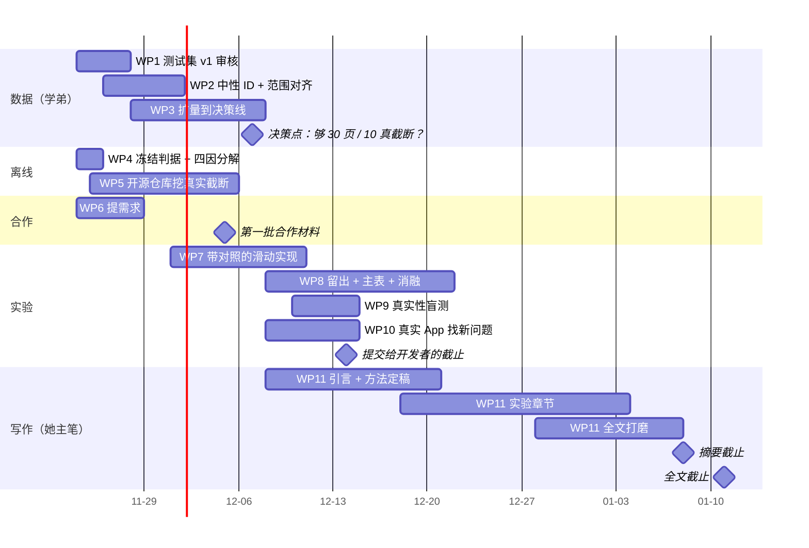

类型：核心 ｜ 归属：截断论文（计划投 ISSTA 2027，摘要 01-08、全文 01-11） ｜ 状态：初稿，她改

> **看哪个文件：** 论文相关的一切只看本页（故事、贡献、进展、排期、优先级、今晚和学弟对的事）。下午汇报只看 `reports/2026-11-23_学长汇报_讲稿版.md`（完整讲述和追问表都在里面，用 Markdown 预览共享）。台账新增行在 `numbers_新增行_待确认.csv`，确认后并进 `numbers.csv` 就删掉。写文档的规矩在 `写作偏好.md`。论文正文草稿（中文 v0.2）在 `论文初稿_v0.md`。不再另开文件，有新内容就往本页对应节里加。

# 我们这篇论文长什么样

## 一、一句话

> 同一个页面在折叠屏、平板上「看起来被切了一块」，可能是真缺陷，也可能是正常设计（还能滑出来、轮播露一半、省略号）。只看截图分不清；加布局树也有一批判不了；去滑一下，「滑了没变」也可能是手势没生效，不一定是真没东西。我们给出一套**先确认证据可信、再下结论**的截断判定方法，并在开源鸿蒙 App 里注入了带标准答案的截断来检验它。

## 二、同类论文怎么讲故事，我们照着怎么讲

Testing-Survey 的精读表里每篇都写了「论文叙事」。离我们最近的六篇，故事骨架几乎一样：

| 论文 | 表象和真实哪里不一致 | 补了哪种证据 | 用什么让人信 |
|---|---|---|---|
| ReFLAIR（FSE 2026，网页） | 窄屏看不见的内容，可能只是折叠或移到屏外，也可能真丢了 | 对候选滚动、展开后重新核对 | 24 页 P/R + 去掉探索的消融 |
| UI-Lens（CVPR 2026） | 细微溢出和正常边缘裁切长得像，通用识别能力不够 | 专家规则 + 真实与合成截图 | 9 个模型分类结果 + 错误分析 |
| SUDFinder（TSE 2026，安卓） | 改系统设置后正常页面出现裁切、错位 | 注入测试页面直接渲染，比较设置前后的空间关系 | 新应用里的真问题，开发者确认和修复 |
| DroidFixBench（ISSTA 2026） | 「测试通过」不等于修对了 | 真实缺陷 + 源码变异，配 GUI 测试 | 真实集比合成集难，失败分类 |
| EP-Detector（ICSE 2025） | 标准点击正常，偏一点、连点就出问题 | 恢复同一起点，做对比动作 | 真实应用里人工确认的风险 |
| TouchAlign（FSE Industry 2026） | 看起来能点的区域和真正响应的区域不一致 | 方向性点按，重建真实点击边界 | 注入实验 P/R + 工业确认缺陷 |

共同的三步：**① 指出「看起来」和「实际」不一致，配一个具体例子；② 主动补一种对照证据；③ 用注入集上的准确率、消融、真实 App 上被确认的缺陷三样东西证明。**

我们照这个骨架讲，同时多走一步：**别人默认「补来的对照证据是可信的」，我们量出来在原生鸿蒙上它并不总是可信**（结构树有盲区、滑了没变不等于没东西），所以要先验证证据本身。这一步就是我们和 ReFLAIR、SUDFinder 拉开距离的地方。

讲给外行时按这个顺序：

1. **场景。** 鸿蒙一次开发、多端部署，同一页面要在直板、双折、三折、平板上都显示正确。屏宽一变，文字、按钮就容易被截断，人工逐台设备检查成本很高。
2. **看起来和实际不一致。** 横向列表最右一格露一半，看上去像被切了，其实往左一滑就全了。只看图会把这类报成缺陷：端到端 50 页里，不滑动时报截断的 15 页有 6 页是误报（D1-007/008）；外部基准上只看截图 recall 53%（D1-014）。
3. **现有的补救和它的盲点。** 加结构树、主动滚动找反证，网页上已经有人做了。但在原生鸿蒙上：结构树能判的部分没有判错，但商业 App 真截断 23 个里 15 个落在它判不了的情况里（X-005）；滑后「变了」错 3/69，「没变」错 11/37（D1-022/024）。
4. **方法。** 截断定义为「内容能不能被用户拿到」；结构树能判的直接判，判不了的才交互；交互前先确认动作作用到了目标容器，没生效就报「证据不足」。
5. **证明。** 开源鸿蒙 App 里成对注入真截断和难负例（自带源码位置和答案），再看商业 App 上的真实截断。

## 三、贡献（暂定）

| # | 贡献 | 现在有什么证据 | 等级 | 还缺什么 |
|---|---|---|---|---|
| C1a | 发现：否定证据（滑了没变）没有对照不可用 | 4% vs 30%（D1-022~025）；滑错 14 个里 12 个本可不滑（X-010） | 存档重判，n 小 | 四因分解；注入集上用新规则重跑 |
| C1b | 发现：结构树盲区可枚举，真截断集中在盲区 | 103/103（D1-028）；商业 15/23 在盲区（X-005）；盲区分机制（X-012） | 存档重判，判据调过 | 冻结判据后在新数据上留出 |
| C2 | 方法：恒定关系 + 盲区交给交互 + 先确认动作生效 | 方法草稿；事后上限 56 框、误报 2、漏报 0、证据不足 17（X-011） | 存档上的事后上限 | 实现新复核规则，做消融 |
| C3 | 数据集：开源鸿蒙 App 白盒注入，真缺陷与难负例成对 | 注入工具跑通 5 款应用、19 条算子（X-014/015）；5 个组合包 25 组修改（X-016） | 工具已有，样本未审核 | 审核通过的测试集、中性 ID、真缺陷与难负例的配对统计（学弟） |

## 四、研究问题

| RQ | 问题 | 主表 |
|---|---|---|
| RQ1 | 截断在真实 App 里分哪几类、成因是什么 | 商业真截断（6 页 7 屏态，X-013）+ 注入集成因分布 |
| RQ2 | 只看截图 / 加结构树 / 加交互复核，各判得多准 | 三档 + 外部基线 × 真截断、能滑出、合法省略三类的查全与误报 |
| RQ3 | 「先确认动作生效」有多大用 | 去掉它后，按「没变」的四种原因分组看误判 |
| RQ4 | 代价 | 每页耗时、滑动次数、复位成功率、证据不足比例 |
| RQ5 | 在真实 App 上能不能找到新问题 | **现在完全空白。** 上面六篇都报了真实 App 上被确认的缺陷，我们一个都没有。骨架 P6（开源 App 原样装到折叠屏找自然截断）要排进来 |

## 五、相关工作：别人做到哪、我们不能再说什么

| 工作 | 已经做到 | 我们不能再声称 |
|---|---|---|
| ReFLAIR | 网页上对疑似缺失项滚动、展开找反证，论文报告去掉探索后 precision 变化 −40.08%（表 4 未写明是百分点还是相对变化；D1-036 待核） | 「从静态判到主动复核」是新意 |
| SUDFinder | 安卓上改设置前后比较组件关系，含主动滚动 | 「设置 / 屏幕变化导致裁切」的检测是空白 |
| UI-Lens | 多模态模型显示质量基准，含折叠屏 | 「大模型看图判不准」是我们发现的 |
| DroidFixBench | 安卓源码变异造 UI 缺陷 | 「源码注入造缺陷」是新做法；我们的差别在成对难负例和多屏态 |
| OwlEye、Nighthawk | 截图上检测显示问题 | 只看图的基线 |

## 五点五、这篇够不够：动机、必要性、创新

| 维度 | 判断 | 理由 | 怎么补强 |
|---|---|---|---|
| 必要性 | 够讲 | 多端部署的实际需求；只看图误报 6/15、只看截图 recall 53% 都是真值；合作方也在要 | 再加开源项目里有修复记录的真实截断，说明开发者真的会犯 |
| 动机（现有方法为什么不行） | 方向对，证据薄 | 两条发现都只在开发存档上，「没变」错的分子只有 11，盲区的商业真截断 14/15 来自两个 App | 冻结判据后在注入集上留出；四因分解 |
| 创新 | **目前最弱** | ReFLAIR、SUDFinder 已有主动滚动和设置变化裁切。我们能站住的是「对照证据本身会失效，要先验证」这一点，加原生多屏态的成对数据集。前者要在消融里量出明显差距才算数 | RQ3 消融必须做出来；如果差距小，定位改成「数据集 + 实证研究」（这在 ISSTA 也是常见类型） |
| 真实发现 | 空白 | 同类论文都报了真实 App 上被确认的缺陷 | RQ5：开源 App 装折叠屏找自然截断；开源仓库挖历史截断 issue |

结论：必要性够，动机方向成立；创新取决于 RQ3 能不能做出差距，做不出来就退到「数据集 + 实证」。正文草稿在 `论文初稿_v0.md`，实验结果部分要等 RQ2/RQ3 的数。

## 六、和开合、和其他方向的关系

**开合不进这篇，也不进汇报主线。** 我同意学长的判断，但理由要说清楚：两者确实都和屏态变化有关，可判定对象不同。截断判的是「同一个屏态里，内容能不能拿到」，靠滑动找反证；开合判的是「切屏前后，内容和状态有没有保住」，两张图对比就够，难点在口径。硬放进一篇，审稿人会问「两种缺陷为什么共用一个方法」，而我们答不上来。

但「屏态变化」本身不用丢：学弟的算子里有「视口宽度不匹配、固定宽视口、首次宽度缓存」三条，对应「切屏态后还用旧窗口尺寸」导致的截断，上游也有真实修复记录（RN 图片旋转后只显示一部分）。所以这篇的多屏态背景讲的是**屏态变化引起的截断**，不需要做开合检测就能接住「折叠屏」这个卖点。

开合更自然的去处是 AI1（DefectGym）：「弹层折叠后没了」「筛选按钮丢了」本质上是状态丢失，属于功能缺陷，正好补 AI1 里「功能缺陷在真机上没有注入来源」那个缺口。合作群要的开合案例按横向交付给，讲稿里留作备用页。

**其他方向**（`papers/README.md`，三篇共用「可执行环境 + 能自动核验的判定器 + 智能体」）：

| 方向 | 一句话 | 现在 |
|---|---|---|
| SE1 截断 oracle（本页） | 先确认证据可信再判截断 | 主攻 |
| SE2 以 UX 问题为目标的探索 | 同样预算下更快走到会出 UX 问题的页面状态 | 10-30 降为低优先级；页面同一性那条天花板（H3）是它的动机证据 |
| AI1 DefectGym | 可重置复刻 App 里程序化注入视觉和功能缺陷，做「发现缺陷」的 benchmark（投 NeurIPS D&B，可以不训练） | 只有方案，没动工；学弟的注入算子可以直接复用到这里 |
| 收敛候选：结构树和画面对不上 | 截断、开合、CUA 的 AX 问题本质相同；AI 篇把「要不要花一次视觉核验」做成有代价的决策 | 前提未验证；和 CUA 线相通 |

这篇的 C1b（盲区）和 C3（注入算子）可以原样喂给 AI1，所以截断这篇做扎实，AI 那篇也有底子。

## 七、进展（挂在上面的结构上看）

| 论文部分 | 状态 | 本周新得到的 |
|---|---|---|
| C1a 否定证据 | 有存档证据 | 滑错 14 个里 12 个落在本可不滑的区域（X-010，先导） |
| C1b 盲区 | 有存档证据，本周拆开更清楚 | 判截断 26 个里 18 个来自构造样例 App（X-004）；商业真截断 15/23 在盲区，集中在 12306、滴滴（X-005）；179 框真值不是逐框人工（X-008）；9 月批 24/24 最接近留出但不是（X-007，先导） |
| C2 方法实现 | 未开始 | — |
| C3 数据集 | **流水线已跑通，缺审核通过的样本** | 5 款开源应用（X-014）、19 条算子 / 16 条属截断（X-015）、5 个组合包 25 组源码修改（X-016）；审核、按组剔除后重建、跨批统计（dataset-audit）都有；**审核通过的样本数快照里没有**；原 UX-Agent 用替代模型试跑 28 目标 TP1/FP3/FN6（X-017） |
| RQ1 真实截断 | 有底数 | 商业真截断盘点 6 页 7 屏态（X-013） |
| RQ2–RQ5 | 未开始 | 全部依赖 C3；RQ5 还没排 |
| 相关工作 | 材料齐 | Testing-Survey 逐篇笔记 |
| 写作 | v0 进行中 | `论文初稿_v0.md`；实验节是空表 + 预期 |

开合这周（横向交付，不算论文进展）：849 组复算为 13 个前缀、789 组已判（X-001/002）；120 组盲审页做好，人还没标（D2-051）。

## 八、优先级与排期（到 01-11）

| 优先 | 做什么 | 回答什么 | 放弃 / 降级条件 |
|---|---|---|---|
| P0 | 注入样本审核通过 + 中性 ID 导出（学弟） | C3，以及所有实验的前提 | 12-07 不到 30 页或 10 个真截断 → 改成「实证研究 + 案例」，或转 ASE 2027 |
| P0 | 「没变」37 次四因分解（离线） | C1a 的机制 | 原始滑动截图找不到 |
| P0 | 冻结判据（记下 `invariant_rejudge.mts` 版本） | 让之后的留出是真留出 | — |
| P1 | 冻结判据在注入集上留出 | C1b | 同 P0 |
| P1 | 新复核规则（同视口阳性对照）vs 旧规则 | C1a 可被推翻的预测 + C2 | 收益不明显 → 定位改成「数据集 + 实证」 |
| P2 | RQ2 主表 + RQ3 消融；真实性盲测 | 主实验 | 盲测不过 → 按真实成因改算子 |
| P1 | 开源仓库挖真实截断：鸿蒙应用（Gitee / GitCode 上的 OpenHarmony 应用为主，GitHub 上 ArkTS 项目少）+ Flutter / 安卓应用里的平板、折叠屏、横屏显示不全 issue，要求有修复提交 | 必要性 + RQ1 真实成因 + 检验算子覆盖了多少真实成因 | GitHub 关键词搜索噪声大（11-23 试过），要按「issue 关键词 + 有关联修复提交」过滤；离线可做，不占真机 |
| P2 | RQ5：开源 App 原样装折叠屏找自然截断 | 真实发现 | 找不到就如实报 |
| P3 | 页面同一性第 2 个 App（mock，离线） | SE2 的动机，不进这篇 | — |

**工作量（人天，估算，等她和学弟按实际改）：**

| WP | 交付物 | 验收 | 她 | 学弟 | 截止 | 依赖 |
|---|---|---|---:|---:|---|---|
| 1 | 测试集 v1 | `dataset-audit` 给出按算子 × 正例 / 难负例 × 应用的已审核数 | 1 | 3 | 11-27 | — |
| 2 | 中性 ID 导出 + 遮挡范围 | 正常和变异的树里没有注入痕迹 | 0 | 2 | 12-01 | 1 |
| 3 | 测试集扩量 | ≥30 页、≥10 真截断 | 1 | 5 | 12-07 | 1 |
| 4 | 冻结判据 + 四因分解 | 判据版本已记录；37 次「没变」归因表 | 0.5 | 0 | 11-25 | 原始截图 |
| 5 | 真实截断清单 | 有 issue + 修复提交的案例表，标出对应算子 | 1 | 0 | 12-05 | — |
| 6 | 合作需求 | 对接人和可提供范围明确 | 1 | 0 | 11-28 | 学长 |
| 7 | 带对照的滑动 | 真机跑通，新旧规则可切换 | 3 | 0 | 12-10 | 4 |
| 8 | 留出 + 主表 + 消融 | RQ2/RQ3/RQ4 的表填完 | 3 | 3 | 12-21 | 2、3、7 |
| 9 | 真实性盲测 | 2 人盲判结果 | 0.5 | 1 | 12-14 | 3 |
| 10 | 真实 App 新问题 | 问题清单；12-14 前提交，才来得及等回复 | 2 | 3 | 12-21 | 7 |
| 11 | 论文全文 | 可投稿版本 | 12 | 0 | 01-07 | 8 |
| — | 开合 120 组盲审（横向，不算论文） | 标完入库 | 1.5 | 0 | 按交付 | — |
| | **合计** | | **26.5** | **17** | | |

11-24 到 01-07 去掉周末和元旦约 32 个工作日。**她需要每周约 4 天投在这件事上；学弟的 17 天集中在 12-21 前，也是每周约 4 天。** 两人都还有交付和其他工作，如果实际只有每周 3 天，就差约 7 天，按这个顺序砍：① WP10 只复现历史 issue，不做新发现；② WP9 盲测缩小；③ 写作多交给 AI 起草；④ 开合盲审推到投稿后。

**怎么迭代：** 每周走一圈：实验卡 → 结果 → 改 `CLAIMS.md` 对应主张 → 改本页第三、七节 → 能进论文的段落直接写进草稿。离线能做的不等真机。

## 九、今晚和学弟对进度

（已按 harmony-truncator 快照 b793957 改写。）他做得比任务单扎实：生成器、审核重建、统计、UX-Agent 试跑都有。今晚不用再催「注入首批」，要的是把生成器的产出变成**论文能用的测试集**。先问两个状态：阔折 / 三折自测跑了没、开合标签交了没。

| # | 做什么 | 交付物 + 验收 | 日期 | 为什么 |
|---|---|---|---|---|
| 1 | 审核通过的第一版测试集 | 跑一次 `dataset-audit`，给出按「算子 × 正例 / 难负例 × 应用」的已审核样本数；目标是够 30 页、10 个以上真截断（12-07 决策线） | 11-27 | 快照里没有审核通过的数，这是所有实验的前提 |
| 2 | 中性 ID 导出 + 范围对齐 | 实现他自己报告 §7 写的「正常与变异一致的中性 ID」导出，去掉 `truncator_` 前缀和只在正例出现的包装结构；同时定遮挡（被兄弟组件盖住）进不进截断范围 | 12-01 前 | 不去掉的话，读布局树的判据可能靠注入痕迹「作弊」，留出就不干净；遮挡占我们盲区真截断的 6 个，排除了 C1b 会少一块 |
| 3 | 给我一份可离线跑的导出 | 已审核样本的截图、布局树、真值标签打包（不要 HAP），放进 Research-Notes 或给下载地址 | 11-28 | 有了它，冻结判据的留出重判、UX-Agent 基线复算我这边离线就能做，不占他时间和真机 |

顺带问他：UX-Agent 那次试跑用的是 qwen3.8-flash，能不能用交付时的模型在同一批 28 个目标上再跑一次（RQ2 的第一个数）。

不给他：26 张任务卡、开合 120 组盲审（都是她自己做）。

## 十、汇报追问准备

追问表统一放在汇报文档第 7 节，这里不再保留第二份。

## 十一、已定决定（11-23）

| 决定 | 影响 |
|---|---|
| 开合不进这篇和汇报主线 | 放汇报附录 A |
| 页面同一性属于探索方向 | 放汇报附录 B |
| 汇报文档按共享屏幕写，保留完整讲述，去掉内部口径 | 追问表放汇报第 7 节 |
| 真实缺陷同时走两条路：开源仓库挖掘、向合作方请求 | WP5、WP6 |
